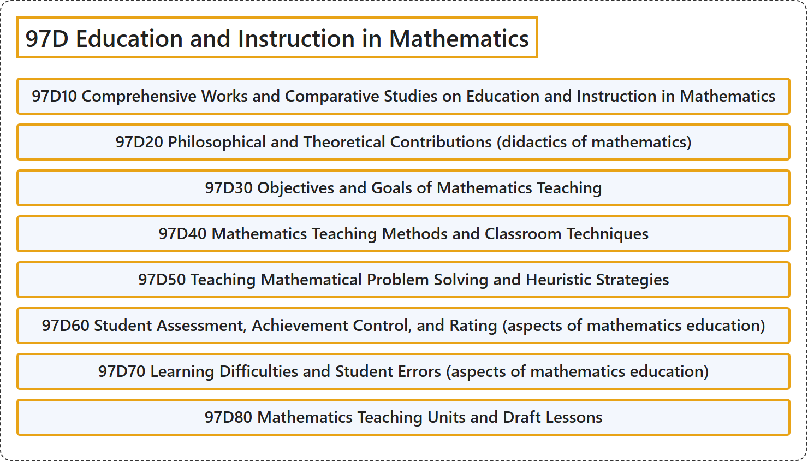

# 97D Education and Instruction in Mathematics

## Classification

## Glossary

| Term | Definition | 中文翻译 | Source |
|---|---|---|---|
| **97D Education and Instruction in Mathematics** 数学教育与教学 | (No definition) | （无定义） | [Associate Editors of Mathematical Reviews and zbMATH, 2020](https://msc2020.org/) |
| **97D10 Comprehensive Works and Comparative Studies on Education and Instruction in Mathematics** 数学教育与教学的综合著作及比较研究 | (No definition) | （无定义） | [Associate Editors of Mathematical Reviews and zbMATH, 2020](https://msc2020.org/) |
| **97D20 Philosophical and Theoretical Contributions (didactics of mathematics)** 哲学与理论贡献（数学教学论） | (No definition) | （无定义） | [Associate Editors of Mathematical Reviews and zbMATH, 2020](https://msc2020.org/) |
| **97D30 Objectives and Goals of Mathematics Teaching** 数学教学的目标与目的 | (No definition) | （无定义） | [Associate Editors of Mathematical Reviews and zbMATH, 2020](https://msc2020.org/) |
| **97D40 Mathematics Teaching Methods and Classroom Techniques** 数学教学方法与课堂技巧 | (No definition) | （无定义） | [Associate Editors of Mathematical Reviews and zbMATH, 2020](https://msc2020.org/) |
| **97D50 Teaching Mathematical Problem Solving and Heuristic Strategies** 数学问题解决与启发式策略的教学 | (No definition) | （无定义） | [Associate Editors of Mathematical Reviews and zbMATH, 2020](https://msc2020.org/) |
| **97D60 Student Assessment, Achievement Control, and Rating (aspects of mathematics education)** 学生评价、成绩检测与评级（数学教育方面） | (No definition) | （无定义） | [Associate Editors of Mathematical Reviews and zbMATH, 2020](https://msc2020.org/) |
| **97D70 Learning Difficulties and Student Errors (aspects of mathematics education)** 学习困难与学生错误（数学教育方面） | (No definition) | （无定义） | [Associate Editors of Mathematical Reviews and zbMATH, 2020](https://msc2020.org/) |
| **97D80 Mathematics Teaching Units and Draft Lessons** 数学教学单元与课程草案 | (No definition) | （无定义） | [Associate Editors of Mathematical Reviews and zbMATH, 2020](https://msc2020.org/) |

## References

Associate Editors of Mathematical Reviews and zbMATH. (2020). *MSC2020: Mathematics Subject Classification system*. Retrieved October 27, 2026, from <https://msc2020.org/>
