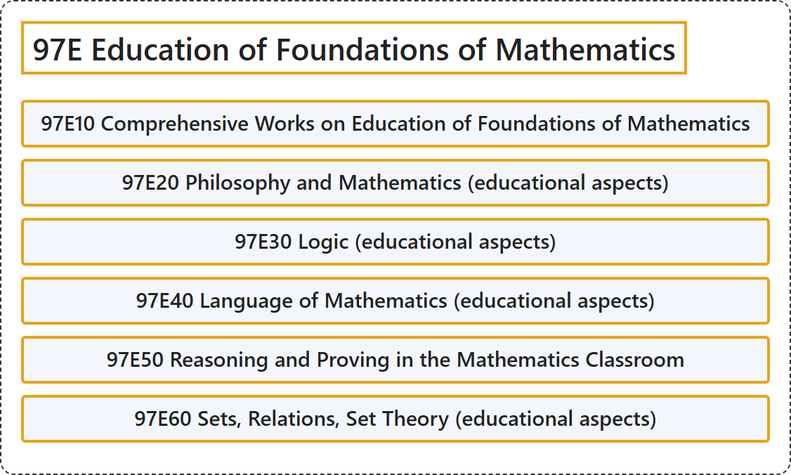

# 97E Education of Foundations of Mathematics

## Classification

## Glossary

| Term | Definition | 中文翻译 | Source |
|---|---|---|---|
| **97E Education of Foundations of Mathematics** 数学基础教育 | (No definition) | （无定义） | [Associate Editors of Mathematical Reviews and zbMATH, 2020](https://msc2020.org/) |
| **97E10 Comprehensive Works on Education of Foundations of Mathematics** 数学基础教育综合著作 | (No definition) | （无定义） | [Associate Editors of Mathematical Reviews and zbMATH, 2020](https://msc2020.org/) |
| **97E20 Philosophy and Mathematics (educational aspects)** 哲学与数学（教育方面） | (No definition) | （无定义） | [Associate Editors of Mathematical Reviews and zbMATH, 2020](https://msc2020.org/) |
| **97E30 Logic (educational aspects)** 逻辑（教育方面） | (No definition) | （无定义） | [Associate Editors of Mathematical Reviews and zbMATH, 2020](https://msc2020.org/) |
| **97E40 Language of Mathematics (educational aspects)** 数学语言（教育方面） | (No definition) | （无定义） | [Associate Editors of Mathematical Reviews and zbMATH, 2020](https://msc2020.org/) |
| **97E50 Reasoning and Proving in the Mathematics Classroom** 数学课堂中的推理与证明 | (No definition) | （无定义） | [Associate Editors of Mathematical Reviews and zbMATH, 2020](https://msc2020.org/) |
| **97E60 Sets, Relations, Set Theory (educational aspects)** 集合、关系、集合论（教育方面） | (No definition) | （无定义） | [Associate Editors of Mathematical Reviews and zbMATH, 2020](https://msc2020.org/) |

## References

Associate Editors of Mathematical Reviews and zbMATH. (2020). *MSC2020: Mathematics Subject Classification system*. Retrieved October 27, 2026, from <https://msc2020.org/>
