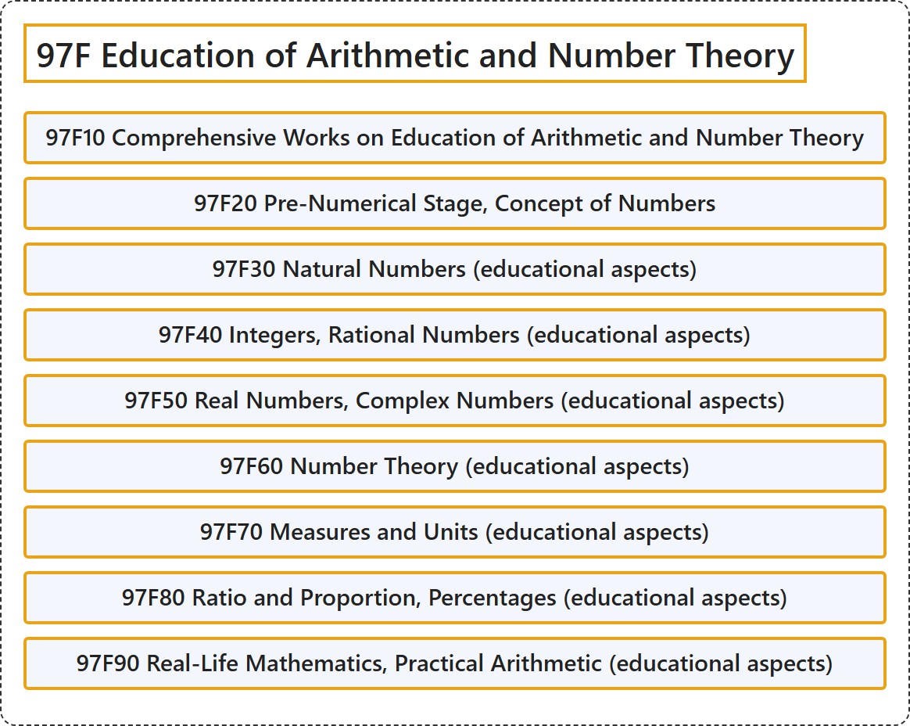

# 97F Education of Arithmetic and Number Theory

## Classification

## Glossary

| Term | Definition | 中文翻译 | Source |
|---|---|---|---|
| **97F Education of Arithmetic and Number Theory** 算术与数论教育 | (No definition) | （无定义） | [Associate Editors of Mathematical Reviews and zbMATH, 2020](https://msc2020.org/) |
| **97F10 Comprehensive Works on Education of Arithmetic and Number Theory** 算术与数论教育综合著作 | (No definition) | （无定义） | [Associate Editors of Mathematical Reviews and zbMATH, 2020](https://msc2020.org/) |
| **97F20 Pre-Numerical Stage, Concept of Numbers** 前数字阶段、数的概念 | (No definition) | （无定义） | [Associate Editors of Mathematical Reviews and zbMATH, 2020](https://msc2020.org/) |
| **97F30 Natural Numbers (educational aspects)** 自然数（教育方面） | (No definition) | （无定义） | [Associate Editors of Mathematical Reviews and zbMATH, 2020](https://msc2020.org/) |
| **97F40 Integers, Rational Numbers (educational aspects)** 整数、有理数（教育方面） | (No definition) | （无定义） | [Associate Editors of Mathematical Reviews and zbMATH, 2020](https://msc2020.org/) |
| **97F50 Real Numbers, Complex Numbers (educational aspects)** 实数、复数（教育方面） | (No definition) | （无定义） | [Associate Editors of Mathematical Reviews and zbMATH, 2020](https://msc2020.org/) |
| **97F60 Number Theory (educational aspects)** 数论（教育方面） | (No definition) | （无定义） | [Associate Editors of Mathematical Reviews and zbMATH, 2020](https://msc2020.org/) |
| **97F70 Measures and Units (educational aspects)** 度量与单位（教育方面） | (No definition) | （无定义） | [Associate Editors of Mathematical Reviews and zbMATH, 2020](https://msc2020.org/) |
| **97F80 Ratio and Proportion, Percentages (educational aspects)** 比与比例、百分数（教育方面） | (No definition) | （无定义） | [Associate Editors of Mathematical Reviews and zbMATH, 2020](https://msc2020.org/) |
| **97F90 Real-Life Mathematics, Practical Arithmetic (educational aspects)** 现实生活数学、实用算术（教育方面） | (No definition) | （无定义） | [Associate Editors of Mathematical Reviews and zbMATH, 2020](https://msc2020.org/) |

## References

Associate Editors of Mathematical Reviews and zbMATH. (2020). *MSC2020: Mathematics Subject Classification system*. Retrieved October 27, 2026, from <https://msc2020.org/>
