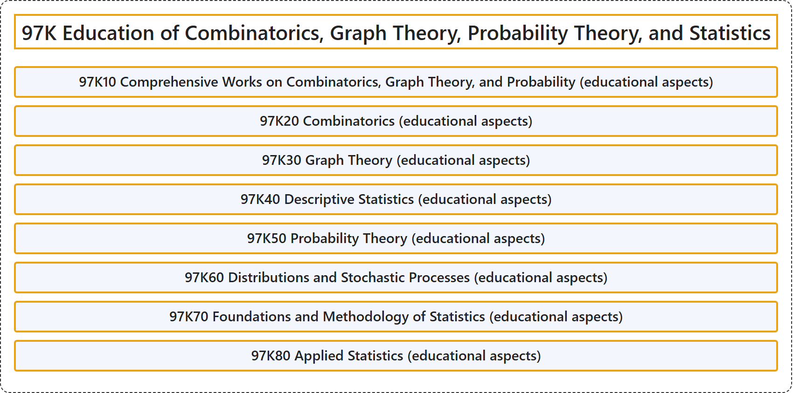

# 97K Education of Combinatorics, Graph Theory, Probability Theory, and Statistics

## Classification

## Glossary

| Term | Definition | 中文翻译 | Source |
|---|---|---|---|
| **97K Education of Combinatorics, Graph Theory, Probability Theory, and Statistics** 组合学、图论、概率论与统计学教育 | (No definition) | （无定义） | [Associate Editors of Mathematical Reviews and zbMATH, 2020](https://msc2020.org/) |
| **97K10 Comprehensive Works on Combinatorics, Graph Theory, and Probability (educational aspects)** 组合学、图论与概率综合著作（教育方面） | (No definition) | （无定义） | [Associate Editors of Mathematical Reviews and zbMATH, 2020](https://msc2020.org/) |
| **97K20 Combinatorics (educational aspects)** 组合学（教育方面） | (No definition) | （无定义） | [Associate Editors of Mathematical Reviews and zbMATH, 2020](https://msc2020.org/) |
| **97K30 Graph Theory (educational aspects)** 图论（教育方面） | (No definition) | （无定义） | [Associate Editors of Mathematical Reviews and zbMATH, 2020](https://msc2020.org/) |
| **97K40 Descriptive Statistics (educational aspects)** 描述统计（教育方面） | (No definition) | （无定义） | [Associate Editors of Mathematical Reviews and zbMATH, 2020](https://msc2020.org/) |
| **97K50 Probability Theory (educational aspects)** 概率论（教育方面） | (No definition) | （无定义） | [Associate Editors of Mathematical Reviews and zbMATH, 2020](https://msc2020.org/) |
| **97K60 Distributions and Stochastic Processes (educational aspects)** 分布与随机过程（教育方面） | (No definition) | （无定义） | [Associate Editors of Mathematical Reviews and zbMATH, 2020](https://msc2020.org/) |
| **97K70 Foundations and Methodology of Statistics (educational aspects)** 统计学基础与方法论（教育方面） | (No definition) | （无定义） | [Associate Editors of Mathematical Reviews and zbMATH, 2020](https://msc2020.org/) |
| **97K80 Applied Statistics (educational aspects)** 应用统计（教育方面） | (No definition) | （无定义） | [Associate Editors of Mathematical Reviews and zbMATH, 2020](https://msc2020.org/) |

## References

Associate Editors of Mathematical Reviews and zbMATH. (2020). *MSC2020: Mathematics Subject Classification system*. Retrieved October 27, 2026, from <https://msc2020.org/>
