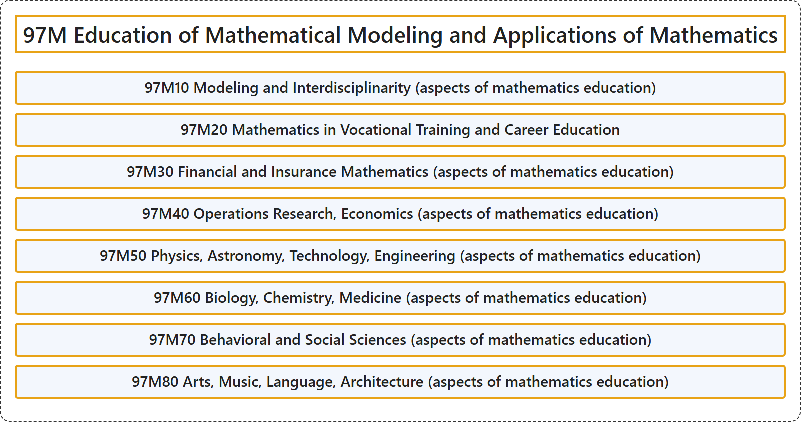

# 97M Education of Mathematical Modeling and Applications of Mathematics

## Classification

## Glossary

| Term | Definition | 中文翻译 | Source |
|---|---|---|---|
| **97M Education of Mathematical Modeling and Applications of Mathematics** 数学建模与数学应用教育 | (No definition) | （无定义） | [Associate Editors of Mathematical Reviews and zbMATH, 2020](https://msc2020.org/) |
| **97M10 Modeling and Interdisciplinarity (aspects of mathematics education)** 建模与跨学科（数学教育方面） | (No definition) | （无定义） | [Associate Editors of Mathematical Reviews and zbMATH, 2020](https://msc2020.org/) |
| **97M20 Mathematics in Vocational Training and Career Education** 职业培训与职业教育中的数学 | (No definition) | （无定义） | [Associate Editors of Mathematical Reviews and zbMATH, 2020](https://msc2020.org/) |
| **97M30 Financial and Insurance Mathematics (aspects of mathematics education)** 金融与保险数学（数学教育方面） | (No definition) | （无定义） | [Associate Editors of Mathematical Reviews and zbMATH, 2020](https://msc2020.org/) |
| **97M40 Operations Research, Economics (aspects of mathematics education)** 运筹学、经济学（数学教育方面） | (No definition) | （无定义） | [Associate Editors of Mathematical Reviews and zbMATH, 2020](https://msc2020.org/) |
| **97M50 Physics, Astronomy, Technology, Engineering (aspects of mathematics education)** 物理、天文、技术、工程（数学教育方面） | (No definition) | （无定义） | [Associate Editors of Mathematical Reviews and zbMATH, 2020](https://msc2020.org/) |
| **97M60 Biology, Chemistry, Medicine (aspects of mathematics education)** 生物、化学、医学（数学教育方面） | (No definition) | （无定义） | [Associate Editors of Mathematical Reviews and zbMATH, 2020](https://msc2020.org/) |
| **97M70 Behavioral and Social Sciences (aspects of mathematics education)** 行为与社会科学（数学教育方面） | (No definition) | （无定义） | [Associate Editors of Mathematical Reviews and zbMATH, 2020](https://msc2020.org/) |
| **97M80 Arts, Music, Language, Architecture (aspects of mathematics education)** 艺术、音乐、语言、建筑（数学教育方面） | (No definition) | （无定义） | [Associate Editors of Mathematical Reviews and zbMATH, 2020](https://msc2020.org/) |

## References

Associate Editors of Mathematical Reviews and zbMATH. (2020). *MSC2020: Mathematics Subject Classification system*. Retrieved October 27, 2026, from <https://msc2020.org/>
