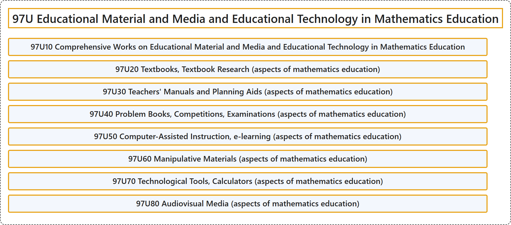

# 97U Educational Material and Media and Educational Technology in Mathematics Education

## Classification

## Glossary

| Term | Definition | 中文翻译 | Source |
|---|---|---|---|
| **97U Educational Material and Media and Educational Technology in Mathematics Education** 数学教育中的教育材料、媒体与教育技术 | (No definition) | （无定义） | [Associate Editors of Mathematical Reviews and zbMATH, 2020](https://msc2020.org/) |
| **97U10 Comprehensive Works on Educational Material and Media and Educational Technology in Mathematics Education** 数学教育中的教材、媒体与教育技术综合著作 | (No definition) | （无定义） | [Associate Editors of Mathematical Reviews and zbMATH, 2020](https://msc2020.org/) |
| **97U20 Textbooks, Textbook Research (aspects of mathematics education)** 教科书、教科书研究（数学教育方面） | (No definition) | （无定义） | [Associate Editors of Mathematical Reviews and zbMATH, 2020](https://msc2020.org/) |
| **97U30 Teachers' Manuals and Planning Aids (aspects of mathematics education)** 教师手册与规划辅助（数学教育方面） | (No definition) | （无定义） | [Associate Editors of Mathematical Reviews and zbMATH, 2020](https://msc2020.org/) |
| **97U40 Problem Books, Competitions, Examinations (aspects of mathematics education)** 习题集、竞赛、考试（数学教育方面） | (No definition) | （无定义） | [Associate Editors of Mathematical Reviews and zbMATH, 2020](https://msc2020.org/) |
| **97U50 Computer-Assisted Instruction, e-learning (aspects of mathematics education)** 计算机辅助教学、电子学习（数学教育方面） | (No definition) | （无定义） | [Associate Editors of Mathematical Reviews and zbMATH, 2020](https://msc2020.org/) |
| **97U60 Manipulative Materials (aspects of mathematics education)** 操作性教具（数学教育方面） | (No definition) | （无定义） | [Associate Editors of Mathematical Reviews and zbMATH, 2020](https://msc2020.org/) |
| **97U70 Technological Tools, Calculators (aspects of mathematics education)** 技术工具、计算器（数学教育方面） | (No definition) | （无定义） | [Associate Editors of Mathematical Reviews and zbMATH, 2020](https://msc2020.org/) |
| **97U80 Audiovisual Media (aspects of mathematics education)** 视听媒体（数学教育方面） | (No definition) | （无定义） | [Associate Editors of Mathematical Reviews and zbMATH, 2020](https://msc2020.org/) |

## References

Associate Editors of Mathematical Reviews and zbMATH. (2020). *MSC2020: Mathematics Subject Classification system*. Retrieved October 27, 2026, from <https://msc2020.org/>
