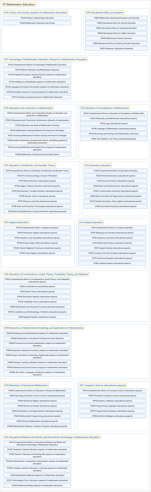

# 97 Mathematics Education

## Classification

## Glossary

| Term | Definition | 中文翻译 | Source |
|---|---|---|---|
| **97 Mathematics Education** 数学教育 | (Definition pending: no web source yet.) | （定义待补：暂无网页来源。） | Pending |
| **[97A History and Society (aspects of mathematics education)](97a-history-and-society-aspects-of-mathematics-education.md)** 历史与社会（数学教育的方面） | (No definition) | （无定义） | [Associate Editors of Mathematical Reviews and zbMATH, 2020](https://msc2020.org/) |
| **[97B Educational Policy and Systems](97b-educational-policy-and-systems.md)** 教育政策与体系 | (No definition) | （无定义） | [Associate Editors of Mathematical Reviews and zbMATH, 2020](https://msc2020.org/) |
| **[97C Psychology of Mathematics Education, Research in Mathematics Education](97c-psychology-of-mathematics-education-research-in-mathematics.md)** 数学教育心理学、数学教育研究 | (No definition) | （无定义） | [Associate Editors of Mathematical Reviews and zbMATH, 2020](https://msc2020.org/) |
| **[97D Education and Instruction in Mathematics](97d-education-and-instruction-in-mathematics.md)** 数学教育与教学 | (No definition) | （无定义） | [Associate Editors of Mathematical Reviews and zbMATH, 2020](https://msc2020.org/) |
| **[97E Education of Foundations of Mathematics](97e-education-of-foundations-of-mathematics.md)** 数学基础教育 | (No definition) | （无定义） | [Associate Editors of Mathematical Reviews and zbMATH, 2020](https://msc2020.org/) |
| **[97F Education of Arithmetic and Number Theory](97f-education-of-arithmetic-and-number-theory.md)** 算术与数论教育 | (No definition) | （无定义） | [Associate Editors of Mathematical Reviews and zbMATH, 2020](https://msc2020.org/) |
| **[97G Geometry Education](97g-geometry-education.md)** 几何教育 | (No definition) | （无定义） | [Associate Editors of Mathematical Reviews and zbMATH, 2020](https://msc2020.org/) |
| **[97H Algebra Education](97h-algebra-education.md)** 代数教育 | (No definition) | （无定义） | [Associate Editors of Mathematical Reviews and zbMATH, 2020](https://msc2020.org/) |
| **[97I Analysis Education](97i-analysis-education.md)** 分析教育 | (No definition) | （无定义） | [Associate Editors of Mathematical Reviews and zbMATH, 2020](https://msc2020.org/) |
| **[97K Education of Combinatorics, Graph Theory, Probability Theory, and Statistics](97k-education-of-combinatorics-graph-theory-probability-theory-a.md)** 组合学、图论、概率论与统计学教育 | (No definition) | （无定义） | [Associate Editors of Mathematical Reviews and zbMATH, 2020](https://msc2020.org/) |
| **[97M Education of Mathematical Modeling and Applications of Mathematics](97m-education-of-mathematical-modeling-and-applications-of-mathe.md)** 数学建模与数学应用教育 | (No definition) | （无定义） | [Associate Editors of Mathematical Reviews and zbMATH, 2020](https://msc2020.org/) |
| **[97N Education of Numerical Mathematics](97n-education-of-numerical-mathematics.md)** 数值数学教育 | (No definition) | （无定义） | [Associate Editors of Mathematical Reviews and zbMATH, 2020](https://msc2020.org/) |
| **[97P Computer Science (educational aspects)](97p-computer-science-educational-aspects.md)** 计算机科学（教育方面） | (No definition) | （无定义） | [Associate Editors of Mathematical Reviews and zbMATH, 2020](https://msc2020.org/) |
| **[97U Educational Material and Media and Educational Technology in Mathematics Education](97u-educational-material-and-media-and-educational-technology-in.md)** 数学教育中的教育材料、媒体与教育技术 | (No definition) | （无定义） | [Associate Editors of Mathematical Reviews and zbMATH, 2020](https://msc2020.org/) |

## References

Associate Editors of Mathematical Reviews and zbMATH. (2020). *MSC2020: Mathematics Subject Classification system*. Retrieved October 27, 2026, from <https://msc2020.org/>
