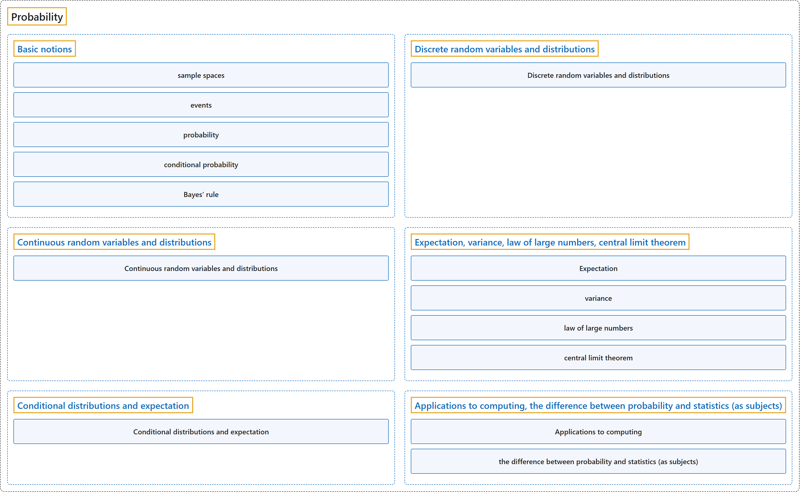

# Probability

## Classification

## Glossary

| Term | Definition | 中文翻译 | Source |
|---|---|---|---|
| **Probability** 概率 | "Probability is the branch of mathematics that studies the **possible outcomes of given events** together with the outcomes' **relative likelihoods and distributions**." | 概率是数学的一个分支，研究**给定事件的可能结果**，以及这些结果的**相对可能性和分布**。 | [Weisstein, n.d.-e, "Probability" entry, para. 1](https://mathworld.wolfram.com/Probability.html#:~:text=Probability%20is%20the%20branch%20of%20mathematics%20that%20studies%20the%20possible%20outcomes) |
| **[Basic notions](basic-notions.md)** 基本概念 | (context) "Informally, the sample space for a given set of events is the **set of all possible values** the events may assume." | （语境）非正式地说，一组给定事件的样本空间是这些事件可能取的**所有可能值的集合**。 | [Weisstein, n.d.-f, "Sample space" entry, para. 1](https://mathworld.wolfram.com/SampleSpace.html#:~:text=the%20sample%20space%20for%20a%20given%20set%20of%20events) |
| **[Discrete random variables and distributions](discrete-random-variables-and-distributions.md)** 离散随机变量和分布 | (context) "A discrete distribution is a statistical distribution whose random variable takes values in a **countable set** almost surely." | （语境）离散分布是一种统计分布，它的随机变量几乎必然在一个**可数集合**中取值。 | [Weisstein, n.d.-c, "Discrete distribution" entry, para. 1](https://mathworld.wolfram.com/DiscreteDistribution.html#:~:text=A%20discrete%20distribution%20is%20a%20statistical%20distribution) |
| **[Continuous random variables and distributions](continuous-random-variables-and-distributions.md)** 连续随机变量和分布 | (context) "A continuous distribution is a statistical distribution for which the variables may take on a **continuous range of values**." | （语境）连续分布是一种统计分布，其中变量可以在**连续的取值范围**内取值。 | [Weisstein, n.d.-b, "Continuous distribution" entry, para. 1](https://mathworld.wolfram.com/ContinuousDistribution.html#:~:text=A%20continuous%20distribution%20is%20a%20statistical%20distribution) |
| **[Expectation, variance, law of large numbers, central limit theorem](expectation-variance-law-of-large-numbers-central-limit-theorem.md)** 期望、方差、大数定律、中心极限定理 | "The expectation value, also called the expected value, mathematical expectation, or mean, of a random variable is its **probability-weighted average**." | 随机变量的期望值（也称为期望、数学期望或均值）是它的**按概率加权的平均值**。 | [Weisstein, n.d.-d, "Expectation value" entry, para. 1](https://mathworld.wolfram.com/ExpectationValue.html#:~:text=is%20its%20probability%2Dweighted%20average) |
| **[Conditional distributions and expectation](conditional-distributions-and-expectation.md)** 条件分布和期望 | "A conditional distribution is the **statistical distribution of a random variable** given **specified information about another random variable or event**." | 条件分布是**一个随机变量的统计分布**，条件是已知**关于另一个随机变量或事件的特定信息**。 | [Weisstein, n.d.-a, "Conditional distribution" entry, para. 1](https://mathworld.wolfram.com/ConditionalDistribution.html#:~:text=A%20conditional%20distribution%20is%20the%20statistical%20distribution) |
| **[Applications to computing, the difference between probability and statistics (as subjects)](applications-to-computing-the-difference-between-probability-and-statistics-as-subjects.md)** 在计算中的应用，概率与统计（作为学科）的区别 | (context) "The analysis of **events governed by probability** is called **statistics**." | （语境）对**受概率支配的事件**所作的分析称为**统计**。 | [Weisstein, n.d.-e, "Probability" entry, para. 1](https://mathworld.wolfram.com/Probability.html#:~:text=The%20analysis%20of%20events%20governed%20by%20probability%20is%20called%20statistics) |

## References

- Joint Task Force on Computing Curricula. (2024). *Computer science curricula 2023*. Association for Computing Machinery. <https://doi.org/10.1145/3664191>
- Weisstein, E. W. (n.d.-a). *Conditional distribution*. MathWorld: A Wolfram Resource. Retrieved October 27, 2026, from <https://mathworld.wolfram.com/ConditionalDistribution.html>
- Weisstein, E. W. (n.d.-b). *Continuous distribution*. MathWorld: A Wolfram Resource. Retrieved October 27, 2026, from <https://mathworld.wolfram.com/ContinuousDistribution.html>
- Weisstein, E. W. (n.d.-c). *Discrete distribution*. MathWorld: A Wolfram Resource. Retrieved October 27, 2026, from <https://mathworld.wolfram.com/DiscreteDistribution.html>
- Weisstein, E. W. (n.d.-d). *Expectation value*. MathWorld: A Wolfram Resource. Retrieved October 27, 2026, from <https://mathworld.wolfram.com/ExpectationValue.html>
- Weisstein, E. W. (n.d.-e). *Probability*. MathWorld: A Wolfram Resource. Retrieved October 27, 2026, from <https://mathworld.wolfram.com/Probability.html>
- Weisstein, E. W. (n.d.-f). *Sample space*. MathWorld: A Wolfram Resource. Retrieved October 27, 2026, from <https://mathworld.wolfram.com/SampleSpace.html>
