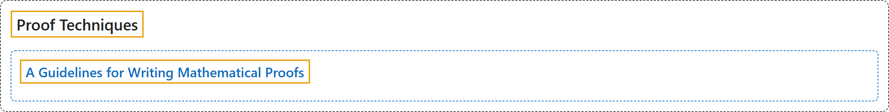

# A Guidelines for Writing Mathematical Proofs

## Classification

## Glossary

| Term | Definition | 中文翻译 | Source |
|---|---|---|---|
| **A Guidelines for Writing Mathematical Proofs** 数学证明写作指南 | (No definition) | （无定义） | [Sundstrom, 2022, appendix A](https://gvsuoer.github.io/sundstrom-textbook/C_writingguides.html) |

## References

Sundstrom, T. (2022). *Mathematical reasoning: Writing and proof* (Version 2.1; PreTeXt edition by Grand Valley State University). Retrieved October 30, 2026, from <https://gvsuoer.github.io/sundstrom-textbook/frontmatter.html>
