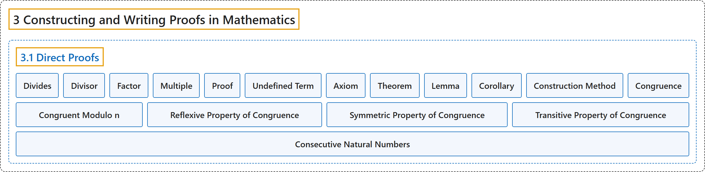

# 3.1 Direct Proofs

## Classification

## Glossary

| Term | Definition | 中文翻译 | Source |
|---|---|---|---|
| **3 Constructing and Writing Proofs in Mathematics** 构造与书写数学证明 | (No definition) | （无定义） | [Sundstrom, 2022, chapter 3](https://gvsuoer.github.io/sundstrom-textbook/C_proofs.html) |
| **3.1 Direct Proofs** 直接证明 | (No definition) | （无定义） | [Sundstrom, 2022, section 3.1](https://gvsuoer.github.io/sundstrom-textbook/S_directproof.html) |
| **Divides** 整除 | "A nonzero integer $m$ **divides** an integer $n$ provided that **there is an integer** $q$ **such that** $n = m \cdot q\text{.}$" | 如果**存在整数** $q$ **使得** $n = m \cdot q$，就说非零整数 $m$ **整除**整数 $n$。 | [Sundstrom, 2022, section 3.1](https://gvsuoer.github.io/sundstrom-textbook/S_directproof.html#divides) |
| **Divisor** 因数 | "We also say that $m$ is **a divisor of** $n\text{,}$ $m$ is a factor of $n\text{,}$ and $n$ is a multiple of $m\text{.}$ The integer 0 is **not a divisor of any integer**." | 我们也说 $m$ 是 $n$ **的因数**，$m$ 是 $n$ 的因子，$n$ 是 $m$ 的倍数。整数 0 **不是任何整数的因数**。 | [Sundstrom, 2022, section 3.1](https://gvsuoer.github.io/sundstrom-textbook/S_directproof.html#divides) |
| **Factor** 因子 | "We also say that $m$ is a divisor of $n\text{,}$ $m$ is **a factor of** $n\text{,}$ and $n$ is a multiple of $m\text{.}$" | 我们也说 $m$ 是 $n$ 的因数，$m$ 是 $n$ **的因子**，$n$ 是 $m$ 的倍数。 | [Sundstrom, 2022, section 3.1](https://gvsuoer.github.io/sundstrom-textbook/S_directproof.html#divides) |
| **Multiple** 倍数 | "We also say that $m$ is a divisor of $n\text{,}$ $m$ is a factor of $n\text{,}$ and $n$ is **a multiple of** $m\text{.}$" | 我们也说 $m$ 是 $n$ 的因数，$m$ 是 $n$ 的因子，$n$ 是 $m$ **的倍数**。 | [Sundstrom, 2022, section 3.1](https://gvsuoer.github.io/sundstrom-textbook/S_directproof.html#divides) |
| **Proof** 证明 | "A proof in mathematics is **a convincing argument that some mathematical statement is true**." | 数学中的证明是**令人信服地说明某个数学陈述为真的论证**。 | [Sundstrom, 2022, section 3.1](https://gvsuoer.github.io/sundstrom-textbook/S_directproof.html#p-1212) |
| **Undefined Term** 未定义术语 | "Surprising to some is the fact that in mathematics, there are **always undefined terms**. This is because **if we tried to define everything, we would end up going in circles**." | 有些人会惊讶：数学中**总有未定义的术语**。这是因为**如果我们试图定义一切，最后会陷入循环**。 | [Sundstrom, 2022, section 3.1](https://gvsuoer.github.io/sundstrom-textbook/S_directproof.html#p-1213) |
| **Axiom** 公理 | "An axiom is **a mathematical statement that is accepted without proof**." | 公理是**不经证明而被接受的数学陈述**。 | [Sundstrom, 2022, section 3.1](https://gvsuoer.github.io/sundstrom-textbook/S_directproof.html#p-1213) |
| **Theorem** 定理 | "A theorem is **a mathematical statement for which we have a proof**." | 定理是**我们已有证明的数学陈述**。 | [Sundstrom, 2022, section 3.1](https://gvsuoer.github.io/sundstrom-textbook/S_directproof.html#p-1216) |
| **Lemma** 引理 | "A lemma is **a true mathematical statement** that was proven mainly **to help in the proof of some theorem**." | 引理是**一个真的数学陈述**，证明它主要是**为了帮助证明某个定理**。 | [Sundstrom, 2022, section 3.1](https://gvsuoer.github.io/sundstrom-textbook/S_directproof.html#p-1216) |
| **Corollary** 推论 | "The term corollary is used to refer to **a theorem that is easily proven once some other theorem has been proven**." | 推论一词指**在另一个定理得证之后就容易证明的定理**。 | [Sundstrom, 2022, section 3.1](https://gvsuoer.github.io/sundstrom-textbook/S_directproof.html#p-1216) |
| **Construction Method** 构造法 | "When we try to **prove that a certain object exists**, we often use what is called **the construction method for a proof**." | 当我们试图**证明某个对象存在**时，常用所谓的**构造法证明**。 | [Sundstrom, 2022, section 3.1](https://gvsuoer.github.io/sundstrom-textbook/S_directproof.html#p-1229) |
| **Congruence** 同余 | "What mathematicians call congruence is **a concept used to describe cycles in the world of the integers**." | 数学家所说的同余是**用来描述整数世界中的周期的概念**。 | [Sundstrom, 2022, section 3.1](https://gvsuoer.github.io/sundstrom-textbook/S_directproof.html#subsection-39) |
| **Congruent Modulo n** 模 n 同余 | "If $a$ and $b$ are integers, then we say that $\boldsymbol{a}$ is congruent to $\boldsymbol{b}$ modulo $\boldsymbol{n}$ provided that $n$ **divides** $a - b\text{.}$" | 如果 $a$ 和 $b$ 是整数，并且 $n$ **整除** $a - b$，就说 $\boldsymbol{a}$ 模 $\boldsymbol{n}$ 同余于 $\boldsymbol{b}$。 | [Sundstrom, 2022, section 3.1](https://gvsuoer.github.io/sundstrom-textbook/S_directproof.html#congruence) |
| **Reflexive Property of Congruence** 同余的自反性 | "**For every integer** $a\text{,}$ $a \equiv a \pmod n\text{.}$ This is called the reflexive property of congruence modulo $n\text{.}$" | **对每个整数** $a$，$a \equiv a \pmod n$。这称为模 $n$ 同余的自反性。 | [Sundstrom, 2022, section 3.1](https://gvsuoer.github.io/sundstrom-textbook/S_directproof.html#exer_cong-props) |
| **Symmetric Property of Congruence** 同余的对称性 | "For all integers $a$ and $b\text{,}$ **if** $a \equiv b \pmod n\text{,}$ **then** $b \equiv a \pmod n\text{.}$ This is called the symmetric property of congruence modulo $n\text{.}$" | 对所有整数 $a$ 和 $b$，**如果** $a \equiv b \pmod n$，**那么** $b \equiv a \pmod n$。这称为模 $n$ 同余的对称性。 | [Sundstrom, 2022, section 3.1](https://gvsuoer.github.io/sundstrom-textbook/S_directproof.html#exer_cong-props) |
| **Transitive Property of Congruence** 同余的传递性 | "For all integers $a\text{,}$ $b\text{,}$ and $c\text{,}$ **if** $a \equiv b \pmod n$ **and** $b \equiv c \pmod n\text{,}$ **then** $a \equiv c \pmod n\text{.}$ This is called the transitive property of congruence modulo $n\text{.}$" | 对所有整数 $a$、$b$ 和 $c$，**如果** $a \equiv b \pmod n$ **且** $b \equiv c \pmod n$，**那么** $a \equiv c \pmod n$。这称为模 $n$ 同余的传递性。 | [Sundstrom, 2022, section 3.1](https://gvsuoer.github.io/sundstrom-textbook/S_directproof.html#exer_cong-props) |
| **Consecutive Natural Numbers** 连续自然数 | "Three natural numbers are called consecutive natural numbers if they **can be written in the form** $m\text{,}$ $m + 1\text{,}$ and $m + 2\text{,}$ where $m$ is a natural number." | 如果三个自然数**能写成** $m$、$m + 1$ 和 $m + 2$ 的形式（其中 $m$ 是自然数），就称它们为连续自然数。 | [Sundstrom, 2022, section 3.1](https://gvsuoer.github.io/sundstrom-textbook/S_directproof.html#activity-12) |

## References

Sundstrom, T. (2022). *Mathematical reasoning: Writing and proof* (Version 2.1; PreTeXt edition by Grand Valley State University). Retrieved October 30, 2026, from <https://gvsuoer.github.io/sundstrom-textbook/frontmatter.html>
