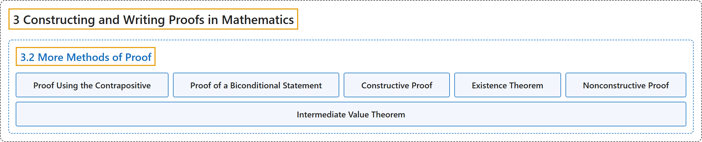

# 3.2 More Methods of Proof

## Classification

## Glossary

| Term | Definition | 中文翻译 | Source |
|---|---|---|---|
| **3 Constructing and Writing Proofs in Mathematics** 构造与书写数学证明 | (No definition) | （无定义） | [Sundstrom, 2022, chapter 3](https://gvsuoer.github.io/sundstrom-textbook/C_proofs.html) |
| **3.2 More Methods of Proof** 更多证明方法 | (No definition) | （无定义） | [Sundstrom, 2022, section 3.2](https://gvsuoer.github.io/sundstrom-textbook/S_moremethods.html) |
| **Proof Using the Contrapositive** 逆否证明 | "One of the most useful logical equivalencies in this regard is that a conditional statement $P \to Q$ is **logically equivalent to its contrapositive**, $\neg Q \to \neg P\text{.}$ This means that **if we prove the contrapositive of the conditional statement, then we have proven the conditional statement**." | 在这方面最有用的逻辑等价之一是：条件陈述 $P \to Q$ **与它的逆否命题逻辑等价**，即 $\neg Q \to \neg P$。这意味着**如果证明了条件陈述的逆否命题，就证明了这个条件陈述**。 | [Sundstrom, 2022, section 3.2](https://gvsuoer.github.io/sundstrom-textbook/S_moremethods.html#subsection-42) |
| **Proof of a Biconditional Statement** 双条件陈述的证明 | "This logical equivalency suggests one method for **proving a biconditional statement** written in the form “$P$ if and only if $Q\text{.}$” This method is to **construct separate proofs of the two conditional statements** $P \to Q$ and $Q \to P\text{.}$" | 这个逻辑等价给出了**证明双条件陈述**（写成“$P$ 当且仅当 $Q$”的形式）的一种方法。这种方法就是**分别证明两个条件陈述** $P \to Q$ 和 $Q \to P$。 | [Sundstrom, 2022, section 3.2](https://gvsuoer.github.io/sundstrom-textbook/S_moremethods.html#subsection-45) |
| **Constructive Proof** 构造性证明 | "For a constructive proof of such a proposition, we actually **name, describe, or explain how to construct some object** in the universe that makes $P( x )$ true." | 对这类命题的构造性证明，我们会实际**给出名称、描述，或说明如何构造**全集中使 $P( x )$ 为真的某个对象。 | [Sundstrom, 2022, section 3.2](https://gvsuoer.github.io/sundstrom-textbook/S_moremethods.html#subsection-47) |
| **Existence Theorem** 存在性定理 | "The objective of an existence theorem is **to prove that a certain mathematical object exists**." | 存在性定理的目的是**证明某个数学对象存在**。 | [Sundstrom, 2022, section 3.2](https://gvsuoer.github.io/sundstrom-textbook/S_moremethods.html#p-1475) |
| **Nonconstructive Proof** 非构造性证明 | "For this type of proof, we make an argument that an object in the universal set that makes $P( x )$ true **must exist** but we **never construct or name the object** that makes $P( x )$ true." | 这类证明论证全集中使 $P( x )$ 为真的对象**必定存在**，但**从不构造或指出这个对象**。 | [Sundstrom, 2022, section 3.2](https://gvsuoer.github.io/sundstrom-textbook/S_moremethods.html#subsection-48) |
| **Intermediate Value Theorem** 介值定理 | "The Intermediate Value Theorem can be stated as follows: If $f$ is a **continuous function** on the closed interval $\left[ {a,b} \right]$ and if $q$ is any real number **strictly between** $f( a )$ and $f( b )\text{,}$ then **there exists a number** $c$ in the interval $\left( {a,b} \right)$ such that $f( c ) = q\text{.}$" | 介值定理可以表述为：如果 $f$ 是闭区间 $\left[ {a,b} \right]$ 上的**连续函数**，并且 $q$ 是**严格介于** $f( a )$ 与 $f( b )$ 之间的任意实数，那么**存在一个数** $c$ 属于区间 $\left( {a,b} \right)$，使得 $f( c ) = q$。 | [Sundstrom, 2022, section 3.2](https://gvsuoer.github.io/sundstrom-textbook/S_moremethods.html#p-1477) |

## References

Sundstrom, T. (2022). *Mathematical reasoning: Writing and proof* (Version 2.1; PreTeXt edition by Grand Valley State University). Retrieved October 30, 2026, from <https://gvsuoer.github.io/sundstrom-textbook/frontmatter.html>
