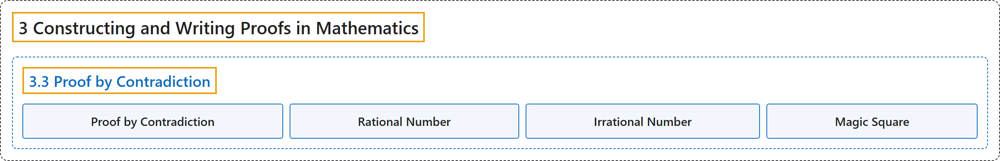

# 3.3 Proof by Contradiction

## Classification

## Glossary

| Term | Definition | 中文翻译 | Source |
|---|---|---|---|
| **3 Constructing and Writing Proofs in Mathematics** 构造与书写数学证明 | (No definition) | （无定义） | [Sundstrom, 2022, chapter 3](https://gvsuoer.github.io/sundstrom-textbook/C_proofs.html) |
| **3.3 Proof by Contradiction** 反证法 | (No definition) | （无定义） | [Sundstrom, 2022, section 3.3](https://gvsuoer.github.io/sundstrom-textbook/S_contradiction.html) |
| **Proof by Contradiction** 反证法 | "The idea is to prove that the statement $X$ is true by **showing that it cannot be false**. This is done by **assuming that** $X$ **is false** and **proving that this leads to a contradiction**." | 其思路是通过**证明它不可能为假**来证明陈述 $X$ 为真。做法是**假设** $X$ **为假**，然后**证明这会导致矛盾**。 | [Sundstrom, 2022, section 3.3](https://gvsuoer.github.io/sundstrom-textbook/S_contradiction.html#PA_contradicton) |
| **Rational Number** 有理数 | "A real number $x$ is defined to be a rational number provided that **there exist integers** $m$ and $n$ with $n \ne 0$ **such that** $x = \dfrac{m}{n}\text{.}$" | 如果**存在整数** $m$ 和 $n$（$n \ne 0$）**使得** $x = \dfrac{m}{n}$，就把实数 $x$ 定义为有理数。 | [Sundstrom, 2022, section 3.3](https://gvsuoer.github.io/sundstrom-textbook/S_contradiction.html#D_rational) |
| **Irrational Number** 无理数 | "A real number that is **not a rational number** is called an irrational number." | **不是有理数**的实数称为无理数。 | [Sundstrom, 2022, section 3.3](https://gvsuoer.github.io/sundstrom-textbook/S_contradiction.html#D_rational) |
| **Magic Square** 幻方 | "A magic square is **a square array of natural numbers** whose **rows, columns, and diagonals all sum to the same number**." | 幻方是**由自然数排成的方阵**，它的**每行、每列和每条对角线之和都相同**。 | [Sundstrom, 2022, section 3.3](https://gvsuoer.github.io/sundstrom-textbook/S_contradiction.html#exercise-227) |

## References

Sundstrom, T. (2022). *Mathematical reasoning: Writing and proof* (Version 2.1; PreTeXt edition by Grand Valley State University). Retrieved October 30, 2026, from <https://gvsuoer.github.io/sundstrom-textbook/frontmatter.html>
