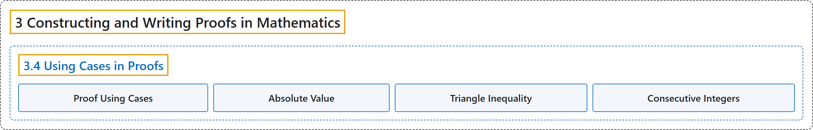

# 3.4 Using Cases in Proofs

## Classification

## Glossary

| Term | Definition | 中文翻译 | Source |
|---|---|---|---|
| **3 Constructing and Writing Proofs in Mathematics** 构造与书写数学证明 | (No definition) | （无定义） | [Sundstrom, 2022, chapter 3](https://gvsuoer.github.io/sundstrom-textbook/C_proofs.html) |
| **3.4 Using Cases in Proofs** 在证明中分情况 | (No definition) | （无定义） | [Sundstrom, 2022, section 3.4](https://gvsuoer.github.io/sundstrom-textbook/S_cases.html) |
| **Proof Using Cases** 分情况证明 | "The method of using cases is often used when **the hypothesis of the proposition is a disjunction**." | 当**命题的假设是一个析取**时，常用分情况的方法。 | [Sundstrom, 2022, section 3.4](https://gvsuoer.github.io/sundstrom-textbook/S_cases.html#PA_cases) |
| **Absolute Value** 绝对值 | "For $x \in \mathbb R\text{,}$ we define $\left\vert x \right\vert\text{,}$ called **the absolute value of x**, by $\left\vert x \right\vert = \begin{cases}x, & \text{ if } x \geq 0\text{; } \\ -x & \text{ if } x \lt 0\text{. } \end{cases}$" | 对 $x \in \mathbb R$，定义 $\left\vert x \right\vert$（称为 **x 的绝对值**）为 $\left\vert x \right\vert = \begin{cases}x, & \text{ 若 } x \geq 0\text{； } \\ -x & \text{ 若 } x \lt 0\text{。 } \end{cases}$ | [Sundstrom, 2022, section 3.4](https://gvsuoer.github.io/sundstrom-textbook/S_cases.html#D_absvalue) |
| **Triangle Inequality** 三角不等式 | "$\left\vert x + y \right\vert \leq \left\vert x \right\vert + \left\vert y \right\vert\text{.}$ This is **known as the Triangle Inequality**." | $\left\vert x + y \right\vert \leq \left\vert x \right\vert + \left\vert y \right\vert$。这**称为三角不等式**。 | [Sundstrom, 2022, section 3.4](https://gvsuoer.github.io/sundstrom-textbook/S_cases.html#T_absvalue-3) |
| **Consecutive Integers** 连续整数 | "We define two integers to be consecutive integers if **one of the integers is one more than the other integer**." | 如果**两个整数中一个比另一个大 1**，就把它们定义为连续整数。 | [Sundstrom, 2022, section 3.4](https://gvsuoer.github.io/sundstrom-textbook/S_cases.html#exer_consecutive) |

## References

Sundstrom, T. (2022). *Mathematical reasoning: Writing and proof* (Version 2.1; PreTeXt edition by Grand Valley State University). Retrieved October 30, 2026, from <https://gvsuoer.github.io/sundstrom-textbook/frontmatter.html>
