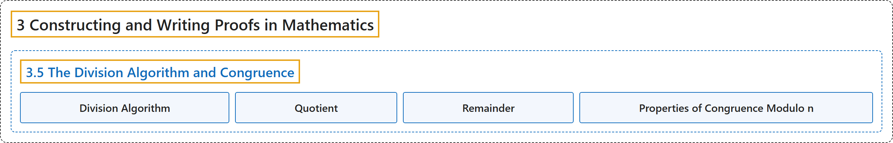

# 3.5 The Division Algorithm and Congruence

## Classification

## Glossary

| Term | Definition | 中文翻译 | Source |
|---|---|---|---|
| **3 Constructing and Writing Proofs in Mathematics** 构造与书写数学证明 | (No definition) | （无定义） | [Sundstrom, 2022, chapter 3](https://gvsuoer.github.io/sundstrom-textbook/C_proofs.html) |
| **3.5 The Division Algorithm and Congruence** 带余除法与同余 | (No definition) | （无定义） | [Sundstrom, 2022, section 3.5](https://gvsuoer.github.io/sundstrom-textbook/S_divalgo.html) |
| **Division Algorithm** 带余除法 | "For all integers $a$ and $b$ with $b>0\text{,}$ **there exist unique integers** $q$ and $r$ such that $a=bq+r \text{ and } 0 \leq r \lt b\text{.}$" | 对所有满足 $b>0$ 的整数 $a$ 和 $b$，**存在唯一的整数** $q$ 和 $r$，使得 $a=bq+r \text{ and } 0 \leq r \lt b$。 | [Sundstrom, 2022, section 3.5](https://gvsuoer.github.io/sundstrom-textbook/S_divalgo.html#divalgorithm) |
| **Quotient** 商 | "In light of the previous comment, when we speak of the quotient and the remainder when we “divide an integer $a$ by the positive integer $b\text{,}$” we will always mean **the quotient** $\left( q \right)$ and the remainder $\left( r \right)$ **guaranteed by the Division Algorithm**." | 鉴于前面的说明，当我们说“用正整数 $b$ 除整数 $a$”所得的商和余数时，总是指**商** $\left( q \right)$ 和余数 $\left( r \right)$，二者都**由带余除法保证**。 | [Sundstrom, 2022, section 3.5](https://gvsuoer.github.io/sundstrom-textbook/S_divalgo.html#li-283) |
| **Remainder** 余数 | "So the remainder $r$ is **the least nonnegative integer** such that **there exists an integer (quotient)** $q$ with $a = bq + r\text{.}$" | 所以余数 $r$ 是**最小的非负整数**，使得**存在整数**（商） $q$ 满足 $a = bq + r$。 | [Sundstrom, 2022, section 3.5](https://gvsuoer.github.io/sundstrom-textbook/S_divalgo.html#li-283) |
| **Properties of Congruence Modulo n** 模 n 同余的性质 | "Let $n$ be a natural number and let $a, b, c, \text{ and } d$ be integers. **If** $a \equiv b \pmod n$ **and** $c \equiv d \pmod n\text{,}$ **then** $\left( {a + c} \right) \equiv \left( {b + d} \right) \pmod n\text{.}$ $ac \equiv bd \pmod n\text{.}$ **For each** $m \in \mathbb{N}\text{,}$ $a^m \equiv b^m \pmod n\text{.}$" | 设 $n$ 是自然数，$a, b, c, \text{ and } d$ 是整数。**如果** $a \equiv b \pmod n$ **且** $c \equiv d \pmod n$，**那么** $\left( {a + c} \right) \equiv \left( {b + d} \right) \pmod n$；$ac \equiv bd \pmod n$；**对每个** $m \in \mathbb{N}$，$a^m \equiv b^m \pmod n$。 | [Sundstrom, 2022, section 3.5](https://gvsuoer.github.io/sundstrom-textbook/S_divalgo.html#T_propsofcong) |

## References

Sundstrom, T. (2022). *Mathematical reasoning: Writing and proof* (Version 2.1; PreTeXt edition by Grand Valley State University). Retrieved October 30, 2026, from <https://gvsuoer.github.io/sundstrom-textbook/frontmatter.html>
