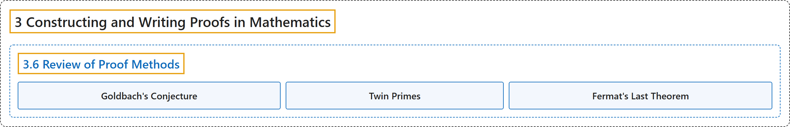

# 3.6 Review of Proof Methods

## Classification

## Glossary

| Term | Definition | 中文翻译 | Source |
|---|---|---|---|
| **3 Constructing and Writing Proofs in Mathematics** 构造与书写数学证明 | (No definition) | （无定义） | [Sundstrom, 2022, chapter 3](https://gvsuoer.github.io/sundstrom-textbook/C_proofs.html) |
| **3.6 Review of Proof Methods** 证明方法回顾 | (No definition) | （无定义） | [Sundstrom, 2022, section 3.6](https://gvsuoer.github.io/sundstrom-textbook/S_reviewproofs.html) |
| **Goldbach's Conjecture** 哥德巴赫猜想 | "The conjecture is as follows: **Every even integer greater than 2 can be expressed as the sum of two (not necessarily distinct) prime numbers**." | 这个猜想是：**每个大于 2 的偶数都能表示为两个（不一定不同的）素数之和**。 | [Sundstrom, 2022, section 3.6](https://gvsuoer.github.io/sundstrom-textbook/S_reviewproofs.html#exer_goldbach) |
| **Twin Primes** 孪生素数 | "Two prime numbers that **differ by 2** are called twin primes." | **相差 2** 的两个素数称为孪生素数。 | [Sundstrom, 2022, section 3.6](https://gvsuoer.github.io/sundstrom-textbook/S_reviewproofs.html#exercise-298) |
| **Fermat's Last Theorem** 费马大定理 | "Fermat made an assertion that **for each natural number** $n$ with $n \geq 3\text{,}$ **there are no positive integers** $a\text{,}$ $b\text{,}$ and $c$ for which $a^n + b^n = c^n\text{.}$" | 费马断言：**对每个自然数** $n$（$n \geq 3$），**不存在正整数** $a$、$b$ 和 $c$ 使得 $a^n + b^n = c^n$。 | [Sundstrom, 2022, section 3.6](https://gvsuoer.github.io/sundstrom-textbook/S_reviewproofs.html#activity-19) |

## References

Sundstrom, T. (2022). *Mathematical reasoning: Writing and proof* (Version 2.1; PreTeXt edition by Grand Valley State University). Retrieved October 30, 2026, from <https://gvsuoer.github.io/sundstrom-textbook/frontmatter.html>
