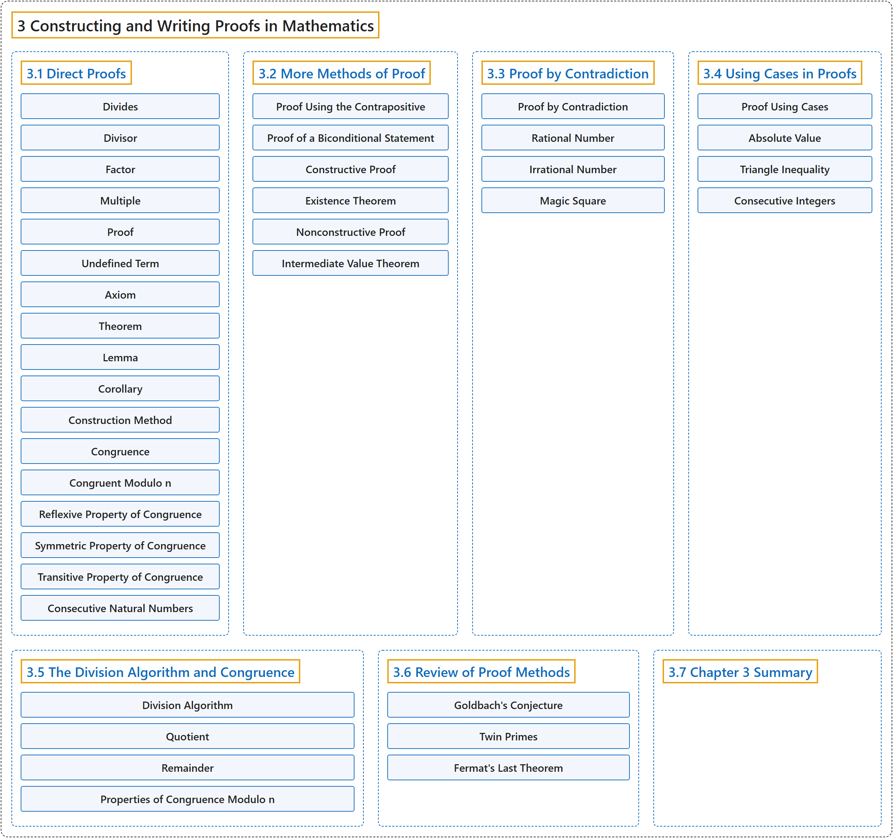

# 3 Constructing and Writing Proofs in Mathematics

## Classification

## Glossary

| Term | Definition | 中文翻译 | Source |
|---|---|---|---|
| **3 Constructing and Writing Proofs in Mathematics** 构造与书写数学证明 | (No definition) | （无定义） | [Sundstrom, 2022, chapter 3](https://gvsuoer.github.io/sundstrom-textbook/C_proofs.html) |
| **[3.1 Direct Proofs](3-1-direct-proofs.md)** 直接证明 | (No definition) | （无定义） | [Sundstrom, 2022, section 3.1](https://gvsuoer.github.io/sundstrom-textbook/S_directproof.html) |
| **[3.2 More Methods of Proof](3-2-more-methods-of-proof.md)** 更多证明方法 | (No definition) | （无定义） | [Sundstrom, 2022, section 3.2](https://gvsuoer.github.io/sundstrom-textbook/S_moremethods.html) |
| **[3.3 Proof by Contradiction](3-3-proof-by-contradiction.md)** 反证法 | (No definition) | （无定义） | [Sundstrom, 2022, section 3.3](https://gvsuoer.github.io/sundstrom-textbook/S_contradiction.html) |
| **[3.4 Using Cases in Proofs](3-4-using-cases-in-proofs.md)** 在证明中分情况 | (No definition) | （无定义） | [Sundstrom, 2022, section 3.4](https://gvsuoer.github.io/sundstrom-textbook/S_cases.html) |
| **[3.5 The Division Algorithm and Congruence](3-5-the-division-algorithm-and-congruence.md)** 带余除法与同余 | (No definition) | （无定义） | [Sundstrom, 2022, section 3.5](https://gvsuoer.github.io/sundstrom-textbook/S_divalgo.html) |
| **[3.6 Review of Proof Methods](3-6-review-of-proof-methods.md)** 证明方法回顾 | (No definition) | （无定义） | [Sundstrom, 2022, section 3.6](https://gvsuoer.github.io/sundstrom-textbook/S_reviewproofs.html) |
| **[3.7 Chapter 3 Summary](3-7-chapter-3-summary.md)** 第 3 章小结 | (No definition) | （无定义） | [Sundstrom, 2022, section 3.7](https://gvsuoer.github.io/sundstrom-textbook/S_3summary.html) |

## References

Sundstrom, T. (2022). *Mathematical reasoning: Writing and proof* (Version 2.1; PreTeXt edition by Grand Valley State University). Retrieved October 30, 2026, from <https://gvsuoer.github.io/sundstrom-textbook/frontmatter.html>
