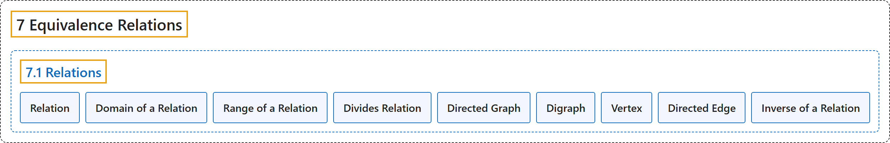

# 7.1 Relations

## Classification

## Glossary

| Term | Definition | 中文翻译 | Source |
|---|---|---|---|
| **7 Equivalence Relations** 等价关系 | (No definition) | （无定义） | [Sundstrom, 2022, chapter 7](https://gvsuoer.github.io/sundstrom-textbook/C_equivrelations.html) |
| **7.1 Relations** 关系 | (No definition) | （无定义） | [Sundstrom, 2022, section 7.1](https://gvsuoer.github.io/sundstrom-textbook/S_relations.html) |
| **Relation** 关系 | "Let $A$ and $B$ be sets. A relation R from the set $\boldsymbol{A}$ to the set $\boldsymbol{B}$ is **a subset of** $A \times B\text{.}$" | 设 $A$ 和 $B$ 是集合。从集合 $\boldsymbol{A}$ 到集合 $\boldsymbol{B}$ 的关系 R 是 $A \times B$ **的子集**。 | [Sundstrom, 2022, section 7.1](https://gvsuoer.github.io/sundstrom-textbook/S_relations.html#relation) |
| **Domain of a Relation** 关系的定义域 | "If $R$ is a relation from the set $A$ to the set $B\text{,}$ then **the subset of** $A$ consisting of all the first coordinates of the ordered pairs in $R$ is called the domain of $R\text{.}$" | 如果 $R$ 是从集合 $A$ 到集合 $B$ 的关系，那么由 $R$ 中所有有序对的第一个坐标组成的 $A$ **的子集**称为 $R$ 的定义域。 | [Sundstrom, 2022, section 7.1](https://gvsuoer.github.io/sundstrom-textbook/S_relations.html#domrangeofrelation) |
| **Range of a Relation** 关系的值域 | "**The subset of** $B$ consisting of all the second coordinates of the ordered pairs in $R$ is called the range of $R\text{.}$" | 由 $R$ 中所有有序对的第二个坐标组成的 $B$ **的子集**称为 $R$ 的值域。 | [Sundstrom, 2022, section 7.1](https://gvsuoer.github.io/sundstrom-textbook/S_relations.html#domrangeofrelation) |
| **Divides Relation** 整除关系 | "Whenever we have spoken about one integer dividing another integer, we have worked with the “divides” relation on $\mathbb{Z}\text{.}$ In particular, we can write $D = \left\{ { {\left( {m, n} \right) \in \mathbb{Z} \times \mathbb{Z} } \mid m \text{ divides } n} \right\}\!\text{.}$" | 每当谈到一个整数整除另一个整数时，我们用的就是 $\mathbb{Z}$ 上的“整除”关系。具体地，可以写成 $D = \left\{ { {\left( {m, n} \right) \in \mathbb{Z} \times \mathbb{Z} } \mid m \text{ divides } n} \right\}\!$。 | [Sundstrom, 2022, section 7.1](https://gvsuoer.github.io/sundstrom-textbook/S_relations.html#prog_dividesrelation) |
| **Directed Graph** 有向图 | "A convenient way to represent such a relation is to **draw a point in the plane for each of the elements of** $A$ and then for each $\left( {x, y} \right) \in R$ (or $x \mathrel{R} y$), we **draw an arrow starting at the point** $x$ **and pointing to the point** $y\text{.}$ If $\left( {x, x} \right) \in R$ (or $x \mathrel{R} x$), we draw a loop at the point $x\text{.}$ The resulting diagram is called a directed graph or a digraph." | 表示这种关系的一种方便方法是：**在平面上画一个点**，对应 $A$ 的每个元素；然后对每个 $\left( {x, y} \right) \in R$（即 $x \mathrel{R} y$），**画一条箭头，从点** $x$ **出发指向点** $y$。如果 $\left( {x, x} \right) \in R$（即 $x \mathrel{R} x$），就在点 $x$ 处画一个环。所得的图称为有向图（directed graph 或 digraph）。 | [Sundstrom, 2022, section 7.1](https://gvsuoer.github.io/sundstrom-textbook/S_relations.html#p-4651) |
| **Digraph** 有向图（简称） | "The resulting diagram is **called a directed graph or a digraph**." | 所得的图**称为有向图**（directed graph 或 digraph）。 | [Sundstrom, 2022, section 7.1](https://gvsuoer.github.io/sundstrom-textbook/S_relations.html#p-4651) |
| **Vertex** 顶点 | "In a directed graph, **the points are called the vertices**. So each element of $A$ corresponds to a vertex." | 在有向图中，**这些点称为顶点**。所以 $A$ 的每个元素对应一个顶点。 | [Sundstrom, 2022, section 7.1](https://gvsuoer.github.io/sundstrom-textbook/S_relations.html#p-4652) |
| **Directed Edge** 有向边 | "**The arrows, including the loops**, are called the directed edges of the directed graph." | **这些箭头**（包括环）称为有向图的有向边。 | [Sundstrom, 2022, section 7.1](https://gvsuoer.github.io/sundstrom-textbook/S_relations.html#p-4652) |
| **Inverse of a Relation** 逆关系 | "Let $R$ be a relation from the set $A$ to the set $B\text{.}$ The inverse of $\boldsymbol{R}$, written $R^{ - 1}$ and read “$R$ inverse,” is **the relation from** $B$ **to** $A$ defined by" | 设 $R$ 是从集合 $A$ 到集合 $B$ 的关系。$\boldsymbol{R}$ 的逆记作 $R^{ - 1}$，读作“$R$ 逆”，是如下定义的**从** $B$ **到** $A$ 的关系 | [Sundstrom, 2022, section 7.1](https://gvsuoer.github.io/sundstrom-textbook/S_relations.html#inverseofrelation) |

## References

Sundstrom, T. (2022). *Mathematical reasoning: Writing and proof* (Version 2.1; PreTeXt edition by Grand Valley State University). Retrieved October 30, 2026, from <https://gvsuoer.github.io/sundstrom-textbook/frontmatter.html>
