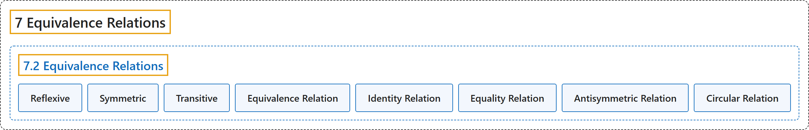

# 7.2 Equivalence Relations

## Classification

## Glossary

| Term | Definition | 中文翻译 | Source |
|---|---|---|---|
| **7 Equivalence Relations** 等价关系 | (No definition) | （无定义） | [Sundstrom, 2022, chapter 7](https://gvsuoer.github.io/sundstrom-textbook/C_equivrelations.html) |
| **7.2 Equivalence Relations** 等价关系 | (No definition) | （无定义） | [Sundstrom, 2022, section 7.2](https://gvsuoer.github.io/sundstrom-textbook/S_equivrelations.html) |
| **Reflexive** 自反 | "The relation $R$ is reflexive on $\boldsymbol{A}$ provided that **for each** $x \in A\text{,}$ $x \mathrel{R} x$ or, equivalently, $\left( {x, x} \right) \in R\text{.}$" | 如果**对每个** $x \in A$，$x \mathrel{R} x$（等价地，$\left( {x, x} \right) \in R$），关系 $R$ 就称为在 $\boldsymbol{A}$ 上自反。 | [Sundstrom, 2022, section 7.2](https://gvsuoer.github.io/sundstrom-textbook/S_equivrelations.html#li-596) |
| **Symmetric** 对称 | "The relation $R$ is symmetric provided that **for every** $x, y \in A\text{,}$ **if** $x \mathrel{R} y\text{,}$ **then** $y \mathrel{R} x$" | 如果**对每个** $x, y \in A$，**若** $x \mathrel{R} y$，**则** $y \mathrel{R} x$，关系 $R$ 就是对称的 | [Sundstrom, 2022, section 7.2](https://gvsuoer.github.io/sundstrom-textbook/S_equivrelations.html#li-597) |
| **Transitive** 传递 | "The relation $R$ is transitive provided that **for every** $x, y, z \in A\text{,}$ **if** $x \mathrel{R} y$ **and** $y \mathrel{R} z\text{,}$ **then** $x \mathrel{R} z$" | 如果**对每个** $x, y, z \in A$，**若** $x \mathrel{R} y$ **且** $y \mathrel{R} z$，**则** $x \mathrel{R} z$，关系 $R$ 就是传递的 | [Sundstrom, 2022, section 7.2](https://gvsuoer.github.io/sundstrom-textbook/S_equivrelations.html#li-598) |
| **Equivalence Relation** 等价关系 | "A relation $\sim$ on the set $A$ is an equivalence relation provided that $\sim$ **is reflexive, symmetric, and transitive**." | 如果集合 $A$ 上的关系 $\sim$ **是自反、对称且传递的**，它就是等价关系。 | [Sundstrom, 2022, section 7.2](https://gvsuoer.github.io/sundstrom-textbook/S_equivrelations.html#equivalencerelation) |
| **Identity Relation** 恒等关系 | "This relation is also called the identity relation on $\boldsymbol{A}$ and is denoted by $I_A\text{,}$ where $I_A = \left\{ {\left( {x, x} \right) \mid x \in A} \right\}\!\text{.}$" | 这个关系也称为 $\boldsymbol{A}$ 上的恒等关系，记作 $I_A$，其中 $I_A = \left\{ {\left( {x, x} \right) \mid x \in A} \right\}\!$。 | [Sundstrom, 2022, section 7.2](https://gvsuoer.github.io/sundstrom-textbook/S_equivrelations.html#subsection-140) |
| **Equality Relation** 相等关系 | "Let $A$ be a nonempty set. The equality relation on $\boldsymbol{A}$ **is an equivalence relation**." | 设 $A$ 是非空集合。$\boldsymbol{A}$ 上的相等关系**是一个等价关系**。 | [Sundstrom, 2022, section 7.2](https://gvsuoer.github.io/sundstrom-textbook/S_equivrelations.html#subsection-140) |
| **Antisymmetric Relation** 反对称关系 | "A relation $R$ on a set $A$ is an antisymmetric relation provided that **for all** $x, y \in A\text{,}$ **if** $x \mathrel{R} y$ **and** $y \mathrel{R} x\text{,}$ **then** $x = y\text{.}$" | 如果**对所有** $x, y \in A$，**若** $x \mathrel{R} y$ **且** $y \mathrel{R} x$，**则** $x = y$，集合 $A$ 上的关系 $R$ 就是反对称关系。 | [Sundstrom, 2022, section 7.2](https://gvsuoer.github.io/sundstrom-textbook/S_equivrelations.html#activity-43) |
| **Circular Relation** 循环关系 | "A relation $R$ on a set $A$ is a circular relation provided that **for all** $x\text{,}$ $y\text{,}$ and $z$ in $A\text{,}$ **if** $x \mathrel{R} y$ **and** $y \mathrel{R} z\text{,}$ **then** $z \mathrel{R} x\text{.}$" | 如果**对所有** $A$ 中的 $x$、$y$ 和 $z$，**若** $x \mathrel{R} y$ **且** $y \mathrel{R} z$，**则** $z \mathrel{R} x$，集合 $A$ 上的关系 $R$ 就是循环关系。 | [Sundstrom, 2022, section 7.2](https://gvsuoer.github.io/sundstrom-textbook/S_equivrelations.html#activity-43) |

## References

Sundstrom, T. (2022). *Mathematical reasoning: Writing and proof* (Version 2.1; PreTeXt edition by Grand Valley State University). Retrieved October 30, 2026, from <https://gvsuoer.github.io/sundstrom-textbook/frontmatter.html>
