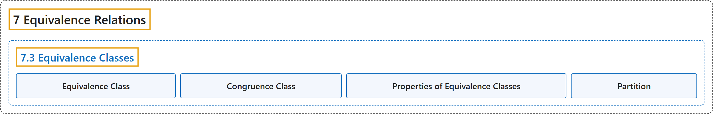

# 7.3 Equivalence Classes

## Classification

## Glossary

| Term | Definition | 中文翻译 | Source |
|---|---|---|---|
| **7 Equivalence Relations** 等价关系 | (No definition) | （无定义） | [Sundstrom, 2022, chapter 7](https://gvsuoer.github.io/sundstrom-textbook/C_equivrelations.html) |
| **7.3 Equivalence Classes** 等价类 | (No definition) | （无定义） | [Sundstrom, 2022, section 7.3](https://gvsuoer.github.io/sundstrom-textbook/S_equivclasses.html) |
| **Equivalence Class** 等价类 | "For each $a \in A\text{,}$ the equivalence class of $\boldsymbol{a}$ determined by $\sim$ is the subset of $A\text{,}$ denoted by $[ a ]\text{,}$ **consisting of all the elements of** $A$ that are equivalent to $a\text{.}$" | 对每个 $a \in A$，由 $\sim$ 确定的 $\boldsymbol{a}$ 的等价类是 $A$ 的子集，记作 $[ a ]$，由 $A$ 中与 $a$ 等价的**全部元素组成**。 | [Sundstrom, 2022, section 7.3](https://gvsuoer.github.io/sundstrom-textbook/S_equivclasses.html#equivalenceclass) |
| **Congruence Class** 同余类 | "So for $a \in \mathbb{Z}\text{,}$ $[ a ] = \left\{ { {x \in \mathbb{Z} } \mid x \equiv a \pmod n} \right\}\!\text{.}$ In this case, $[ a ]$ is called the congruence class of $\boldsymbol{a}$ modulo $\boldsymbol{n}$." | 所以对 $a \in \mathbb{Z}$，$[ a ] = \left\{ { {x \in \mathbb{Z} } \mid x \equiv a \pmod n} \right\}\!$。这时 $[ a ]$ 称为 $\boldsymbol{a}$ 模 $\boldsymbol{n}$ 的同余类。 | [Sundstrom, 2022, section 7.3](https://gvsuoer.github.io/sundstrom-textbook/S_equivclasses.html#congclass) |
| **Properties of Equivalence Classes** 等价类的性质 | "The properties of equivalence classes that we will prove are as follows: (1) **Every element of** $A$ **is in its own equivalence class**; (2) **two elements are equivalent if and only if their equivalence classes are equal**; and (3) **two equivalence classes are either identical or they are disjoint**." | 我们要证明的等价类性质如下：(1) **每个元素**（$A$ 的）**都在它自己的等价类中**；(2) **两个元素等价当且仅当它们的等价类相等**；(3) **两个等价类要么相同，要么不相交**。 | [Sundstrom, 2022, section 7.3](https://gvsuoer.github.io/sundstrom-textbook/S_equivclasses.html#p-4916) |
| **Partition** 划分 | "The collection of subsets $\mathcal{C}$ is a partition of $\boldsymbol{A}$ provided that **For each** $V \in \mathcal{C}\text{,}$ $V \ne \emptyset\text{.}$ **For each** $x \in A\text{,}$ **there exists a** $V \in \mathcal{C}$ **such that** $x \in V\text{.}$ **For every** $V, W \in \mathcal{C}\text{,}$ $V = W$ or $V \cap W = \emptyset\text{.}$" | 子集族 $\mathcal{C}$ 是 $\boldsymbol{A}$ 的划分，如果：**对每个** $V \in \mathcal{C}$，$V \ne \emptyset$；**对每个** $x \in A$，**存在** $V \in \mathcal{C}$ **使得** $x \in V$；**对每个** $V, W \in \mathcal{C}$，$V = W$ 或 $V \cap W = \emptyset$。 | [Sundstrom, 2022, section 7.3](https://gvsuoer.github.io/sundstrom-textbook/S_equivclasses.html#partition) |

## References

Sundstrom, T. (2022). *Mathematical reasoning: Writing and proof* (Version 2.1; PreTeXt edition by Grand Valley State University). Retrieved October 30, 2026, from <https://gvsuoer.github.io/sundstrom-textbook/frontmatter.html>
