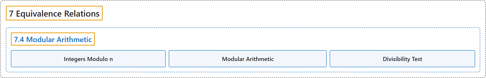

# 7.4 Modular Arithmetic

## Classification

## Glossary

| Term | Definition | 中文翻译 | Source |
|---|---|---|---|
| **7 Equivalence Relations** 等价关系 | (No definition) | （无定义） | [Sundstrom, 2022, chapter 7](https://gvsuoer.github.io/sundstrom-textbook/C_equivrelations.html) |
| **7.4 Modular Arithmetic** 模运算 | (No definition) | （无定义） | [Sundstrom, 2022, section 7.4](https://gvsuoer.github.io/sundstrom-textbook/S_modulararithmetic.html) |
| **Integers Modulo n** 模 n 整数 | "**The set of congruence classes for the relation of congruence modulo** $n$ on $\mathbb{Z}$ is the set of integers modulo $\boldsymbol{n}$, or the set of integers mod $n\text{.}$" | $\mathbb{Z}$ 上模 $n$ **同余关系的同余类所成的集合**，就是模 $\boldsymbol{n}$ 整数集（integers mod $n$）。 | [Sundstrom, 2022, section 7.4](https://gvsuoer.github.io/sundstrom-textbook/S_modulararithmetic.html#integersmodn) |
| **Modular Arithmetic** 模运算 | "The term modular arithmetic is used to refer to **the operations of addition and multiplication of congruence classes** in the integers modulo $n\text{.}$" | 模运算一词指模 $n$ 整数中**同余类的加法和乘法运算**。 | [Sundstrom, 2022, section 7.4](https://gvsuoer.github.io/sundstrom-textbook/S_modulararithmetic.html#modulararithmetic) |
| **Divisibility Test** 整除判别法 | "Item 3 of Theorem 7.27 is called a divisibility test. If gives **a necessary and sufficient condition for a natural number to be divisible by 9**." | 定理 7.27 的第 3 项称为一个整除判别法。它给出了**一个自然数能被 9 整除的充分必要条件**。 | [Sundstrom, 2022, section 7.4](https://gvsuoer.github.io/sundstrom-textbook/S_modulararithmetic.html#p-5090) |

## References

Sundstrom, T. (2022). *Mathematical reasoning: Writing and proof* (Version 2.1; PreTeXt edition by Grand Valley State University). Retrieved October 30, 2026, from <https://gvsuoer.github.io/sundstrom-textbook/frontmatter.html>
