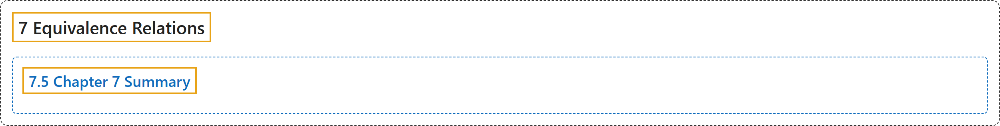

# 7.5 Chapter 7 Summary

## Classification

## Glossary

| Term | Definition | 中文翻译 | Source |
|---|---|---|---|
| **7 Equivalence Relations** 等价关系 | (No definition) | （无定义） | [Sundstrom, 2022, chapter 7](https://gvsuoer.github.io/sundstrom-textbook/C_equivrelations.html) |
| **7.5 Chapter 7 Summary** 第 7 章小结 | (No definition) | （无定义） | [Sundstrom, 2022, section 7.5](https://gvsuoer.github.io/sundstrom-textbook/section-37.html) |

## References

Sundstrom, T. (2022). *Mathematical reasoning: Writing and proof* (Version 2.1; PreTeXt edition by Grand Valley State University). Retrieved October 30, 2026, from <https://gvsuoer.github.io/sundstrom-textbook/frontmatter.html>
