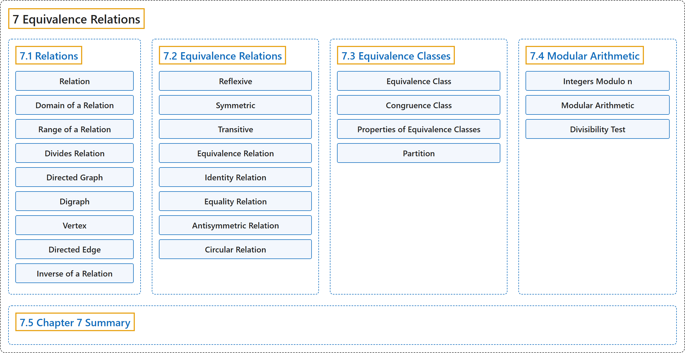

# 7 Equivalence Relations

## Classification

## Glossary

| Term | Definition | 中文翻译 | Source |
|---|---|---|---|
| **7 Equivalence Relations** 等价关系 | (No definition) | （无定义） | [Sundstrom, 2022, chapter 7](https://gvsuoer.github.io/sundstrom-textbook/C_equivrelations.html) |
| **[7.1 Relations](7-1-relations.md)** 关系 | (No definition) | （无定义） | [Sundstrom, 2022, section 7.1](https://gvsuoer.github.io/sundstrom-textbook/S_relations.html) |
| **[7.2 Equivalence Relations](7-2-equivalence-relations.md)** 等价关系 | (No definition) | （无定义） | [Sundstrom, 2022, section 7.2](https://gvsuoer.github.io/sundstrom-textbook/S_equivrelations.html) |
| **[7.3 Equivalence Classes](7-3-equivalence-classes.md)** 等价类 | (No definition) | （无定义） | [Sundstrom, 2022, section 7.3](https://gvsuoer.github.io/sundstrom-textbook/S_equivclasses.html) |
| **[7.4 Modular Arithmetic](7-4-modular-arithmetic.md)** 模运算 | (No definition) | （无定义） | [Sundstrom, 2022, section 7.4](https://gvsuoer.github.io/sundstrom-textbook/S_modulararithmetic.html) |
| **[7.5 Chapter 7 Summary](7-5-chapter-7-summary.md)** 第 7 章小结 | (No definition) | （无定义） | [Sundstrom, 2022, section 7.5](https://gvsuoer.github.io/sundstrom-textbook/section-37.html) |

## References

Sundstrom, T. (2022). *Mathematical reasoning: Writing and proof* (Version 2.1; PreTeXt edition by Grand Valley State University). Retrieved October 30, 2026, from <https://gvsuoer.github.io/sundstrom-textbook/frontmatter.html>
