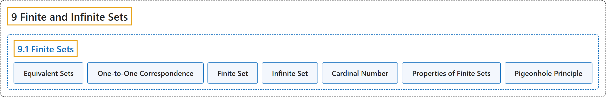

# 9.1 Finite Sets

## Classification

## Glossary

| Term | Definition | 中文翻译 | Source |
|---|---|---|---|
| **9 Finite and Infinite Sets** 有限集与无限集 | (No definition) | （无定义） | [Sundstrom, 2022, chapter 9](https://gvsuoer.github.io/sundstrom-textbook/C_topicsinsets.html) |
| **9.1 Finite Sets** 有限集 | (No definition) | （无定义） | [Sundstrom, 2022, section 9.1](https://gvsuoer.github.io/sundstrom-textbook/S_finitesets.html) |
| **Equivalent Sets** 等势集合 | "The set $A$ is equivalent to the set $B$ provided that **there exists a bijection from the set** $A$ **onto the set** $B\text{.}$ In this case, we write $A \approx B\text{.}$" | 如果**存在从集合** $A$ **到集合** $B$ 上的双射，集合 $A$ 就与集合 $B$ 等势。这时记作 $A \approx B$。 | [Sundstrom, 2022, section 9.1](https://gvsuoer.github.io/sundstrom-textbook/S_finitesets.html#equivsets) |
| **One-to-One Correspondence** 一一对应 | "When $A \approx B\text{,}$ we also say that the set $A$ is **in one-to-one correspondence with the set** $B$ and that the set $A$ has the same cardinality as the set $B\text{.}$" | 当 $A \approx B$ 时，也说集合 $A$ 与集合 $B$ **一一对应**，并且集合 $A$ 与集合 $B$ 有相同的势。 | [Sundstrom, 2022, section 9.1](https://gvsuoer.github.io/sundstrom-textbook/S_finitesets.html#equivsets) |
| **Finite Set** 有限集 | "A set $A$ is a finite set provided that $A = \emptyset$ **or there exists a natural number** $k$ **such that** $A \approx \mathbb{N}_k\text{.}$" | 如果 $A = \emptyset$，**或存在自然数** $k$ **使得** $A \approx \mathbb{N}_k$，集合 $A$ 就是有限集。 | [Sundstrom, 2022, section 9.1](https://gvsuoer.github.io/sundstrom-textbook/S_finitesets.html#cardinalityfinite) |
| **Infinite Set** 无限集 | "A set is an infinite set provided that **it is not a finite set**." | 如果一个集合**不是有限集**，它就是无限集。 | [Sundstrom, 2022, section 9.1](https://gvsuoer.github.io/sundstrom-textbook/S_finitesets.html#cardinalityfinite) |
| **Cardinal Number** 基数 | "If $A \approx \mathbb{N}_k\text{,}$ we say that **the set** $A$ **has cardinality** $\boldsymbol{k}$ (or cardinal number $\boldsymbol{k}$), and we write $\text{ card} \left( A \right) = k\text{.}$" | 若 $A \approx \mathbb{N}_k$，就说**集合** $A$ **的势为** $\boldsymbol{k}$（或基数为 $\boldsymbol{k}$），记作 $\text{ card} \left( A \right) = k$。 | [Sundstrom, 2022, section 9.1](https://gvsuoer.github.io/sundstrom-textbook/S_finitesets.html#cardinalityfinite) |
| **Properties of Finite Sets** 有限集的性质 | "If $A \approx \mathbb{N}_k\text{,}$ we say that the set $A$ has cardinality $\boldsymbol{k}$ (or cardinal number $\boldsymbol{k}$), and we write $\text{ card} \left( A \right) = k\text{.}$ In addition, we say that **the empty set has cardinality 0** (or cardinal number 0), and we write $\text{ card} \left( \emptyset \right) = 0\text{.}$" | 若 $A \approx \mathbb{N}_k$，就说集合 $A$ 的势为 $\boldsymbol{k}$（或基数为 $\boldsymbol{k}$），记作 $\text{ card} \left( A \right) = k$。此外，**空集的势为 0**（或基数为 0），记作 $\text{ card} \left( \emptyset \right) = 0$。 | [Sundstrom, 2022, section 9.1](https://gvsuoer.github.io/sundstrom-textbook/S_finitesets.html#cardinalityfinite) |
| **Pigeonhole Principle** 鸽巢原理 | "Let $A$ and $B$ be finite sets. **If** $\text{ card} ( A ) > \text{ card} ( B )\text{,}$ **then any function** $f: A \to B$ **is not an injection**." | 设 $A$ 和 $B$ 是有限集。**如果** $\text{ card} ( A ) > \text{ card} ( B )$，**那么任何函数** $f: A \to B$ **都不是单射**。 | [Sundstrom, 2022, section 9.1](https://gvsuoer.github.io/sundstrom-textbook/S_finitesets.html#T_pigeonhole) |

## References

Sundstrom, T. (2022). *Mathematical reasoning: Writing and proof* (Version 2.1; PreTeXt edition by Grand Valley State University). Retrieved October 30, 2026, from <https://gvsuoer.github.io/sundstrom-textbook/frontmatter.html>
