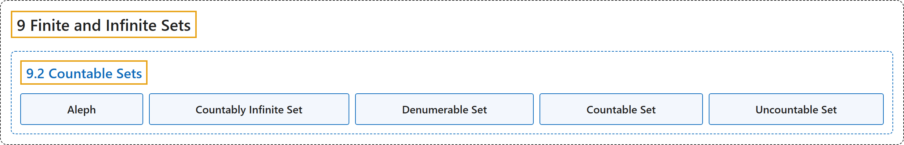

# 9.2 Countable Sets

## Classification

## Glossary

| Term | Definition | 中文翻译 | Source |
|---|---|---|---|
| **9 Finite and Infinite Sets** 有限集与无限集 | (No definition) | （无定义） | [Sundstrom, 2022, chapter 9](https://gvsuoer.github.io/sundstrom-textbook/C_topicsinsets.html) |
| **9.2 Countable Sets** 可数集 | (No definition) | （无定义） | [Sundstrom, 2022, section 9.2](https://gvsuoer.github.io/sundstrom-textbook/S_infinitesets.html) |
| **Aleph** 阿列夫 | "The cardinality of $\boldsymbol{\mathbb N}$ is denoted by $\aleph_0\text{.}$ The symbol $\aleph$ is **the first letter of the Hebrew alphabet**, aleph." | $\boldsymbol{\mathbb N}$ 的势记作 $\aleph_0$。符号 $\aleph$ 是**希伯来字母表的第一个字母**，读作 aleph（阿列夫）。 | [Sundstrom, 2022, section 9.2](https://gvsuoer.github.io/sundstrom-textbook/S_infinitesets.html#aleph0) |
| **Countably Infinite Set** 可数无限集 | "A set $A$ is countably infinite provided that $A \approx \mathbb{N}\text{.}$" | 如果 $A \approx \mathbb{N}$，集合 $A$ 就是可数无限的。 | [Sundstrom, 2022, section 9.2](https://gvsuoer.github.io/sundstrom-textbook/S_infinitesets.html#countinfinite) |
| **Denumerable Set** 可列集 | "A set that is **countably infinite** is sometimes called a denumerable set." | **可数无限**的集合有时称为可列集。 | [Sundstrom, 2022, section 9.2](https://gvsuoer.github.io/sundstrom-textbook/S_infinitesets.html#countinfinite) |
| **Countable Set** 可数集 | "A set is countable provided that **it is finite or countably infinite**." | 如果一个集合**是有限的或可数无限的**，它就是可数集。 | [Sundstrom, 2022, section 9.2](https://gvsuoer.github.io/sundstrom-textbook/S_infinitesets.html#countinfinite) |
| **Uncountable Set** 不可数集 | "**An infinite set that is not countably infinite** is called an uncountable set." | **不是可数无限的无限集**称为不可数集。 | [Sundstrom, 2022, section 9.2](https://gvsuoer.github.io/sundstrom-textbook/S_infinitesets.html#countinfinite) |

## References

Sundstrom, T. (2022). *Mathematical reasoning: Writing and proof* (Version 2.1; PreTeXt edition by Grand Valley State University). Retrieved October 30, 2026, from <https://gvsuoer.github.io/sundstrom-textbook/frontmatter.html>
