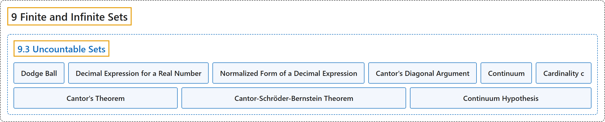

# 9.3 Uncountable Sets

## Classification

## Glossary

| Term | Definition | 中文翻译 | Source |
|---|---|---|---|
| **9 Finite and Infinite Sets** 有限集与无限集 | (No definition) | （无定义） | [Sundstrom, 2022, chapter 9](https://gvsuoer.github.io/sundstrom-textbook/C_topicsinsets.html) |
| **9.3 Uncountable Sets** 不可数集 | (No definition) | （无定义） | [Sundstrom, 2022, section 9.3](https://gvsuoer.github.io/sundstrom-textbook/S_uncountablesets.html) |
| **Dodge Ball** 躲避球 | "Dodge Ball is **a game for two players**." | 躲避球是**一种两人游戏**。 | [Sundstrom, 2022, section 9.3](https://gvsuoer.github.io/sundstrom-textbook/S_uncountablesets.html#PA_dodgeball) |
| **Decimal Expression for a Real Number** 实数的小数表示 | "In its decimal form, any real number $a$ in the interval $( 0, 1 )$ **can be written as** $a = 0.a_1 a_2 a_3 a_4 \ldots \text{,}$ where each $a_i$ is an integer with $0 \leq a_i \leq 9\text{.}$" | 区间 $( 0, 1 )$ 中的任意实数 $a$ 的小数形式**可以写成** $a = 0.a_1 a_2 a_3 a_4 \ldots$，其中每个 $a_i$ 都是满足 $0 \leq a_i \leq 9$ 的整数。 | [Sundstrom, 2022, section 9.3](https://gvsuoer.github.io/sundstrom-textbook/S_uncountablesets.html#subsection-168) |
| **Normalized Form of a Decimal Expression** 小数表示的规范形式 | "That is, the decimal representation of $a$ is in normalized form if and only if **it does not end with an infinite string of 9's**." | 也就是说，$a$ 的小数表示是规范形式，当且仅当**它不以无穷个 9 结尾**。 | [Sundstrom, 2022, section 9.3](https://gvsuoer.github.io/sundstrom-textbook/S_uncountablesets.html#normalized) |
| **Cantor's Diagonal Argument** 康托尔对角线论证 | "**The proof of Theorem 9.27** is often referred to as Cantor's diagonal argument." | **定理 9.27 的证明**常称为康托尔对角线论证。 | [Sundstrom, 2022, section 9.3](https://gvsuoer.github.io/sundstrom-textbook/S_uncountablesets.html#prog_diagonal) |
| **Continuum** 连续统 | "The cardinal number of $( 0, 1 )$ is defined to be $\boldsymbol{c}\text{,}$ which **stands for the cardinal number of the continuum**." | $( 0, 1 )$ 的基数定义为 $\boldsymbol{c}$，它**代表连续统的基数**。 | [Sundstrom, 2022, section 9.3](https://gvsuoer.github.io/sundstrom-textbook/S_uncountablesets.html#p-5943) |
| **Cardinality c** 基数 c | "A set $A$ is said to have cardinality $\boldsymbol{c}$ provided that $A$ **is equivalent to** $( 0, 1 )\text{.}$" | 如果 $A$ 与 $( 0, 1 )$ **等势**，就说集合 $A$ 的势为 $\boldsymbol{c}$。 | [Sundstrom, 2022, section 9.3](https://gvsuoer.github.io/sundstrom-textbook/S_uncountablesets.html#cardinalityc) |
| **Cantor's Theorem** 康托尔定理 | "For every set $A\text{,}$ $A$ and $\mathcal{P} ( A )$ **do not have the same cardinality**." | 对每个集合 $A$，$A$ 与 $\mathcal{P} ( A )$ **的势不相同**。 | [Sundstrom, 2022, section 9.3](https://gvsuoer.github.io/sundstrom-textbook/S_uncountablesets.html#T_cantor) |
| **Cantor-Schröder-Bernstein Theorem** 康托尔-施罗德-伯恩斯坦定理 | "Let $A$ and $B$ be sets. **If there exist injections** $f: A \to B$ and $g: B \to A\text{,}$ **then** $A \approx B\text{.}$" | 设 $A$ 和 $B$ 是集合。**如果存在单射** $f: A \to B$ 和 $g: B \to A$，**那么** $A \approx B$。 | [Sundstrom, 2022, section 9.3](https://gvsuoer.github.io/sundstrom-textbook/S_uncountablesets.html#T_bernstein) |
| **Continuum Hypothesis** 连续统假设 | "This conjecture has come to be known as the Continuum Hypothesis. Stated somewhat more formally, the Continuum Hypothesis is **There is no set** $X$ **such that** $\aleph_0 \lt \text{ card} ( X ) \lt \boldsymbol{c}\text{.}$" | 这个猜想后来称为连续统假设。更正式地说，连续统假设是：**不存在集合** $X$ **使得** $\aleph_0 \lt \text{ card} ( X ) \lt \boldsymbol{c}$。 | [Sundstrom, 2022, section 9.3](https://gvsuoer.github.io/sundstrom-textbook/S_uncountablesets.html#li-763) |

## References

Sundstrom, T. (2022). *Mathematical reasoning: Writing and proof* (Version 2.1; PreTeXt edition by Grand Valley State University). Retrieved October 30, 2026, from <https://gvsuoer.github.io/sundstrom-textbook/frontmatter.html>
