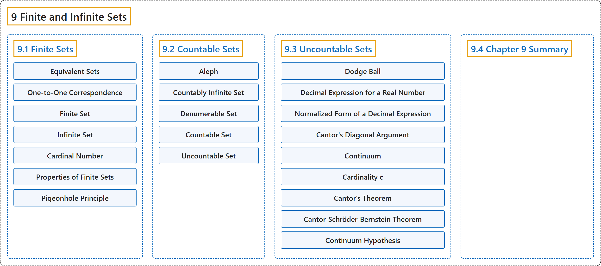

# 9 Finite and Infinite Sets

## Classification

## Glossary

| Term | Definition | 中文翻译 | Source |
|---|---|---|---|
| **9 Finite and Infinite Sets** 有限集与无限集 | (No definition) | （无定义） | [Sundstrom, 2022, chapter 9](https://gvsuoer.github.io/sundstrom-textbook/C_topicsinsets.html) |
| **[9.1 Finite Sets](9-1-finite-sets.md)** 有限集 | (No definition) | （无定义） | [Sundstrom, 2022, section 9.1](https://gvsuoer.github.io/sundstrom-textbook/S_finitesets.html) |
| **[9.2 Countable Sets](9-2-countable-sets.md)** 可数集 | (No definition) | （无定义） | [Sundstrom, 2022, section 9.2](https://gvsuoer.github.io/sundstrom-textbook/S_infinitesets.html) |
| **[9.3 Uncountable Sets](9-3-uncountable-sets.md)** 不可数集 | (No definition) | （无定义） | [Sundstrom, 2022, section 9.3](https://gvsuoer.github.io/sundstrom-textbook/S_uncountablesets.html) |
| **[9.4 Chapter 9 Summary](9-4-chapter-9-summary.md)** 第 9 章小结 | (No definition) | （无定义） | [Sundstrom, 2022, section 9.4](https://gvsuoer.github.io/sundstrom-textbook/section-45.html) |

## References

Sundstrom, T. (2022). *Mathematical reasoning: Writing and proof* (Version 2.1; PreTeXt edition by Grand Valley State University). Retrieved October 30, 2026, from <https://gvsuoer.github.io/sundstrom-textbook/frontmatter.html>
