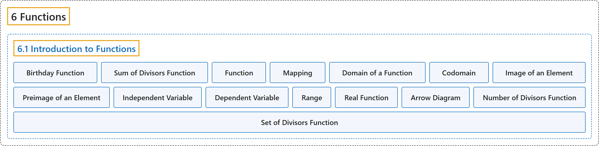

# 6.1 Introduction to Functions

## Classification

## Glossary

| Term | Definition | 中文翻译 | Source |
|---|---|---|---|
| **6 Functions** 函数 | (No definition) | （无定义） | [Sundstrom, 2022, chapter 6](https://gvsuoer.github.io/sundstrom-textbook/C_functions.html) |
| **6.1 Introduction to Functions** 函数入门 | (No definition) | （无定义） | [Sundstrom, 2022, section 6.1](https://gvsuoer.github.io/sundstrom-textbook/S_introfunctions.html) |
| **Birthday Function** 生日函数 | "Let $b$ be the function that **assigns to each person his or her birthday (month and day)**. The domain of the function $b$ is the set of all people and the codomain of $b$ is the set of all days in a leap year (i.e., January 1 through December 31, including February 29). (a) Explain why $b$ really is a function. We will call this the birthday function." | 设 $b$ 是**给每个人指定其生日**（月和日）的函数。函数 $b$ 的定义域是所有人的集合，$b$ 的陪域是闰年中所有日子的集合（即 1 月 1 日到 12 月 31 日，包括 2 月 29 日）。(a) 解释为什么 $b$ 确实是函数。我们把它称为生日函数。 | [Sundstrom, 2022, section 6.1](https://gvsuoer.github.io/sundstrom-textbook/S_introfunctions.html#exercise-526) |
| **Sum of Divisors Function** 因数和函数 | "Let $s$ be the function that **associates with each natural number the sum of its distinct natural number divisors**. This is called the sum of the divisors function." | 设 $s$ 是**让每个自然数对应它的不同自然数因数之和**的函数。它称为因数和函数。 | [Sundstrom, 2022, section 6.1](https://gvsuoer.github.io/sundstrom-textbook/S_introfunctions.html#sym_sumdivisors) |
| **Function** 函数 | "A function from a set $A$ to a set $B$ is **a rule that associates with each element** $x$ of the set $A$ **exactly one element** of the set $B\text{.}$" | 从集合 $A$ 到集合 $B$ 的函数是**一种规则，它让**集合 $A$ 中的每个元素 $x$ **对应恰好一个元素**（集合 $B$ 中的）。 | [Sundstrom, 2022, section 6.1](https://gvsuoer.github.io/sundstrom-textbook/S_introfunctions.html#function) |
| **Mapping** 映射 | "A function from $A$ to $B$ is **also called a mapping** from $A$ to $B\text{.}$" | 从 $A$ 到 $B$ 的函数**也称为映射**（从 $A$ 到 $B$）。 | [Sundstrom, 2022, section 6.1](https://gvsuoer.github.io/sundstrom-textbook/S_introfunctions.html#function) |
| **Domain of a Function** 函数的定义域 | "Let $f \colon A \to B\text{.}$ (This is read, “Let $f$ be a function from $A$ to $B\text{.}$”) The set $A$ is **called the domain of the function** $f\text{,}$ and we write $A = \text{ dom} ( f )\text{.}$" | 设 $f \colon A \to B$（读作“设 $f$ 是从 $A$ 到 $B$ 的函数”）。集合 $A$ **称为函数的定义域** $f$，记作 $A = \text{ dom} ( f )$。 | [Sundstrom, 2022, section 6.1](https://gvsuoer.github.io/sundstrom-textbook/S_introfunctions.html#domainfunction) |
| **Codomain** 陪域 | "The set $B$ is **called the codomain of the function** $f\text{,}$ and we write $B = \text{ codom} ( f )\text{.}$" | 集合 $B$ **称为函数的陪域** $f$，记作 $B = \text{ codom} ( f )$。 | [Sundstrom, 2022, section 6.1](https://gvsuoer.github.io/sundstrom-textbook/S_introfunctions.html#domainfunction) |
| **Image of an Element** 元素的像 | "If $a \in A\text{,}$ then the element of $B$ **that is associated with** $a$ is denoted by $f( a )$ and is called the image of $\boldsymbol{a}$ under $\boldsymbol{f}$." | 若 $a \in A$，则 $B$ 中**对应于** $a$ 的元素记作 $f( a )$，称为 $\boldsymbol{a}$ 在 $\boldsymbol{f}$ 下的像。 | [Sundstrom, 2022, section 6.1](https://gvsuoer.github.io/sundstrom-textbook/S_introfunctions.html#domainfunction) |
| **Preimage of an Element** 元素的原像 | "If $f( a ) = b\text{,}$ with $b \in B\text{,}$ then $a$ is **called a preimage of** $\boldsymbol{b}$ for $\boldsymbol{f}$." | 若 $f( a ) = b$，其中 $b \in B$，则 $a$ **称为原像**，即 $\boldsymbol{b}$ 关于 $\boldsymbol{f}$ 的原像。 | [Sundstrom, 2022, section 6.1](https://gvsuoer.github.io/sundstrom-textbook/S_introfunctions.html#domainfunction) |
| **Independent Variable** 自变量 | "In this case, we consider $x$ to be **an unspecified object that can be chosen from the set** $A\text{,}$ and we would say that $x$ is the independent variable of the function $f$ and $y$ is the dependent variable of the function $f\text{.}$" | 这时我们把 $x$ 看作**可以从集合中选取的未指定对象** $A$，说 $x$ 是函数 $f$ 的自变量，$y$ 是函数 $f$ 的因变量。 | [Sundstrom, 2022, section 6.1](https://gvsuoer.github.io/sundstrom-textbook/S_introfunctions.html#functionterms) |
| **Dependent Variable** 因变量 | "When we have a function $f \colon A \to B\text{,}$ we often write $y = f(x)\text{.}$ In this case, we consider $x$ to be an unspecified object that can be chosen from the set $A\text{,}$ and we would say that $x$ is the independent variable of the function $f$ and $y$ **is the dependent variable** of the function $f\text{.}$" | 当有函数 $f \colon A \to B$ 时，常写成 $y = f(x)$。这时我们把 $x$ 看作可以从集合 $A$ 中选取的未指定对象，说 $x$ 是函数 $f$ 的自变量，$y$ **是因变量**（函数 $f$ 的）。 | [Sundstrom, 2022, section 6.1](https://gvsuoer.github.io/sundstrom-textbook/S_introfunctions.html#functionterms) |
| **Range** 值域 | "The set $\left\{ {f( x ) \mid x \in A} \right\}$ is **called the range of the function** $\boldsymbol{f}$ and is denoted by $\text{ range} \left( f \right)\text{.}$" | 集合 $\left\{ {f( x ) \mid x \in A} \right\}$ **称为函数的值域** $\boldsymbol{f}$，记作 $\text{ range} \left( f \right)$。 | [Sundstrom, 2022, section 6.1](https://gvsuoer.github.io/sundstrom-textbook/S_introfunctions.html#rangeandimage) |
| **Real Function** 实函数 | "Because we use the Cartesian plane when drawing this type of graph, we can only use this type of graph when **both the domain and the codomain of the function are subsets of the real numbers** $\mathbb R\text{.}$ Such a function is sometimes called a real function." | 由于画这类图要用笛卡尔平面，所以只有当**函数的定义域和陪域都是实数集的子集**（$\mathbb R$）时才能用这类图。这样的函数有时称为实函数。 | [Sundstrom, 2022, section 6.1](https://gvsuoer.github.io/sundstrom-textbook/S_introfunctions.html#p-3686) |
| **Arrow Diagram** 箭头图 | "A convenient way to **illustrate or visualize this type of function** is with a so-called arrow diagram as shown in Figure 6.6." | **说明或直观展示这类函数**的一种方便方法是所谓的箭头图，如图 6.6 所示。 | [Sundstrom, 2022, section 6.1](https://gvsuoer.github.io/sundstrom-textbook/S_introfunctions.html#subsection-110) |
| **Number of Divisors Function** 因数个数函数 | "Let $d$ be the function that **associates with each natural number the number of its natural number divisors**." | 设 $d$ 是**让每个自然数对应它的自然数因数个数**的函数。 | [Sundstrom, 2022, section 6.1](https://gvsuoer.github.io/sundstrom-textbook/S_introfunctions.html#exer_numberofdivisors) |
| **Set of Divisors Function** 因数集函数 | "A function that is related to this function is the so-called set of divisors function. This can be defined as a function $S$ that **associates with each natural number the set of its distinct natural number factors**." | 与此相关的一个函数是所谓的因数集函数。它可以定义为一个函数 $S$，**让每个自然数对应它的不同自然数因数组成的集合**。 | [Sundstrom, 2022, section 6.1](https://gvsuoer.github.io/sundstrom-textbook/S_introfunctions.html#exer_sec62-5) |

## References

Sundstrom, T. (2022). *Mathematical reasoning: Writing and proof* (Version 2.1; PreTeXt edition by Grand Valley State University). Retrieved October 30, 2026, from <https://gvsuoer.github.io/sundstrom-textbook/frontmatter.html>
