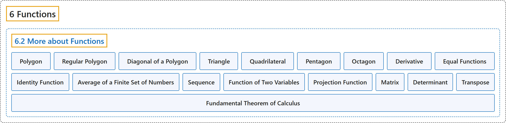

# 6.2 More about Functions

## Classification

## Glossary

| Term | Definition | 中文翻译 | Source |
|---|---|---|---|
| **6 Functions** 函数 | (No definition) | （无定义） | [Sundstrom, 2022, chapter 6](https://gvsuoer.github.io/sundstrom-textbook/C_functions.html) |
| **6.2 More about Functions** 函数的更多内容 | (No definition) | （无定义） | [Sundstrom, 2022, section 6.2](https://gvsuoer.github.io/sundstrom-textbook/S_moreaboutfunctions.html) |
| **Polygon** 多边形 | "A polygon is **a closed plane figure formed by the joining of three or more straight lines**." | 多边形是**由三条或更多直线首尾相接形成的封闭平面图形**。 | [Sundstrom, 2022, section 6.2](https://gvsuoer.github.io/sundstrom-textbook/S_moreaboutfunctions.html#PA_diagonals) |
| **Regular Polygon** 正多边形 | "A regular polygon is one that has **equal-length sides and congruent interior angles**." | 正多边形是**各边等长且各内角全等**的多边形。 | [Sundstrom, 2022, section 6.2](https://gvsuoer.github.io/sundstrom-textbook/S_moreaboutfunctions.html#PA_diagonals) |
| **Diagonal of a Polygon** 多边形的对角线 | "A diagonal of a polygon is **a line segment that connects two nonadjacent vertices of the polygon**." | 多边形的对角线是**连接多边形两个不相邻顶点的线段**。 | [Sundstrom, 2022, section 6.2](https://gvsuoer.github.io/sundstrom-textbook/S_moreaboutfunctions.html#PA_diagonals) |
| **Triangle** 三角形 | "For example, a triangle is **a polygon that has three sides**" | 例如，三角形是**有三条边的多边形** | [Sundstrom, 2022, section 6.2](https://gvsuoer.github.io/sundstrom-textbook/S_moreaboutfunctions.html#PA_diagonals) |
| **Quadrilateral** 四边形 | "a quadrilateral is **a polygon that has four sides** and includes squares, rectangles, and parallelograms" | 四边形是**有四条边的多边形**，包括正方形、长方形和平行四边形 | [Sundstrom, 2022, section 6.2](https://gvsuoer.github.io/sundstrom-textbook/S_moreaboutfunctions.html#PA_diagonals) |
| **Pentagon** 五边形 | "a pentagon is **a polygon that has five sides**" | 五边形是**有五条边的多边形** | [Sundstrom, 2022, section 6.2](https://gvsuoer.github.io/sundstrom-textbook/S_moreaboutfunctions.html#PA_diagonals) |
| **Octagon** 八边形 | "and an octagon is **a polygon that has eight sides**." | 八边形是**有八条边的多边形**。 | [Sundstrom, 2022, section 6.2](https://gvsuoer.github.io/sundstrom-textbook/S_moreaboutfunctions.html#PA_diagonals) |
| **Derivative** 导数 | (context) "In calculus, we learned **how to find the derivatives of certain functions**." | （语境）在微积分中，我们学过**如何求某些函数的导数**。 | [Sundstrom, 2022, section 6.2](https://gvsuoer.github.io/sundstrom-textbook/S_moreaboutfunctions.html#PA_derivatives) |
| **Equal Functions** 相等函数 | "Two functions $f$ and $g$ are equal provided that **The domain of** $f$ **equals the domain of** $g\text{.}$ That is, $\text{ dom} ( f ) = \text{ dom} ( g )\text{.}$ **The codomain of** $f$ **equals the codomain of** $g\text{.}$ That is, $\text{ codom} ( f ) = \text{ codom} ( g )\text{.}$ **For each** $x$ **in the domain of** $f$ (which equals the domain of $g$), $f( x ) = g( x )\text{.}$" | 两个函数 $f$ 和 $g$ 相等，如果：$f$ **的定义域等于** $g$ **的定义域**，即 $\text{ dom} ( f ) = \text{ dom} ( g )$；$f$ **的陪域等于** $g$ **的陪域**，即 $\text{ codom} ( f ) = \text{ codom} ( g )$；**对** $f$ **定义域中的每个** $x$（它也等于 $g$ 的定义域），$f( x ) = g( x )$。 | [Sundstrom, 2022, section 6.2](https://gvsuoer.github.io/sundstrom-textbook/S_moreaboutfunctions.html#functionequality) |
| **Identity Function** 恒等函数 | "Let $A$ be a nonempty set. The identity function on the set $\boldsymbol{A}$ denoted by $I_A$, is the function $I_A: A \to A$ defined by $I_A ( x ) = x$ for every $x$ in $A\text{.}$ That is, for the identity map, **the output is always equal to the input**." | 设 $A$ 是非空集合。集合 $\boldsymbol{A}$ 上的恒等函数记作 $I_A$，是由 $I_A ( x ) = x$（对 $A$ 中的每个 $x$）定义的函数 $I_A: A \to A$。也就是说，对恒等映射，**输出总是等于输入**。 | [Sundstrom, 2022, section 6.2](https://gvsuoer.github.io/sundstrom-textbook/S_moreaboutfunctions.html#pr_equalfunc) |
| **Average of a Finite Set of Numbers** 有限数集的平均数 | "Let $A = \left\{ a_1, a_2, \ldots, a_n \right\}$ be a finite set whose elements are the distinct real numbers $a_1, a_2, \ldots, a_n\text{.}$ We define the average of the set $A$ to be the real number $\bar{A}\text{,}$ where $\bar{A} = \frac{a_1 + a_2 + \cdots + a_n}{n}\text{.}$" | 设 $A = \left\{ a_1, a_2, \ldots, a_n \right\}$ 是有限集，其元素是互不相同的实数 $a_1, a_2, \ldots, a_n$。定义集合 $A$ 的平均数为实数 $\bar{A}$，其中 $\bar{A} = \frac{a_1 + a_2 + \cdots + a_n}{n}$。 | [Sundstrom, 2022, section 6.2](https://gvsuoer.github.io/sundstrom-textbook/S_moreaboutfunctions.html#pr_average) |
| **Sequence** 数列 | "An (infinite) sequence is **a function whose domain is** $\mathbb{N}$ or some infinite subset of $\mathbb{N} \cup \left\{ 0 \right\}\text{.}$" | （无穷）数列是**一个函数，其定义域是** $\mathbb{N}$，或 $\mathbb{N} \cup \left\{ 0 \right\}$ 的某个无穷子集。 | [Sundstrom, 2022, section 6.2](https://gvsuoer.github.io/sundstrom-textbook/S_moreaboutfunctions.html#sequence) |
| **Function of Two Variables** 二元函数 | "Since the domain of this function is $\mathbb Z \times \mathbb Z$ and **each element of** $\mathbb Z \times \mathbb Z$ **is an ordered pair of integers**, we frequently call this type of function a function of two variables." | 由于这个函数的定义域是 $\mathbb Z \times \mathbb Z$，而 $\mathbb Z \times \mathbb Z$ **的每个元素**都**是整数有序对**，我们常把这类函数称为二元函数。 | [Sundstrom, 2022, section 6.2](https://gvsuoer.github.io/sundstrom-textbook/S_moreaboutfunctions.html#li-508) |
| **Projection Function** 投影函数 | "One projection function will **map an ordered pair to its first coordinate**, and the other projection function will **map the ordered pair to its second coordinate**." | 一个投影函数**把有序对映射到它的第一个坐标**，另一个投影函数**把有序对映射到它的第二个坐标**。 | [Sundstrom, 2022, section 6.2](https://gvsuoer.github.io/sundstrom-textbook/S_moreaboutfunctions.html#sym_projfunc) |
| **Matrix** 矩阵 | "A 2 by 2 matrix over $\mathbb{R}$ is **a rectangular array of four real numbers arranged in two rows and two columns**." | $\mathbb{R}$ 上的 2 乘 2 矩阵是**排成两行两列的四个实数组成的矩形阵列**。 | [Sundstrom, 2022, section 6.2](https://gvsuoer.github.io/sundstrom-textbook/S_moreaboutfunctions.html#sym_determinant) |
| **Determinant** 行列式 | "The determinant of the 2 by 2 matrix $A\text{,}$ denoted by $\det( A )\text{,}$ is defined as $\det( A ) = ad - bc\text{.}$" | 2 乘 2 矩阵 $A$ 的行列式记作 $\det( A )$，定义为 $\det( A ) = ad - bc$。 | [Sundstrom, 2022, section 6.2](https://gvsuoer.github.io/sundstrom-textbook/S_moreaboutfunctions.html#sym_determinant) |
| **Transpose** 转置 | "The transpose of the matrix $\boldsymbol{A}$, denoted by $A^T\text{,}$ is the 2 by 2 matrix over $\mathbb{R}$ defined by $A^T = \left[ {\begin{array}{*{20}c} a & c \\ b & d \end{array} } \right]\text{.}$" | 矩阵 $\boldsymbol{A}$ 的转置记作 $A^T$，是由 $A^T = \left[ {\begin{array}{*{20}c} a & c \\ b & d \end{array} } \right]$ 定义的 $\mathbb{R}$ 上的 2 乘 2 矩阵。 | [Sundstrom, 2022, section 6.2](https://gvsuoer.github.io/sundstrom-textbook/S_moreaboutfunctions.html#sym_transpose) |
| **Fundamental Theorem of Calculus** 微积分基本定理 | "In fact, one form of the Fundamental Theorem of Calculus states that $\int_a^b {f( x ) \, dx} = F( b ) - F( a )\text{,}$ where $F$ is **any antiderivative of** $f\text{,}$ that is, where $F \,' = f\text{.}$" | 事实上，微积分基本定理的一种形式是 $\int_a^b {f( x ) \, dx} = F( b ) - F( a )$，其中 $F$ 是 $f$ **的任意一个原函数**，即 $F \,' = f$。 | [Sundstrom, 2022, section 6.2](https://gvsuoer.github.io/sundstrom-textbook/S_moreaboutfunctions.html#activity-35) |

## References

Sundstrom, T. (2022). *Mathematical reasoning: Writing and proof* (Version 2.1; PreTeXt edition by Grand Valley State University). Retrieved October 30, 2026, from <https://gvsuoer.github.io/sundstrom-textbook/frontmatter.html>
