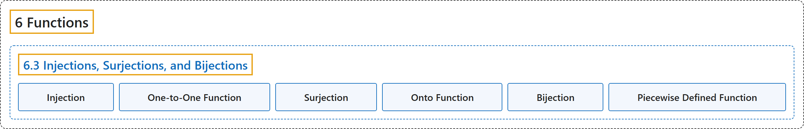

# 6.3 Injections, Surjections, and Bijections

## Classification

## Glossary

| Term | Definition | 中文翻译 | Source |
|---|---|---|---|
| **6 Functions** 函数 | (No definition) | （无定义） | [Sundstrom, 2022, chapter 6](https://gvsuoer.github.io/sundstrom-textbook/C_functions.html) |
| **6.3 Injections, Surjections, and Bijections** 单射、满射与双射 | (No definition) | （无定义） | [Sundstrom, 2022, section 6.3](https://gvsuoer.github.io/sundstrom-textbook/S_typesoffunctions.html) |
| **Injection** 单射 | "The function $f$ is called an injection provided that **for all** $x_1 , x_2 \in A\text{,}$ **if** $x_1 \ne x_2\text{,}$ **then** $f( {x_1 } ) \ne f( {x_2 } )\text{.}$" | 如果**对所有** $x_1 , x_2 \in A$，**若** $x_1 \ne x_2$，**则** $f( {x_1 } ) \ne f( {x_2 } )$，函数 $f$ 就称为单射。 | [Sundstrom, 2022, section 6.3](https://gvsuoer.github.io/sundstrom-textbook/S_typesoffunctions.html#injection) |
| **One-to-One Function** 一对一函数 | "When $f$ is **an injection**, we also say that $f$ is a one-to-one function, or that $f$ is an injective function." | 当 $f$ 是**单射**时，也说 $f$ 是一对一函数，或单射函数。 | [Sundstrom, 2022, section 6.3](https://gvsuoer.github.io/sundstrom-textbook/S_typesoffunctions.html#injection) |
| **Surjection** 满射 | "The function $f$ is called a surjection provided that **the range of** $f$ **equals the codomain of** $f\text{.}$ This means that **for every** $y \in B\text{,}$ **there exists an** $x \in A$ **such that** $f( x ) = y\text{.}$" | 如果 $f$ **的值域等于** $f$ **的陪域**，函数 $f$ 就称为满射。这意味着**对每个** $y \in B$，**存在** $x \in A$ **使得** $f( x ) = y$。 | [Sundstrom, 2022, section 6.3](https://gvsuoer.github.io/sundstrom-textbook/S_typesoffunctions.html#surjection) |
| **Onto Function** 映上函数 | "When $f$ is **a surjection**, we also say that $f$ is an onto function or that $f$ maps $\boldsymbol{A}$ onto $\boldsymbol{B}$." | 当 $f$ 是**满射**时，也说 $f$ 是映上函数，或 $f$ 把 $\boldsymbol{A}$ 映上到 $\boldsymbol{B}$。 | [Sundstrom, 2022, section 6.3](https://gvsuoer.github.io/sundstrom-textbook/S_typesoffunctions.html#surjection) |
| **Bijection** 双射 | "A bijection is **a function that is both an injection and a surjection**." | 双射是**既是单射又是满射的函数**。 | [Sundstrom, 2022, section 6.3](https://gvsuoer.github.io/sundstrom-textbook/S_typesoffunctions.html#bijection) |
| **Piecewise Defined Function** 分段函数 | "We often say that a function is a piecewise defined function if it **has different rules for determining the output for different parts of its domain**." | 如果一个函数**在定义域的不同部分用不同规则确定输出**，常称它为分段函数。 | [Sundstrom, 2022, section 6.3](https://gvsuoer.github.io/sundstrom-textbook/S_typesoffunctions.html#exer_piecewisefunction) |

## References

Sundstrom, T. (2022). *Mathematical reasoning: Writing and proof* (Version 2.1; PreTeXt edition by Grand Valley State University). Retrieved October 30, 2026, from <https://gvsuoer.github.io/sundstrom-textbook/frontmatter.html>
