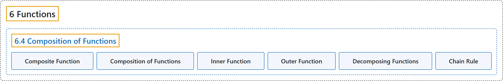

# 6.4 Composition of Functions

## Classification

## Glossary

| Term | Definition | 中文翻译 | Source |
|---|---|---|---|
| **6 Functions** 函数 | (No definition) | （无定义） | [Sundstrom, 2022, chapter 6](https://gvsuoer.github.io/sundstrom-textbook/C_functions.html) |
| **6.4 Composition of Functions** 函数的复合 | (No definition) | （无定义） | [Sundstrom, 2022, section 6.4](https://gvsuoer.github.io/sundstrom-textbook/S_compositionoffunctions.html) |
| **Composite Function** 复合函数 | "We often refer to the function $g \circ f$ as **a composite function**." | 我们常把函数 $g \circ f$ 称为**复合函数**。 | [Sundstrom, 2022, section 6.4](https://gvsuoer.github.io/sundstrom-textbook/S_compositionoffunctions.html#functioncomposition) |
| **Composition of Functions** 函数的复合 | "The composition of $\boldsymbol{f}$ and $\boldsymbol{g}$ is **the function** $g \circ f: A \to C$ **defined by** $( {g \circ f} )( x ) = g\left( {f( x )} \right)$ for all $x \in A\text{.}$" | $\boldsymbol{f}$ 与 $\boldsymbol{g}$ 的复合是**函数** $g \circ f: A \to C$，**定义为**对所有 $x \in A$，$( {g \circ f} )( x ) = g\left( {f( x )} \right)$。 | [Sundstrom, 2022, section 6.4](https://gvsuoer.github.io/sundstrom-textbook/S_compositionoffunctions.html#functioncomposition) |
| **Inner Function** 内层函数 | "It is helpful to think of the composite function $g \circ f$ as “$\boldsymbol{f}$ followed by $\boldsymbol{g}\text{.}$” We then **refer to** $f$ **as the inner function** and $g$ as the outer function." | 把复合函数 $g \circ f$ 看作“先 $\boldsymbol{f}$ 后 $\boldsymbol{g}$”会有帮助。于是**把** $f$ **称为内层函数**，把 $g$ 称为外层函数。 | [Sundstrom, 2022, section 6.4](https://gvsuoer.github.io/sundstrom-textbook/S_compositionoffunctions.html#p-4108) |
| **Outer Function** 外层函数 | "It is helpful to think of the composite function $g \circ f$ as “$\boldsymbol{f}$ followed by $\boldsymbol{g}\text{.}$” We then refer to $f$ as the inner function and $g$ **as the outer function**." | 把复合函数 $g \circ f$ 看作“先 $\boldsymbol{f}$ 后 $\boldsymbol{g}$”会有帮助。于是把 $f$ 称为内层函数，把 $g$ **称为外层函数**。 | [Sundstrom, 2022, section 6.4](https://gvsuoer.github.io/sundstrom-textbook/S_compositionoffunctions.html#p-4108) |
| **Decomposing Functions** 函数分解 | "The first step in the process is to **recognize a given function as a composite function**." | 这个过程的第一步是**把给定函数看成复合函数**。 | [Sundstrom, 2022, section 6.4](https://gvsuoer.github.io/sundstrom-textbook/S_compositionoffunctions.html#subsection-122) |
| **Chain Rule** 链式法则 | "We use the chain rule in calculus to **find the derivative of a composite function**." | 在微积分中，我们用链式法则来**求复合函数的导数**。 | [Sundstrom, 2022, section 6.4](https://gvsuoer.github.io/sundstrom-textbook/S_compositionoffunctions.html#subsection-122) |

## References

Sundstrom, T. (2022). *Mathematical reasoning: Writing and proof* (Version 2.1; PreTeXt edition by Grand Valley State University). Retrieved October 30, 2026, from <https://gvsuoer.github.io/sundstrom-textbook/frontmatter.html>
