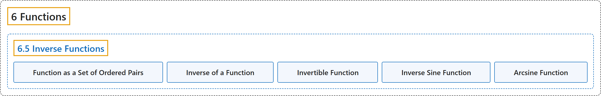

# 6.5 Inverse Functions

## Classification

## Glossary

| Term | Definition | 中文翻译 | Source |
|---|---|---|---|
| **6 Functions** 函数 | (No definition) | （无定义） | [Sundstrom, 2022, chapter 6](https://gvsuoer.github.io/sundstrom-textbook/C_functions.html) |
| **6.5 Inverse Functions** 反函数 | (No definition) | （无定义） | [Sundstrom, 2022, section 6.5](https://gvsuoer.github.io/sundstrom-textbook/S_inversefunctions.html) |
| **Function as a Set of Ordered Pairs** 作为有序对集合的函数 | "In Beginning Activity 1, we observed that if we have a function $f: A \to B\text{,}$ we can **generate a set of ordered pairs** $f$ that is a subset of $A \times B$ as follows: $f = \left\{ { {\left( {a, f( a )} \right)} \mid a \in A} \right\} \text{ or } f = \left\{ {( {a, b} ) \in A \times B \mid b = f( a )} \right\}\!\text{.}$" | 在开篇活动 1 中我们看到，若有函数 $f: A \to B$，就可以按如下方式**生成一个有序对集合** $f$，它是 $A \times B$ 的子集：$f = \left\{ { {\left( {a, f( a )} \right)} \mid a \in A} \right\} \text{ or } f = \left\{ {( {a, b} ) \in A \times B \mid b = f( a )} \right\}\!$ | [Sundstrom, 2022, section 6.5](https://gvsuoer.github.io/sundstrom-textbook/S_inversefunctions.html#subsection-124) |
| **Inverse of a Function** 反函数 | "The inverse of $\boldsymbol{f}$, denoted by $f^{ - 1}\text{,}$ is **the set of ordered pairs** $\left\{ { {( {b, a} ) \in B \times A} \mid f( a ) = b} \right\}\text{.}$" | $\boldsymbol{f}$ 的逆记作 $f^{ - 1}$，是**有序对的集合** $\left\{ { {( {b, a} ) \in B \times A} \mid f( a ) = b} \right\}$。 | [Sundstrom, 2022, section 6.5](https://gvsuoer.github.io/sundstrom-textbook/S_inversefunctions.html#inversefunction) |
| **Invertible Function** 可逆函数 | "In the situation where $f: A \to B$ is **a bijection** and $f^{ - 1}$ is **a function from** $B$ **to** $A\text{,}$ we can write $f^{ - 1} : B \to A\text{.}$ In this case, we frequently say that $f$ is an invertible function" | 当 $f: A \to B$ 是**双射**，且 $f^{ - 1}$ 是**从** $B$ **到** $A$ 的函数时，可以写 $f^{ - 1} : B \to A$。这时常说 $f$ 是可逆函数 | [Sundstrom, 2022, section 6.5](https://gvsuoer.github.io/sundstrom-textbook/S_inversefunctions.html#p-4267) |
| **Inverse Sine Function** 反正弦函数 | "The inverse of the function in Task 41.b is **itself a function** and is called the inverse sine function (or sometimes the arcsine function)." | 任务 41.b 中函数的逆**本身就是函数**，称为反正弦函数（有时也称 arcsin 函数）。 | [Sundstrom, 2022, section 6.5](https://gvsuoer.github.io/sundstrom-textbook/S_inversefunctions.html#A_inversesine) |
| **Arcsine Function** arcsin 函数 | "The inverse of the function in Task 41.b is **itself a function** and is called the inverse sine function (or sometimes the arcsine function)." | 任务 41.b 中函数的逆**本身就是函数**，称为反正弦函数（有时也称 arcsin 函数）。 | [Sundstrom, 2022, section 6.5](https://gvsuoer.github.io/sundstrom-textbook/S_inversefunctions.html#A_inversesine) |

## References

Sundstrom, T. (2022). *Mathematical reasoning: Writing and proof* (Version 2.1; PreTeXt edition by Grand Valley State University). Retrieved October 30, 2026, from <https://gvsuoer.github.io/sundstrom-textbook/frontmatter.html>
