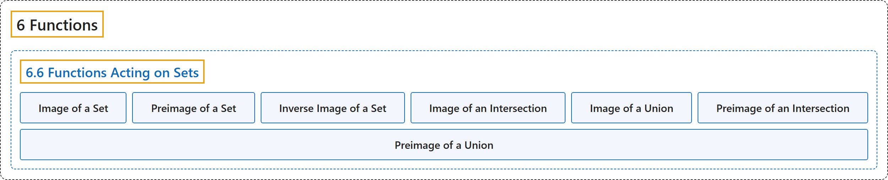

# 6.6 Functions Acting on Sets

## Classification

## Glossary

| Term | Definition | 中文翻译 | Source |
|---|---|---|---|
| **6 Functions** 函数 | (No definition) | （无定义） | [Sundstrom, 2022, chapter 6](https://gvsuoer.github.io/sundstrom-textbook/C_functions.html) |
| **6.6 Functions Acting on Sets** 作用于集合的函数 | (No definition) | （无定义） | [Sundstrom, 2022, section 6.6](https://gvsuoer.github.io/sundstrom-textbook/S_functionsonsets.html) |
| **Image of a Set** 集合的像 | "Let $f: S \to T\text{.}$ If $A \subseteq S\text{,}$ then the image of $\boldsymbol{A}$ under $\boldsymbol{f}$ is the set $f ( A )\text{,}$ where $f ( A ) = \left\{f ( x ) \mid x \in A \right\}\!\text{.}$" | 设 $f: S \to T$。若 $A \subseteq S$，则 $\boldsymbol{A}$ 在 $\boldsymbol{f}$ 下的像是集合 $f ( A )$，其中 $f ( A ) = \left\{f ( x ) \mid x \in A \right\}\!$。 | [Sundstrom, 2022, section 6.6](https://gvsuoer.github.io/sundstrom-textbook/S_functionsonsets.html#imageofA) |
| **Preimage of a Set** 集合的原像 | "Let $f: S \to T\text{.}$ If $C \subseteq T\text{,}$ then the preimage of $\boldsymbol{C}$ under $\boldsymbol{f}$ is the set $f^{-1} ( C )\text{,}$ where $f^{-1} ( C ) = \left\{x \in S \mid f ( x ) \in C \right\}\text{.}$" | 设 $f: S \to T$。若 $C \subseteq T$，则 $\boldsymbol{C}$ 在 $\boldsymbol{f}$ 下的原像是集合 $f^{-1} ( C )$，其中 $f^{-1} ( C ) = \left\{x \in S \mid f ( x ) \in C \right\}$。 | [Sundstrom, 2022, section 6.6](https://gvsuoer.github.io/sundstrom-textbook/S_functionsonsets.html#inverseimage) |
| **Inverse Image of a Set** 集合的逆像 | "The preimage of the set $C$ under $f$ is **also called the inverse image** of $\boldsymbol{C}$ under $\boldsymbol{f}$." | 集合 $C$ 在 $f$ 下的原像**也称为逆像**（$\boldsymbol{C}$ 在 $\boldsymbol{f}$ 下的逆像）。 | [Sundstrom, 2022, section 6.6](https://gvsuoer.github.io/sundstrom-textbook/S_functionsonsets.html#inverseimage) |
| **Image of an Intersection** 交集的像 | "$\displaystyle f ( A \cap B ) \subseteq f ( A ) \cap f ( B )$" | $\displaystyle f ( A \cap B ) \subseteq f ( A ) \cap f ( B )$ | [Sundstrom, 2022, section 6.6](https://gvsuoer.github.io/sundstrom-textbook/S_functionsonsets.html#T_imageofoperations1) |
| **Image of a Union** 并集的像 | "$\displaystyle f ( A \cup B ) = f ( A ) \cup f ( B )$" | $\displaystyle f ( A \cup B ) = f ( A ) \cup f ( B )$ | [Sundstrom, 2022, section 6.6](https://gvsuoer.github.io/sundstrom-textbook/S_functionsonsets.html#T_imageofoperations2) |
| **Preimage of an Intersection** 交集的原像 | "$\displaystyle f^{-1} ( C \cap D ) = f^{-1} ( C ) \cap f^{-1} ( D )$" | $\displaystyle f^{-1} ( C \cap D ) = f^{-1} ( C ) \cap f^{-1} ( D )$ | [Sundstrom, 2022, section 6.6](https://gvsuoer.github.io/sundstrom-textbook/S_functionsonsets.html#T_invimageofoperations1) |
| **Preimage of a Union** 并集的原像 | "$\displaystyle f^{-1} ( C \cup D ) = f^{-1} ( C ) \cup f^{-1} ( D )$" | $\displaystyle f^{-1} ( C \cup D ) = f^{-1} ( C ) \cup f^{-1} ( D )$ | [Sundstrom, 2022, section 6.6](https://gvsuoer.github.io/sundstrom-textbook/S_functionsonsets.html#T_invimageofoperations2) |

## References

Sundstrom, T. (2022). *Mathematical reasoning: Writing and proof* (Version 2.1; PreTeXt edition by Grand Valley State University). Retrieved October 30, 2026, from <https://gvsuoer.github.io/sundstrom-textbook/frontmatter.html>
