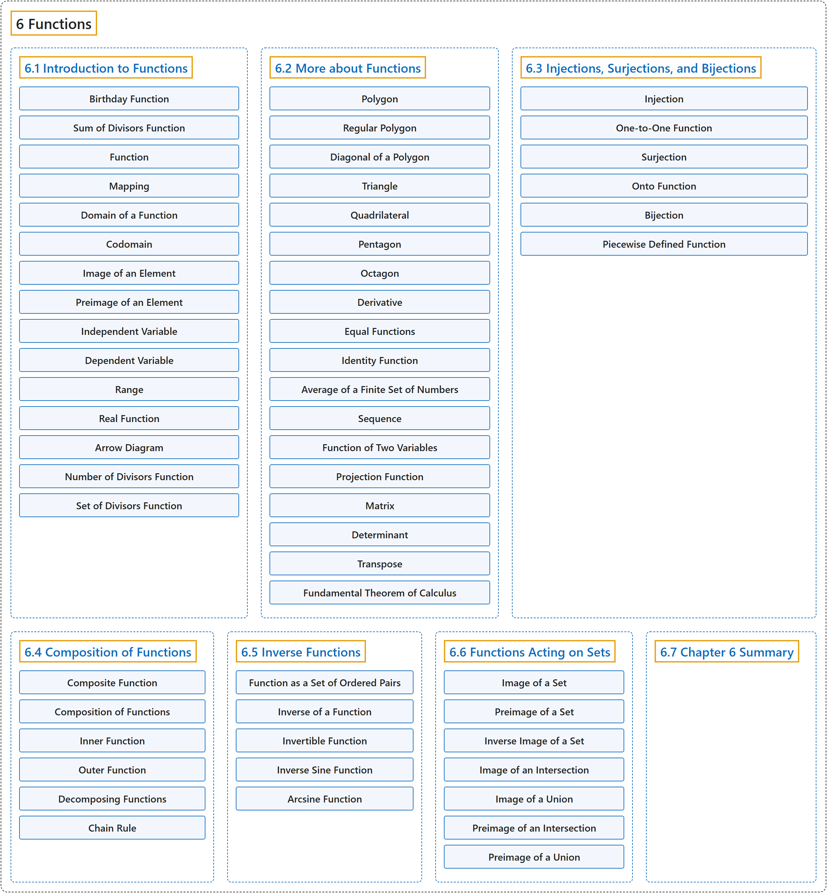

# 6 Functions

## Classification

## Glossary

| Term | Definition | 中文翻译 | Source |
|---|---|---|---|
| **6 Functions** 函数 | (No definition) | （无定义） | [Sundstrom, 2022, chapter 6](https://gvsuoer.github.io/sundstrom-textbook/C_functions.html) |
| **[6.1 Introduction to Functions](6-1-introduction-to-functions.md)** 函数入门 | (No definition) | （无定义） | [Sundstrom, 2022, section 6.1](https://gvsuoer.github.io/sundstrom-textbook/S_introfunctions.html) |
| **[6.2 More about Functions](6-2-more-about-functions.md)** 函数的更多内容 | (No definition) | （无定义） | [Sundstrom, 2022, section 6.2](https://gvsuoer.github.io/sundstrom-textbook/S_moreaboutfunctions.html) |
| **[6.3 Injections, Surjections, and Bijections](6-3-injections-surjections-and-bijections.md)** 单射、满射与双射 | (No definition) | （无定义） | [Sundstrom, 2022, section 6.3](https://gvsuoer.github.io/sundstrom-textbook/S_typesoffunctions.html) |
| **[6.4 Composition of Functions](6-4-composition-of-functions.md)** 函数的复合 | (No definition) | （无定义） | [Sundstrom, 2022, section 6.4](https://gvsuoer.github.io/sundstrom-textbook/S_compositionoffunctions.html) |
| **[6.5 Inverse Functions](6-5-inverse-functions.md)** 反函数 | (No definition) | （无定义） | [Sundstrom, 2022, section 6.5](https://gvsuoer.github.io/sundstrom-textbook/S_inversefunctions.html) |
| **[6.6 Functions Acting on Sets](6-6-functions-acting-on-sets.md)** 作用于集合的函数 | (No definition) | （无定义） | [Sundstrom, 2022, section 6.6](https://gvsuoer.github.io/sundstrom-textbook/S_functionsonsets.html) |
| **[6.7 Chapter 6 Summary](6-7-chapter-6-summary.md)** 第 6 章小结 | (No definition) | （无定义） | [Sundstrom, 2022, section 6.7](https://gvsuoer.github.io/sundstrom-textbook/S_6summary.html) |

## References

Sundstrom, T. (2022). *Mathematical reasoning: Writing and proof* (Version 2.1; PreTeXt edition by Grand Valley State University). Retrieved October 30, 2026, from <https://gvsuoer.github.io/sundstrom-textbook/frontmatter.html>
