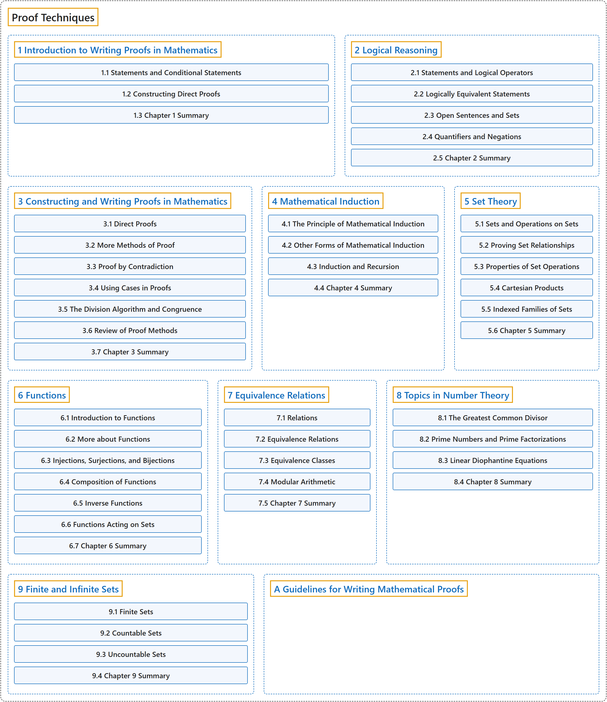

# Proof Techniques

## Classification

## Glossary

| Term | Definition | 中文翻译 | Source |
|---|---|---|---|
| **Proof Techniques** 证明技巧 | (context) "This textbook is designed for the first course in the college mathematics curriculum that introduces students to the process of **constructing and writing proofs**." | （语境）本教材面向大学数学课程中的第一门课，向学生介绍**构造和书写证明**的过程。 | [Sundstrom, n.d.](https://www.tedsundstrom.com/mathematical-reasoning-writing-and-proof) |
| **[1 Introduction to Writing Proofs in Mathematics](introduction-to-writing-proofs-in-mathematics/index.md)** 数学证明写作入门 | (No definition) | （无定义） | [Sundstrom, 2022, chapter 1](https://gvsuoer.github.io/sundstrom-textbook/C_1intro.html) |
| **[2 Logical Reasoning](logical-reasoning/index.md)** 逻辑推理 | (No definition) | （无定义） | [Sundstrom, 2022, chapter 2](https://gvsuoer.github.io/sundstrom-textbook/C_2logic.html) |
| **[3 Constructing and Writing Proofs in Mathematics](constructing-and-writing-proofs-in-mathematics/index.md)** 构造与书写数学证明 | (No definition) | （无定义） | [Sundstrom, 2022, chapter 3](https://gvsuoer.github.io/sundstrom-textbook/C_proofs.html) |
| **[4 Mathematical Induction](mathematical-induction/index.md)** 数学归纳法 | (No definition) | （无定义） | [Sundstrom, 2022, chapter 4](https://gvsuoer.github.io/sundstrom-textbook/C_induction.html) |
| **[5 Set Theory](set-theory/index.md)** 集合论 | (No definition) | （无定义） | [Sundstrom, 2022, chapter 5](https://gvsuoer.github.io/sundstrom-textbook/C_settheory.html) |
| **[6 Functions](functions/index.md)** 函数 | (No definition) | （无定义） | [Sundstrom, 2022, chapter 6](https://gvsuoer.github.io/sundstrom-textbook/C_functions.html) |
| **[7 Equivalence Relations](equivalence-relations/index.md)** 等价关系 | (No definition) | （无定义） | [Sundstrom, 2022, chapter 7](https://gvsuoer.github.io/sundstrom-textbook/C_equivrelations.html) |
| **[8 Topics in Number Theory](topics-in-number-theory/index.md)** 数论专题 | (No definition) | （无定义） | [Sundstrom, 2022, chapter 8](https://gvsuoer.github.io/sundstrom-textbook/C_numbertheory.html) |
| **[9 Finite and Infinite Sets](finite-and-infinite-sets/index.md)** 有限集与无限集 | (No definition) | （无定义） | [Sundstrom, 2022, chapter 9](https://gvsuoer.github.io/sundstrom-textbook/C_topicsinsets.html) |
| **[A Guidelines for Writing Mathematical Proofs](a-guidelines-for-writing-mathematical-proofs.md)** 数学证明写作指南 | (No definition) | （无定义） | [Sundstrom, 2022, appendix A](https://gvsuoer.github.io/sundstrom-textbook/C_writingguides.html) |

## References

Sundstrom, T. (2022). *Mathematical reasoning: Writing and proof* (Version 2.1; PreTeXt edition by Grand Valley State University). Retrieved October 30, 2026, from <https://gvsuoer.github.io/sundstrom-textbook/frontmatter.html>

Sundstrom, T. (n.d.). *Mathematical reasoning: Writing and proof*. Retrieved October 30, 2026, from <https://www.tedsundstrom.com/mathematical-reasoning-writing-and-proof>
