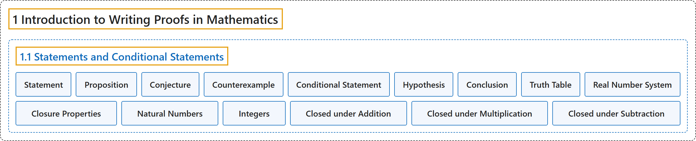

# 1.1 Statements and Conditional Statements

## Classification

## Glossary

| Term | Definition | 中文翻译 | Source |
|---|---|---|---|
| **1 Introduction to Writing Proofs in Mathematics** 数学证明写作入门 | (No definition) | （无定义） | [Sundstrom, 2022, chapter 1](https://gvsuoer.github.io/sundstrom-textbook/C_1intro.html) |
| **1.1 Statements and Conditional Statements** 陈述与条件陈述 | (No definition) | （无定义） | [Sundstrom, 2022, section 1.1](https://gvsuoer.github.io/sundstrom-textbook/S_1prop.html) |
| **Statement** 陈述 | "In mathematics, a statement is **a declarative sentence that must have a definite truth value**, **either true or false but not both**." | 在数学中，陈述是**必须有确定真值的陈述句**，**要么真要么假，不能两者都是**。 | [Sundstrom, 2022, section 1.1](https://gvsuoer.github.io/sundstrom-textbook/S_1prop.html#PA_prop) |
| **Proposition** 命题 | "A statement is **sometimes called a proposition**." | 陈述**有时也称为命题**。 | [Sundstrom, 2022, section 1.1](https://gvsuoer.github.io/sundstrom-textbook/S_1prop.html#p-79) |
| **Conjecture** 猜想 | "When we **make a guess in mathematics**, we usually call it a conjecture." | 当我们**在数学中做出猜测**时，通常称它为猜想。 | [Sundstrom, 2022, section 1.1](https://gvsuoer.github.io/sundstrom-textbook/S_1prop.html#li-39) |
| **Counterexample** 反例 | "In this way, we can gather information that provides evidence that a statement is true, or we might find **an example that shows the statement is false**. This type of example is called a counterexample." | 这样我们可以收集证据说明某个陈述为真，也可能找到**说明该陈述为假的例子**。这类例子称为反例。 | [Sundstrom, 2022, section 1.1](https://gvsuoer.github.io/sundstrom-textbook/S_1prop.html#li-40) |
| **Conditional Statement** 条件陈述 | "A conditional statement is a statement that **can be written in the form “If** $P$ **then** $Q\text{,}$” where $P$ and $Q$ are sentences." | 条件陈述是**能写成“如果** $P$ **那么** $Q$”形式的陈述，其中 $P$ 和 $Q$ 是语句。 | [Sundstrom, 2022, section 1.1](https://gvsuoer.github.io/sundstrom-textbook/S_1prop.html#D_conditional) |
| **Hypothesis** 假设 | "For this conditional statement, $P$ is **called the hypothesis** and $Q$ is called the conclusion." | 对这个条件陈述，$P$ **称为假设**，$Q$ 称为结论。 | [Sundstrom, 2022, section 1.1](https://gvsuoer.github.io/sundstrom-textbook/S_1prop.html#D_conditional) |
| **Conclusion** 结论 | "For this conditional statement, $P$ is called the hypothesis and $Q$ is **called the conclusion**." | 对这个条件陈述，$P$ 称为假设，$Q$ **称为结论**。 | [Sundstrom, 2022, section 1.1](https://gvsuoer.github.io/sundstrom-textbook/S_1prop.html#D_conditional) |
| **Truth Table** 真值表 | "This is summarized in Table 1.3, which is called **a truth table for the conditional statement** $P \to Q\text{.}$" | 这一点总结在表 1.3 中，它称为**条件陈述 $P \to Q$ 的真值表**。 | [Sundstrom, 2022, section 1.1](https://gvsuoer.github.io/sundstrom-textbook/S_1prop.html#p-150) |
| **Real Number System** 实数系 | "The primary number system used in algebra and calculus is the real number system. We usually use the symbol $\mathbb{R}$ to stand for the set of all real numbers. The real numbers **consist of the rational numbers and the irrational numbers**." | 代数和微积分中使用的主要数系是实数系。我们通常用符号 $\mathbb{R}$ 表示全体实数的集合。实数**由有理数和无理数组成**。 | [Sundstrom, 2022, section 1.1](https://gvsuoer.github.io/sundstrom-textbook/S_1prop.html#p-186) |
| **Closure Properties** 封闭性 | "Notice that these so-called closure properties are **defined in terms of conditional statements**." | 注意，这些所谓的封闭性是**用条件陈述来定义的**。 | [Sundstrom, 2022, section 1.1](https://gvsuoer.github.io/sundstrom-textbook/S_1prop.html#p-186) |
| **Natural Numbers** 自然数 | "The natural numbers **consist of the positive whole numbers** such as 1, 2, 3, 107, and 203." | 自然数**由正整数组成**，例如 1、2、3、107 和 203。 | [Sundstrom, 2022, section 1.1](https://gvsuoer.github.io/sundstrom-textbook/S_1prop.html#p-187) |
| **Integers** 整数 | "The integers **consist of zero, the natural numbers, and the negatives of the natural numbers**." | 整数**由零、自然数和自然数的相反数组成**。 | [Sundstrom, 2022, section 1.1](https://gvsuoer.github.io/sundstrom-textbook/S_1prop.html#p-187) |
| **Closed under Addition** 对加法封闭 | "Three of the basic properties of the integers are that the set $\mathbb{Z}$ is **closed under addition**, the set $\mathbb{Z}$ is closed under multiplication, and the set of integers is closed under subtraction. This means that If $x$ and $y$ are integers, then $x + y$ **is an integer**;" | 整数的三个基本性质是：集合 $\mathbb{Z}$ **对加法封闭**，对乘法封闭，整数集对减法封闭。这意味着：如果 $x$ 和 $y$ 是整数，那么 $x + y$ **是整数**； | [Sundstrom, 2022, section 1.1](https://gvsuoer.github.io/sundstrom-textbook/S_1prop.html#p-188) |
| **Closed under Multiplication** 对乘法封闭 | "Three of the basic properties of the integers are that the set $\mathbb{Z}$ is closed under addition, the set $\mathbb{Z}$ is **closed under multiplication**, and the set of integers is closed under subtraction. This means that If $x$ and $y$ are integers, then $x + y$ is an integer; If $x$ and $y$ are integers, then $x \cdot y$ **is an integer**;" | 整数的三个基本性质是：集合 $\mathbb{Z}$ 对加法封闭，**对乘法封闭**，整数集对减法封闭。这意味着：如果 $x$ 和 $y$ 是整数，那么 $x + y$ 是整数；如果 $x$ 和 $y$ 是整数，那么 $x \cdot y$ **是整数**； | [Sundstrom, 2022, section 1.1](https://gvsuoer.github.io/sundstrom-textbook/S_1prop.html#p-188) |
| **Closed under Subtraction** 对减法封闭 | "Three of the basic properties of the integers are that the set $\mathbb{Z}$ is closed under addition, the set $\mathbb{Z}$ is closed under multiplication, and the set of integers is **closed under subtraction**. This means that If $x$ and $y$ are integers, then $x + y$ is an integer; If $x$ and $y$ are integers, then $x \cdot y$ is an integer; and If $x$ and $y$ are integers, then $x - y$ **is an integer**." | 整数的三个基本性质是：集合 $\mathbb{Z}$ 对加法封闭，对乘法封闭，整数集**对减法封闭**。这意味着：如果 $x$ 和 $y$ 是整数，那么 $x + y$ 是整数；如果 $x$ 和 $y$ 是整数，那么 $x \cdot y$ 是整数；如果 $x$ 和 $y$ 是整数，那么 $x - y$ **是整数**。 | [Sundstrom, 2022, section 1.1](https://gvsuoer.github.io/sundstrom-textbook/S_1prop.html#p-188) |

## References

Sundstrom, T. (2022). *Mathematical reasoning: Writing and proof* (Version 2.1; PreTeXt edition by Grand Valley State University). Retrieved October 30, 2026, from <https://gvsuoer.github.io/sundstrom-textbook/frontmatter.html>
