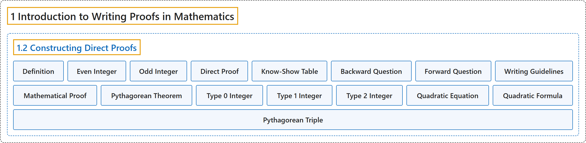

# 1.2 Constructing Direct Proofs

## Classification

## Glossary

| Term | Definition | 中文翻译 | Source |
|---|---|---|---|
| **1 Introduction to Writing Proofs in Mathematics** 数学证明写作入门 | (No definition) | （无定义） | [Sundstrom, 2022, chapter 1](https://gvsuoer.github.io/sundstrom-textbook/C_1intro.html) |
| **1.2 Constructing Direct Proofs** 构造直接证明 | (No definition) | （无定义） | [Sundstrom, 2022, section 1.2](https://gvsuoer.github.io/sundstrom-textbook/S_1direct.html) |
| **Definition** 定义 | "A definition is **an agreement that a particular word or phrase will stand for some object, property, or other concept** that we expect to refer to often." | 定义是**约定某个词或短语代表某个对象、性质或其他概念**，这些是我们预计会经常提到的。 | [Sundstrom, 2022, section 1.2](https://gvsuoer.github.io/sundstrom-textbook/S_1direct.html#PA_even) |
| **Even Integer** 偶数 | "An integer $a$ is an even integer provided that **there exists an integer** $n$ **such that** $a = 2n\text{.}$" | 如果**存在整数** $n$ **使得** $a = 2n$，整数 $a$ 就是偶数。 | [Sundstrom, 2022, section 1.2](https://gvsuoer.github.io/sundstrom-textbook/S_1direct.html#D_even) |
| **Odd Integer** 奇数 | "An integer $a$ is an odd integer provided **there exists an integer** $n$ **such that** $a = 2n + 1\text{.}$" | 如果**存在整数** $n$ **使得** $a = 2n + 1$，整数 $a$ 就是奇数。 | [Sundstrom, 2022, section 1.2](https://gvsuoer.github.io/sundstrom-textbook/S_1direct.html#D_even) |
| **Direct Proof** 直接证明 | "A direct proof of a conditional statement is **a demonstration that the conclusion of the conditional statement follows logically from the hypothesis** of the conditional statement." | 条件陈述的直接证明是**说明条件陈述的结论可以从假设逻辑地推出**。 | [Sundstrom, 2022, section 1.2](https://gvsuoer.github.io/sundstrom-textbook/S_1direct.html#PA_thinking) |
| **Know-Show Table** 已知-求证表 | "This method will involve **working forward from the hypothesis**, $P\text{,}$ and **backward from the conclusion**, $Q\text{.}$ We will use a device called the know-show table to **help organize our thoughts and the steps of the proof**." | 这种方法包括**从假设出发向前推**（$P$）和**从结论出发向后推**（$Q$）。我们用一种叫已知-求证表的工具来**帮助整理思路和证明步骤**。 | [Sundstrom, 2022, section 1.2](https://gvsuoer.github.io/sundstrom-textbook/S_1direct.html#p-333) |
| **Backward Question** 逆向问题 | "We usually start with the conclusion that we are trying to prove by asking a so-called backward question. The basic form of the question is, “**Under what conditions can we conclude that** $Q$ **is true?**”" | 我们通常从要证明的结论出发，提出所谓的逆向问题。问题的基本形式是：“**在什么条件下可以断定** $Q$ **为真**？” | [Sundstrom, 2022, section 1.2](https://gvsuoer.github.io/sundstrom-textbook/S_1direct.html#p-336) |
| **Forward Question** 正向问题 | "To do this, we work forward from step $P\text{,}$ and this involves asking a forward question. The basic form of this type of question is, “**What can we conclude from the fact that** $P$ **is true?**”" | 为此，我们从步骤 $P$ 向前推，这需要提出正向问题。这类问题的基本形式是：“**从** $P$ **为真这一事实能得出什么结论**？” | [Sundstrom, 2022, section 1.2](https://gvsuoer.github.io/sundstrom-textbook/S_1direct.html#p-339) |
| **Writing Guidelines** 写作指南 | "At the risk of oversimplification, doing mathematics can be considered to have **two distinct stages**. The first stage is **to convince yourself that you have solved the problem or proved a conjecture**." | 冒着过于简化的风险，可以认为做数学有**两个不同阶段**。第一阶段是**让自己相信已经解决了问题或证明了猜想**。 | [Sundstrom, 2022, section 1.2](https://gvsuoer.github.io/sundstrom-textbook/S_1direct.html#subsection-8) |
| **Mathematical Proof** 数学证明 | "A mathematical proof is **a convincing argument** (within the accepted standards of the mathematical community) **that a certain mathematical statement is necessarily true**." | 数学证明是**一个令人信服的论证**（符合数学界公认的标准），**说明某个数学陈述必然为真**。 | [Sundstrom, 2022, section 1.2](https://gvsuoer.github.io/sundstrom-textbook/S_1direct.html#p-351) |
| **Pythagorean Theorem** 勾股定理 | "The Pythagorean Theorem for right triangles states that **if** $a$ and $b$ are **the lengths of the legs of a right triangle** and $c$ is **the length of the hypotenuse**, **then** $a^2 + b^2 = c^2$" | 直角三角形的勾股定理指出：**如果** $a$ 和 $b$ 是**直角三角形两条直角边的长**，$c$ 是**斜边的长**，**那么** $a^2 + b^2 = c^2$ | [Sundstrom, 2022, section 1.2](https://gvsuoer.github.io/sundstrom-textbook/S_1direct.html#pr_pythag) |
| **Type 0 Integer** 0 型整数 | "An integer $a$ is said to be a type 0 integer if **there exists an integer** $n$ **such that** $a=3n\text{.}$" | 如果**存在整数** $n$ **使得** $a=3n$，就说整数 $a$ 是 0 型整数。 | [Sundstrom, 2022, section 1.2](https://gvsuoer.github.io/sundstrom-textbook/S_1direct.html#exer_sec12-type) |
| **Type 1 Integer** 1 型整数 | "An integer $a$ is said to be a type 1 integer if **there exists an integer** $n$ **such that** $a=3n+1\text{.}$" | 如果**存在整数** $n$ **使得** $a=3n+1$，就说整数 $a$ 是 1 型整数。 | [Sundstrom, 2022, section 1.2](https://gvsuoer.github.io/sundstrom-textbook/S_1direct.html#exer_sec12-type) |
| **Type 2 Integer** 2 型整数 | "An integer $a$ is said to be a type 2 integer if **there exists an integer** $m$ **such that** $a=3m+2\text{.}$" | 如果**存在整数** $m$ **使得** $a=3m+2$，就说整数 $a$ 是 2 型整数。 | [Sundstrom, 2022, section 1.2](https://gvsuoer.github.io/sundstrom-textbook/S_1direct.html#exer_sec12-type) |
| **Quadratic Equation** 二次方程 | "Let $a\text{,}$ $b\text{,}$ and $c$ be real numbers with $a \ne 0\text{.}$ The solutions of **the quadratic equation** $ax^2 + bx + c = 0$ are given by the quadratic formula" | 设 $a$、$b$ 和 $c$ 是实数，$a \ne 0$。**二次方程** $ax^2 + bx + c = 0$ 的解由求根公式给出 | [Sundstrom, 2022, section 1.2](https://gvsuoer.github.io/sundstrom-textbook/S_1direct.html#exer_sec12-11) |
| **Quadratic Formula** 二次方程求根公式 | "The solutions of the quadratic equation $ax^2 + bx + c = 0$ are given by the quadratic formula, which states that **the solutions are** $x_1$ and $x_2\text{,}$ where $x_1 = \frac{-b + \sqrt{b^2 - 4ac}}{2a} \text{ and } x_2 = \frac{-b - \sqrt{b^2 - 4ac}}{2a}\text{.}$" | 二次方程 $ax^2 + bx + c = 0$ 的解由求根公式给出，该公式指出**方程的解为** $x_1$ 和 $x_2$，其中 $x_1 = \frac{-b + \sqrt{b^2 - 4ac}}{2a} \text{ and } x_2 = \frac{-b - \sqrt{b^2 - 4ac}}{2a}$。 | [Sundstrom, 2022, section 1.2](https://gvsuoer.github.io/sundstrom-textbook/S_1direct.html#exer_sec12-11) |
| **Pythagorean Triple** 勾股数组 | "Three natural numbers $a\text{,}$ $b\text{,}$ and $c$ with $a \lt b \lt c$ are said to form a Pythagorean triple provided that $a^2 + b^2 = c^2\text{.}$" | 三个自然数 $a$、$b$ 和 $c$（$a \lt b \lt c$），如果满足 $a^2 + b^2 = c^2$，就说它们构成勾股数组。 | [Sundstrom, 2022, section 1.2](https://gvsuoer.github.io/sundstrom-textbook/S_1direct.html#exer_pythag) |

## References

Sundstrom, T. (2022). *Mathematical reasoning: Writing and proof* (Version 2.1; PreTeXt edition by Grand Valley State University). Retrieved October 30, 2026, from <https://gvsuoer.github.io/sundstrom-textbook/frontmatter.html>
