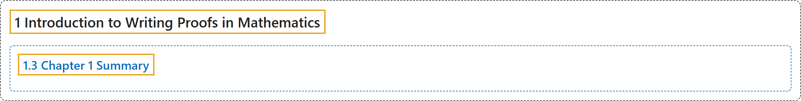

# 1.3 Chapter 1 Summary

## Classification

## Glossary

| Term | Definition | 中文翻译 | Source |
|---|---|---|---|
| **1 Introduction to Writing Proofs in Mathematics** 数学证明写作入门 | (No definition) | （无定义） | [Sundstrom, 2022, chapter 1](https://gvsuoer.github.io/sundstrom-textbook/C_1intro.html) |
| **1.3 Chapter 1 Summary** 第 1 章小结 | (No definition) | （无定义） | [Sundstrom, 2022, section 1.3](https://gvsuoer.github.io/sundstrom-textbook/S_1summary.html) |

## References

Sundstrom, T. (2022). *Mathematical reasoning: Writing and proof* (Version 2.1; PreTeXt edition by Grand Valley State University). Retrieved October 30, 2026, from <https://gvsuoer.github.io/sundstrom-textbook/frontmatter.html>
