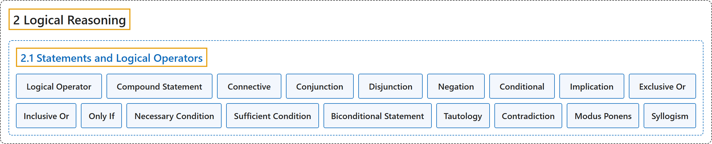

# 2.1 Statements and Logical Operators

## Classification

## Glossary

| Term | Definition | 中文翻译 | Source |
|---|---|---|---|
| **2 Logical Reasoning** 逻辑推理 | (No definition) | （无定义） | [Sundstrom, 2022, chapter 2](https://gvsuoer.github.io/sundstrom-textbook/C_2logic.html) |
| **2.1 Statements and Logical Operators** 陈述与逻辑运算符 | (No definition) | （无定义） | [Sundstrom, 2022, section 2.1](https://gvsuoer.github.io/sundstrom-textbook/S_2logop.html) |
| **Logical Operator** 逻辑运算符 | "A logical operator (or connective) on mathematical statements is **a word or combination of words that combines one or more mathematical statements to make a new mathematical statement**." | 数学陈述上的逻辑运算符（或联结词）是**把一个或多个数学陈述组合成新数学陈述的词或词组**。 | [Sundstrom, 2022, section 2.1](https://gvsuoer.github.io/sundstrom-textbook/S_2logop.html#PA_compound) |
| **Compound Statement** 复合陈述 | "A compound statement is **a statement that contains one or more operators**." | 复合陈述是**含有一个或多个运算符的陈述**。 | [Sundstrom, 2022, section 2.1](https://gvsuoer.github.io/sundstrom-textbook/S_2logop.html#PA_compound) |
| **Connective** 联结词 | "A logical operator (or connective) on mathematical statements is **a word or combination of words that combines one or more mathematical statements to make a new mathematical statement**." | 数学陈述上的逻辑运算符（或联结词）是**把一个或多个数学陈述组合成新数学陈述的词或词组**。 | [Sundstrom, 2022, section 2.1](https://gvsuoer.github.io/sundstrom-textbook/S_2logop.html#PA_compound) |
| **Conjunction** 合取 | "The conjunction of the statements $P$ and $Q$ is the statement “$P$ **and** $Q$” and its denoted by $P \wedge Q$. The statement $P \wedge Q$ is **true only when both** $P$ and $Q$ are true." | 陈述 $P$ 与 $Q$ 的合取是陈述“$P$ **且** $Q$”，记作 $P \wedge Q$。陈述 $P \wedge Q$ **只有在两者都为真时才为真**，即 $P$ 和 $Q$ 都为真。 | [Sundstrom, 2022, section 2.1](https://gvsuoer.github.io/sundstrom-textbook/S_2logop.html#sym_and) |
| **Disjunction** 析取 | "The disjunction of the statements $P$ and $Q$ is the statement “$P$ **or** $Q$” and its denoted by $P \vee Q\text{.}$ The statement $P \vee Q$ is **true only when at least one** of $P$ or $Q$ is true." | 陈述 $P$ 与 $Q$ 的析取是陈述“$P$ **或** $Q$”，记作 $P \vee Q$。陈述 $P \vee Q$ **只有在至少一个为真时才为真**，即 $P$ 或 $Q$ 中至少一个为真。 | [Sundstrom, 2022, section 2.1](https://gvsuoer.github.io/sundstrom-textbook/S_2logop.html#sym_or) |
| **Negation** 否定 | "The negation of the statement $P$ is **the statement “not** $P$” and is denoted by $\neg P$. The negation of $P$ is **true only when** $P$ **is false**, and $\neg P$ is false only when $P$ is true." | 陈述 $P$ 的否定是**陈述“非** $P$”，记作 $\neg P$。$P$ 的否定**只有在** $P$ **为假时才为真**，而 $\neg P$ 只有在 $P$ 为真时才为假。 | [Sundstrom, 2022, section 2.1](https://gvsuoer.github.io/sundstrom-textbook/S_2logop.html#sym_not) |
| **Conditional** 条件式 | "The implication or conditional is **the statement “If** $P$ **then** $Q$” and is denoted by $P \to Q$. The statement $P \to Q$ is often read as “$P$ implies $Q\text{,}$” and we have seen in Section 1.1 that $P \to Q$ is **false only when** $P$ **is true and** $Q$ **is false**." | 蕴涵或条件式是**陈述“如果** $P$ **那么** $Q$”，记作 $P \to Q$。陈述 $P \to Q$ 常读作“$P$ 蕴涵 $Q$”，我们在 1.1 节看到 $P \to Q$ **只有在** $P$ **为真且** $Q$ **为假时才为假**。 | [Sundstrom, 2022, section 2.1](https://gvsuoer.github.io/sundstrom-textbook/S_2logop.html#sym_cond2) |
| **Implication** 蕴涵 | "The implication or conditional is **the statement “If** $P$ **then** $Q$” and is denoted by $P \to Q$. The statement $P \to Q$ is often read as “$P$ **implies** $Q\text{,}$”" | 蕴涵或条件式是**陈述“如果** $P$ **那么** $Q$”，记作 $P \to Q$。陈述 $P \to Q$ 常读作“$P$ **蕴涵** $Q$”。 | [Sundstrom, 2022, section 2.1](https://gvsuoer.github.io/sundstrom-textbook/S_2logop.html#sym_cond2) |
| **Exclusive Or** 不可兼或 | "A different use of the word “or” is the “exclusive or.” For the exclusive or, **the resulting statement is false when both statements are true**. That is, “$P$ exclusive or $Q$” is **true only when exactly one** of $P$ or $Q$ is true." | “或”的另一种用法是“不可兼或”。对不可兼或，**两个陈述都为真时，所得陈述为假**。也就是说，“$P$ 不可兼或 $Q$”**只有在恰好一个为真时才为真**，即 $P$ 或 $Q$ 中恰好一个为真。 | [Sundstrom, 2022, section 2.1](https://gvsuoer.github.io/sundstrom-textbook/S_2logop.html#paragraphs-8) |
| **Inclusive Or** 可兼或 | "In mathematics, we use the “inclusive or” unless stated otherwise. This means that $P \vee Q$ is **true when both** $P$ and $Q$ are true **and also when only one of them is true**." | 在数学中，除非另有说明，我们使用“可兼或”。这意味着 $P \vee Q$ **在两者都为真时为真**（$P$ 和 $Q$ 都为真），**在只有其中一个为真时也为真**。 | [Sundstrom, 2022, section 2.1](https://gvsuoer.github.io/sundstrom-textbook/S_2logop.html#paragraphs-8) |
| **Only If** 仅当 | "Following are some common ways to express the conditional statement $P \to Q$ in the English language: If $P\text{,}$ then $Q\text{.}$ $P$ implies $Q\text{.}$ $P$ **only if** $Q\text{.}$" | 下面是英语中表达条件陈述 $P \to Q$ 的一些常见方式：如果 $P$，那么 $Q$。$P$ 蕴涵 $Q$。$P$ **仅当** $Q$。 | [Sundstrom, 2022, section 2.1](https://gvsuoer.github.io/sundstrom-textbook/S_2logop.html#li-113) |
| **Necessary Condition** 必要条件 | "$Q$ is **necessary** for $P\text{.}$ (This means that **if** $P$ **is true, then** $Q$ **is necessarily true**.)" | $Q$ 对 $P$ 是**必要的**。（这意味着**如果** $P$ **为真，那么** $Q$ **必然为真**。） | [Sundstrom, 2022, section 2.1](https://gvsuoer.github.io/sundstrom-textbook/S_2logop.html#li-117) |
| **Sufficient Condition** 充分条件 | "$P$ is **sufficient** for $Q\text{.}$ (This means that **if you want** $Q$ **to be true, it is sufficient to show that** $P$ **is true**.)" | $P$ 对 $Q$ 是**充分的**。（这意味着**如果要** $Q$ **为真，只需证明** $P$ **为真**。） | [Sundstrom, 2022, section 2.1](https://gvsuoer.github.io/sundstrom-textbook/S_2logop.html#li-118) |
| **Biconditional Statement** 双条件陈述 | "The symbolic form for the biconditional statement “$P$ **if and only if** $Q$” is $P \leftrightarrow Q\text{.}$" | 双条件陈述“$P$ **当且仅当** $Q$”的符号形式是 $P \leftrightarrow Q$。 | [Sundstrom, 2022, section 2.1](https://gvsuoer.github.io/sundstrom-textbook/S_2logop.html#sym_bicond) |
| **Tautology** 重言式 | "A tautology is a compound statement $S$ that is **true for all possible combinations of truth values** of the component statements that are part of $S\text{.}$" | 重言式是一个复合陈述 $S$，它**对所有可能的真值组合都为真**（指构成 $S$ 的各分陈述的真值）。 | [Sundstrom, 2022, section 2.1](https://gvsuoer.github.io/sundstrom-textbook/S_2logop.html#D_tautology) |
| **Contradiction** 矛盾式 | "A contradiction is a compound statement that is **false for all possible combinations of truth values** of the component statements that are part of $S\text{.}$" | 矛盾式是一个复合陈述，它**对所有可能的真值组合都为假**（指构成 $S$ 的各分陈述的真值）。 | [Sundstrom, 2022, section 2.1](https://gvsuoer.github.io/sundstrom-textbook/S_2logop.html#D_tautology) |
| **Modus Ponens** 肯定前件式 | "Show that $\left[ (P \to Q) \wedge P \right] \to Q$ is a tautology. Note: In symbolic logic, this is **an important logical argument form** called modus ponens." | 证明 $\left[ (P \to Q) \wedge P \right] \to Q$ 是重言式。注：在符号逻辑中，这是一种称为肯定前件式的**重要逻辑论证形式**。 | [Sundstrom, 2022, section 2.1](https://gvsuoer.github.io/sundstrom-textbook/S_2logop.html#exer_sec22-10) |
| **Syllogism** 三段论 | "Show that $\left[ (P \to Q) \wedge (Q \to R) \right] \to (P \to R)$ is a tautology. Note: In symbolic logic, this is **an important logical argument form** called syllogism." | 证明 $\left[ (P \to Q) \wedge (Q \to R) \right] \to (P \to R)$ 是重言式。注：在符号逻辑中，这是一种称为三段论的**重要逻辑论证形式**。 | [Sundstrom, 2022, section 2.1](https://gvsuoer.github.io/sundstrom-textbook/S_2logop.html#exer_sec22-10) |

## References

Sundstrom, T. (2022). *Mathematical reasoning: Writing and proof* (Version 2.1; PreTeXt edition by Grand Valley State University). Retrieved October 30, 2026, from <https://gvsuoer.github.io/sundstrom-textbook/frontmatter.html>
