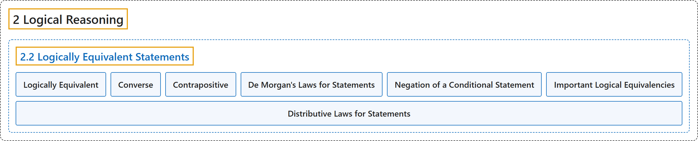

# 2.2 Logically Equivalent Statements

## Classification

## Glossary

| Term | Definition | 中文翻译 | Source |
|---|---|---|---|
| **2 Logical Reasoning** 逻辑推理 | (No definition) | （无定义） | [Sundstrom, 2022, chapter 2](https://gvsuoer.github.io/sundstrom-textbook/C_2logic.html) |
| **2.2 Logically Equivalent Statements** 逻辑等价的陈述 | (No definition) | （无定义） | [Sundstrom, 2022, section 2.2](https://gvsuoer.github.io/sundstrom-textbook/S_logequiv.html) |
| **Logically Equivalent** 逻辑等价 | "Two expressions are logically equivalent provided that they **have the same truth value for all possible combinations of truth values for all variables** appearing in the two expressions." | 如果两个表达式对其中出现的所有变量的**所有可能真值组合都有相同的真值**，它们就是逻辑等价的。 | [Sundstrom, 2022, section 2.2](https://gvsuoer.github.io/sundstrom-textbook/S_logequiv.html#D_logequiv) |
| **Converse** 逆命题 | "The converse of the conditional statement $P \to Q$ is **the conditional statement** $Q \to P\text{.}$" | 条件陈述 $P \to Q$ 的逆命题是**条件陈述** $Q \to P$。 | [Sundstrom, 2022, section 2.2](https://gvsuoer.github.io/sundstrom-textbook/S_logequiv.html#D_converse) |
| **Contrapositive** 逆否命题 | "The contrapositive of the conditional statement $P \to Q$ is **the conditional statement** $\neg Q \to \neg P\text{.}$" | 条件陈述 $P \to Q$ 的逆否命题是**条件陈述** $\neg Q \to \neg P$。 | [Sundstrom, 2022, section 2.2](https://gvsuoer.github.io/sundstrom-textbook/S_logequiv.html#D_converse) |
| **De Morgan's Laws for Statements** 陈述的德摩根律 | "For statements $P$ and $Q\text{,}$ The statement $\neg \left( {P \wedge Q} \right)$ is **logically equivalent to** $\neg P \vee \neg Q\text{.}$ This can be written as $\neg \left( {P \wedge Q} \right) \equiv \;\neg P \vee \neg Q\text{.}$ The statement $\neg \left( {P \vee Q} \right)$ is **logically equivalent to** $\neg P \wedge \neg Q\text{.}$" | 对陈述 $P$ 和 $Q$：陈述 $\neg \left( {P \wedge Q} \right)$ **逻辑等价于** $\neg P \vee \neg Q$，可写成 $\neg \left( {P \wedge Q} \right) \equiv \;\neg P \vee \neg Q$。陈述 $\neg \left( {P \vee Q} \right)$ **逻辑等价于** $\neg P \wedge \neg Q$。 | [Sundstrom, 2022, section 2.2](https://gvsuoer.github.io/sundstrom-textbook/S_logequiv.html#T_demorgan) |
| **Negation of a Conditional Statement** 条件陈述的否定 | "The logical equivalency $\neg \left( {P \to Q} \right) \equiv P \wedge \neg Q$ is interesting because it shows us that **the negation of a conditional statement is not another conditional statement**. The negation of a conditional statement **can be written in the form of a conjunction**." | 逻辑等价式 $\neg \left( {P \to Q} \right) \equiv P \wedge \neg Q$ 很有意思，因为它说明**条件陈述的否定不是另一个条件陈述**。条件陈述的否定**可以写成合取的形式**。 | [Sundstrom, 2022, section 2.2](https://gvsuoer.github.io/sundstrom-textbook/S_logequiv.html#subsection-19) |
| **Important Logical Equivalencies** 重要逻辑等价式 | "For statements $P\text{,}$ $Q\text{,}$ and $R\text{,}$ **De Morgan's Laws**. $\neg \left( {P \wedge Q} \right) \equiv \;\neg P \vee \neg Q$ $\neg \left( {P \vee Q} \right) \equiv \;\neg P \wedge \neg Q$ **Conditional Statements**. $P \to Q \equiv \;\neg Q \to \neg P \text{()}$ $P \to Q \equiv \;\neg P \vee Q$ $\neg \left( {P \to Q} \right) \equiv P \wedge \neg Q$ **Biconditional Statement**. $\left( {P \leftrightarrow Q} \right) \equiv \left( {P \to Q} \right) \wedge \left( {Q \to P} \right)$ **Double Negation**. $\neg \left( {\neg P} \right) \equiv P$" | 对陈述 $P$、$Q$ 和 $R$：**德摩根律**：$\neg \left( {P \wedge Q} \right) \equiv \;\neg P \vee \neg Q$，$\neg \left( {P \vee Q} \right) \equiv \;\neg P \wedge \neg Q$；**条件陈述**：$P \to Q \equiv \;\neg Q \to \neg P \text{()}$，$P \to Q \equiv \;\neg P \vee Q$，$\neg \left( {P \to Q} \right) \equiv P \wedge \neg Q$；**双条件陈述**：$\left( {P \leftrightarrow Q} \right) \equiv \left( {P \to Q} \right) \wedge \left( {Q \to P} \right)$；**双重否定**：$\neg \left( {\neg P} \right) \equiv P$ | [Sundstrom, 2022, section 2.2](https://gvsuoer.github.io/sundstrom-textbook/S_logequiv.html#T_logequiv) |
| **Distributive Laws for Statements** 陈述的分配律 | "**Distributive Laws**. $P \vee \left( {Q \wedge R} \right) \equiv \left( {P \vee Q} \right) \wedge \left( {P \vee R} \right)$ $P \wedge \left( {Q \vee R} \right) \equiv \left( {P \wedge Q} \right) \vee \left( {P \wedge R} \right)$" | **分配律**：$P \vee \left( {Q \wedge R} \right) \equiv \left( {P \vee Q} \right) \wedge \left( {P \vee R} \right)$，$P \wedge \left( {Q \vee R} \right) \equiv \left( {P \wedge Q} \right) \vee \left( {P \wedge R} \right)$ | [Sundstrom, 2022, section 2.2](https://gvsuoer.github.io/sundstrom-textbook/S_logequiv.html#T_logequiv) |

## References

Sundstrom, T. (2022). *Mathematical reasoning: Writing and proof* (Version 2.1; PreTeXt edition by Grand Valley State University). Retrieved October 30, 2026, from <https://gvsuoer.github.io/sundstrom-textbook/frontmatter.html>
