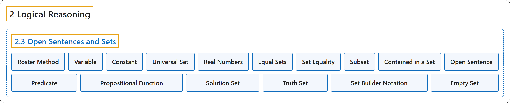

# 2.3 Open Sentences and Sets

## Classification

## Glossary

| Term | Definition | 中文翻译 | Source |
|---|---|---|---|
| **2 Logical Reasoning** 逻辑推理 | (No definition) | （无定义） | [Sundstrom, 2022, chapter 2](https://gvsuoer.github.io/sundstrom-textbook/C_2logic.html) |
| **2.3 Open Sentences and Sets** 开语句与集合 | (No definition) | （无定义） | [Sundstrom, 2022, section 2.3](https://gvsuoer.github.io/sundstrom-textbook/S_2predicates.html) |
| **Roster Method** 列举法 | "**Listing the elements of a set inside braces** is called the roster method of specifying the elements of the set." | **把集合的元素列在花括号内**，称为表示集合元素的列举法。 | [Sundstrom, 2022, section 2.3](https://gvsuoer.github.io/sundstrom-textbook/S_2predicates.html#p-780) |
| **Variable** 变量 | "A variable is **a symbol representing an unspecified object** that can be chosen from a given set $U\text{.}$" | 变量是**代表一个未指定对象的符号**，该对象可以从给定集合 $U$ 中选取。 | [Sundstrom, 2022, section 2.3](https://gvsuoer.github.io/sundstrom-textbook/S_2predicates.html#D_universal) |
| **Constant** 常量 | "A constant is **a specific member of the universal set**." | 常量是**全集中的一个特定成员**。 | [Sundstrom, 2022, section 2.3](https://gvsuoer.github.io/sundstrom-textbook/S_2predicates.html#D_universal) |
| **Universal Set** 全集 | "The set $U$ is called the universal set for the variable. It is **the set of specified objects from which objects may be chosen to substitute for the variable**." | 集合 $U$ 称为该变量的全集。它是**一组指定的对象，可从中选取对象来代入变量**。 | [Sundstrom, 2022, section 2.3](https://gvsuoer.github.io/sundstrom-textbook/S_2predicates.html#D_universal) |
| **Real Numbers** 实数 | "Recall that we use the symbol $\mathbb{R}$ to **stand for the set of all real numbers**" | 回想一下，我们用符号 $\mathbb{R}$ **表示全体实数的集合** | [Sundstrom, 2022, section 2.3](https://gvsuoer.github.io/sundstrom-textbook/S_2predicates.html#p-795) |
| **Equal Sets** 相等集合 | "Two sets, $A$ and $B\text{,}$ are equal when they **have precisely the same elements**. In this case, we write $A = B$." | 两个集合 $A$ 和 $B$ **的元素完全相同**时，它们相等。这时记作 $A = B$。 | [Sundstrom, 2022, section 2.3](https://gvsuoer.github.io/sundstrom-textbook/S_2predicates.html#D_setequality) |
| **Set Equality** 集合相等 | "Two sets, $A$ and $B\text{,}$ are equal when they **have precisely the same elements**. In this case, we write $A = B$." | 两个集合 $A$ 和 $B$ **的元素完全相同**时，它们相等。这时记作 $A = B$。 | [Sundstrom, 2022, section 2.3](https://gvsuoer.github.io/sundstrom-textbook/S_2predicates.html#D_setequality) |
| **Subset** 子集 | "The set $A$ is a subset of a set $B$ provided that **each element of** $A$ **is an element of** $B\text{.}$ In this case, we write $A \subseteq B$ and also say that $A$ is contained in $B\text{.}$" | 如果 $A$ **的每个元素都是** $B$ **的元素**，集合 $A$ 就是集合 $B$ 的子集。这时记作 $A \subseteq B$，也说 $A$ 包含于 $B$。 | [Sundstrom, 2022, section 2.3](https://gvsuoer.github.io/sundstrom-textbook/S_2predicates.html#D_setequality) |
| **Contained in a Set** 包含于集合 | "In this case, we write $A \subseteq B$ and also **say that** $A$ **is contained in** $B\text{.}$" | 这时记作 $A \subseteq B$，也**说** $A$ **包含于** $B$。 | [Sundstrom, 2022, section 2.3](https://gvsuoer.github.io/sundstrom-textbook/S_2predicates.html#D_setequality) |
| **Open Sentence** 开语句 | "An open sentence is a sentence $P( {x_1 ,x_2 , \ldots ,x_n })$ involving variables $x_1 ,x_2 , \ldots ,x_n$ with the property that **when specific values from the universal set are assigned** to $x_1 ,x_2 , \ldots ,x_n\text{,}$ then **the resulting sentence is either true or false**." | 开语句是含有变量 $x_1 ,x_2 , \ldots ,x_n$ 的语句 $P( {x_1 ,x_2 , \ldots ,x_n })$，具有这样的性质：**把全集中的具体值赋给** $x_1 ,x_2 , \ldots ,x_n$ 后，**所得语句要么真要么假**。 | [Sundstrom, 2022, section 2.3](https://gvsuoer.github.io/sundstrom-textbook/S_2predicates.html#D_predicate) |
| **Predicate** 谓词 | "An open sentence is **also called a predicate** or a propositional function." | 开语句**也称为谓词**或命题函数。 | [Sundstrom, 2022, section 2.3](https://gvsuoer.github.io/sundstrom-textbook/S_2predicates.html#D_predicate) |
| **Propositional Function** 命题函数 | "An open sentence is also called a predicate or **a propositional function**." | 开语句也称为谓词或**命题函数**。 | [Sundstrom, 2022, section 2.3](https://gvsuoer.github.io/sundstrom-textbook/S_2predicates.html#D_predicate) |
| **Solution Set** 解集 | "In more formal terms, the process of solving an equation is **a way to determine the truth set for the equation**, which is an open sentence. In this case, we often call the truth set the solution set." | 更正式地说，解方程的过程是**确定该方程真值集的一种方法**，而方程是开语句。这时我们常把真值集称为解集。 | [Sundstrom, 2022, section 2.3](https://gvsuoer.github.io/sundstrom-textbook/S_2predicates.html#p-832) |
| **Truth Set** 真值集 | "The truth set of an open sentence with one variable is **the collection of objects in the universal set that can be substituted for the variable to make the predicate a true statement**." | 单变量开语句的真值集是**全集中能代入该变量、使谓词成为真陈述的那些对象的全体**。 | [Sundstrom, 2022, section 2.3](https://gvsuoer.github.io/sundstrom-textbook/S_2predicates.html#D_truthset) |
| **Set Builder Notation** 集合构造记号 | "In this case, it is sometimes convenient to use the so-called set builder notation in which **the set is defined by stating a rule that all elements of the set must satisfy**." | 这时，有时用所谓的集合构造记号比较方便，即**通过陈述集合所有元素都必须满足的规则来定义集合**。 | [Sundstrom, 2022, section 2.3](https://gvsuoer.github.io/sundstrom-textbook/S_2predicates.html#p-837) |
| **Empty Set** 空集 | "When a set **contains no elements**, we say that the set is the empty set." | 当一个集合**不含任何元素**时，我们说它是空集。 | [Sundstrom, 2022, section 2.3](https://gvsuoer.github.io/sundstrom-textbook/S_2predicates.html#sym_empty) |

## References

Sundstrom, T. (2022). *Mathematical reasoning: Writing and proof* (Version 2.1; PreTeXt edition by Grand Valley State University). Retrieved October 30, 2026, from <https://gvsuoer.github.io/sundstrom-textbook/frontmatter.html>
