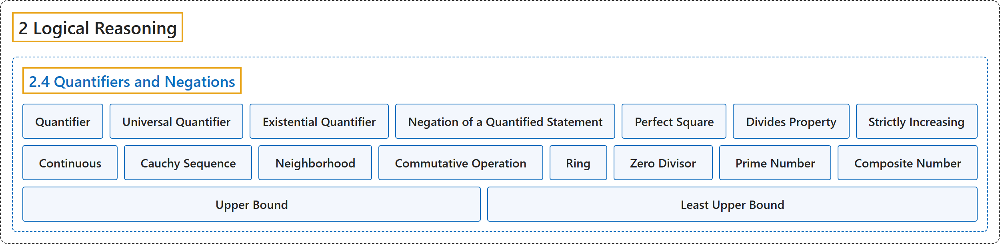

# 2.4 Quantifiers and Negations

## Classification

## Glossary

| Term | Definition | 中文翻译 | Source |
|---|---|---|---|
| **2 Logical Reasoning** 逻辑推理 | (No definition) | （无定义） | [Sundstrom, 2022, chapter 2](https://gvsuoer.github.io/sundstrom-textbook/C_2logic.html) |
| **2.4 Quantifiers and Negations** 量词与否定 | (No definition) | （无定义） | [Sundstrom, 2022, section 2.4](https://gvsuoer.github.io/sundstrom-textbook/S_2quantifier.html) |
| **Quantifier** 量词 | "Another way is to **make some claim about the truth set of the open sentence**. This is often done by using a quantifier." | 另一种方法是**对开语句的真值集做出某种断言**。这常常通过量词来实现。 | [Sundstrom, 2022, section 2.4](https://gvsuoer.github.io/sundstrom-textbook/S_2quantifier.html#PA_quantifier) |
| **Universal Quantifier** 全称量词 | "The phrase “**for every**” (or its equivalents) is called a universal quantifier." | 短语“**对每个**”（或其等价说法）称为全称量词。 | [Sundstrom, 2022, section 2.4](https://gvsuoer.github.io/sundstrom-textbook/S_2quantifier.html#D_every) |
| **Existential Quantifier** 存在量词 | "The phrase “**there exists**” (or its equivalents) is called an existential quantifier." | 短语“**存在**”（或其等价说法）称为存在量词。 | [Sundstrom, 2022, section 2.4](https://gvsuoer.github.io/sundstrom-textbook/S_2quantifier.html#D_every) |
| **Negation of a Quantified Statement** 量化陈述的否定 | "When we write $\neg \left( {\forall x} \in U \right)\left[ {P\left( x \right)} \right]\text{,}$ we are asserting that the statement $\left( {\forall x} \in U \right)\left[ {P( x )} \right]$ **is false**. This is equivalent to saying that **the truth set of the open sentence** $P( x )$ **is not the universal set**." | 当我们写 $\neg \left( {\forall x} \in U \right)\left[ {P\left( x \right)} \right]$ 时，是在断言陈述 $\left( {\forall x} \in U \right)\left[ {P( x )} \right]$ **为假**。这等于说**开语句** $P( x )$ **的真值集不是全集**。 | [Sundstrom, 2022, section 2.4](https://gvsuoer.github.io/sundstrom-textbook/S_2quantifier.html#subsection-27) |
| **Perfect Square** 完全平方数 | "A natural number $n$ is a perfect square provided that **there exists a natural number** $k$ **such that** $n = k^2\text{.}$" | 如果**存在自然数** $k$ **使得** $n = k^2$，自然数 $n$ 就是完全平方数。 | [Sundstrom, 2022, section 2.4](https://gvsuoer.github.io/sundstrom-textbook/S_2quantifier.html#D_square) |
| **Divides Property** 整除性质 | "An integer $m$ is said to have the divides property provided that **for all integers** $a$ and $b\text{,}$ **if** $m$ **divides** $ab\text{,}$ **then** $m$ **divides** $a$ **or** $m$ **divides** $b\text{.}$" | 如果**对所有整数** $a$ 和 $b$，**若** $m$ **整除** $ab$，**则** $m$ **整除** $a$ **或** $m$ **整除** $b$，就说整数 $m$ 具有整除性质。 | [Sundstrom, 2022, section 2.4](https://gvsuoer.github.io/sundstrom-textbook/S_2quantifier.html#exercise-132) |
| **Strictly Increasing** 严格递增 | "In calculus, we define a function $f$ with domain $\mathbb{R}$ to be strictly increasing provided that **for all real numbers** $x$ and $y\text{,}$ $f\left( x \right) \lt f\left( y \right)$ **whenever** $x \lt y\text{.}$" | 在微积分中，定义域为 $\mathbb{R}$ 的函数 $f$ 称为严格递增，如果**对所有实数** $x$ 和 $y$，$f\left( x \right) \lt f\left( y \right)$ **只要** $x \lt y$。 | [Sundstrom, 2022, section 2.4](https://gvsuoer.github.io/sundstrom-textbook/S_2quantifier.html#exer_24-increasing) |
| **Continuous** 连续 | "In calculus, we define a function $f$ to be continuous at a real number $a$ provided that **for every** $\varepsilon > 0\text{,}$ **there exists a** $\delta > 0$ **such that if** $\left\vert {x - a} \right\vert \lt \delta\text{,}$ **then** $\left\vert {f\left( x \right) - f\left( a \right)} \right\vert \lt \varepsilon\text{.}$" | 在微积分中，函数 $f$ 称为在实数 $a$ 处连续，如果**对每个** $\varepsilon > 0$，**存在** $\delta > 0$ **使得若** $\left\vert {x - a} \right\vert \lt \delta$，**则** $\left\vert {f\left( x \right) - f\left( a \right)} \right\vert \lt \varepsilon$。 | [Sundstrom, 2022, section 2.4](https://gvsuoer.github.io/sundstrom-textbook/S_2quantifier.html#exer_24-continuous) |
| **Cauchy Sequence** 柯西序列 | "In advanced calculus, a sequence of real numbers $\left(x_1, x_2, \ldots, x_k, \ldots \right)$ is called a Cauchy sequence provided that **for each positive real number** $\varepsilon\text{,}$ **there exists a natural number** $N$ **such that for all** $m, n \in \mathbb N\text{,}$ **if** $m > N$ and $n > N\text{,}$ **then** $\left\vert x_n - x_m \right\vert \lt \varepsilon\text{.}$" | 在高等微积分中，实数数列 $\left(x_1, x_2, \ldots, x_k, \ldots \right)$ 称为柯西序列，如果**对每个正实数** $\varepsilon$，**存在自然数** $N$ **使得对所有** $m, n \in \mathbb N$，**若** $m > N$ 且 $n > N$，**则** $\left\vert x_n - x_m \right\vert \lt \varepsilon$。 | [Sundstrom, 2022, section 2.4](https://gvsuoer.github.io/sundstrom-textbook/S_2quantifier.html#exer_advanced) |
| **Neighborhood** 邻域 | "A set $M$ of real numbers is called a neighborhood of a real number $a$ provided that **there exists a positive real number** $\varepsilon$ **such that the open interval** $(a - \varepsilon, a + \varepsilon)$ **is contained in** $M\text{.}$" | 实数集 $M$ 称为实数 $a$ 的邻域，如果**存在正实数** $\varepsilon$ **使得开区间** $(a - \varepsilon, a + \varepsilon)$ **包含于** $M$。 | [Sundstrom, 2022, section 2.4](https://gvsuoer.github.io/sundstrom-textbook/S_2quantifier.html#exer_advanced) |
| **Commutative Operation** 可交换运算 | "In abstract algebra, an operation $*$ on a set $A$ is called a commutative operation provided that **for all** $x, y \in A\text{,}$ $x * y = y * x\text{.}$" | 在抽象代数中，集合 $A$ 上的运算 $*$ 称为可交换运算，如果**对所有** $x, y \in A$，$x * y = y * x$。 | [Sundstrom, 2022, section 2.4](https://gvsuoer.github.io/sundstrom-textbook/S_2quantifier.html#exer_advanced) |
| **Ring** 环 | "In abstract algebra, a ring consists of **a nonempty set** $R$ **and two operations called addition and multiplication**." | 在抽象代数中，环由**一个非空集合** $R$ **和两种称为加法与乘法的运算组成**。 | [Sundstrom, 2022, section 2.4](https://gvsuoer.github.io/sundstrom-textbook/S_2quantifier.html#exer_advanced) |
| **Zero Divisor** 零因子 | "A nonzero element $a$ in a ring $R$ is called a zero divisor provided that **there exists a nonzero element** $b$ **in** $R$ **such that** $ab = 0$ or $ba = 0\text{.}$" | 环 $R$ 中的非零元素 $a$ 称为零因子，如果**存在非零元素** $b$ **属于** $R$ **使得** $ab = 0$ 或 $ba = 0$。 | [Sundstrom, 2022, section 2.4](https://gvsuoer.github.io/sundstrom-textbook/S_2quantifier.html#exer_advanced) |
| **Prime Number** 素数 | "A natural number $p$ is a prime number provided that **it is greater than 1** and **the only natural numbers that are factors of** $p$ are 1 and $p\text{.}$" | 如果自然数 $p$ **大于 1**，并且 $p$ **的自然数因数只有** 1 和 $p$，它就是素数。 | [Sundstrom, 2022, section 2.4](https://gvsuoer.github.io/sundstrom-textbook/S_2quantifier.html#D_prime) |
| **Composite Number** 合数 | "A natural number **other than 1** that is **not a prime number** is a composite number. The number 1 is neither prime nor composite." | **不等于 1** 且**不是素数**的自然数是合数。1 既不是素数也不是合数。 | [Sundstrom, 2022, section 2.4](https://gvsuoer.github.io/sundstrom-textbook/S_2quantifier.html#D_prime) |
| **Upper Bound** 上界 | "Let $A$ be a subset of the real numbers. A number $b$ is called an upper bound for the set $A$ provided that **for each element** $x$ **in** $A\text{,}$ $x \leq b\text{.}$" | 设 $A$ 是实数集的子集。如果**对** $A$ **中的每个元素** $x$，都有 $x \leq b$，数 $b$ 就称为集合 $A$ 的上界。 | [Sundstrom, 2022, section 2.4](https://gvsuoer.github.io/sundstrom-textbook/S_2quantifier.html#A_upper) |
| **Least Upper Bound** 最小上界 | "A real number $\alpha$ is the least upper bound for $A$ provided that $\alpha$ **is an upper bound for** $A\text{,}$ and if $\beta$ is an upper bound for $A\text{,}$ **then** $\alpha \leq \beta\text{.}$" | 如果 $\alpha$ 是 $A$ **的一个上界**，并且只要 $\beta$ 是 $A$ 的上界**就有** $\alpha \leq \beta$，实数 $\alpha$ 就是 $A$ 的最小上界。 | [Sundstrom, 2022, section 2.4](https://gvsuoer.github.io/sundstrom-textbook/S_2quantifier.html#exer_leastupper) |

## References

Sundstrom, T. (2022). *Mathematical reasoning: Writing and proof* (Version 2.1; PreTeXt edition by Grand Valley State University). Retrieved October 30, 2026, from <https://gvsuoer.github.io/sundstrom-textbook/frontmatter.html>
