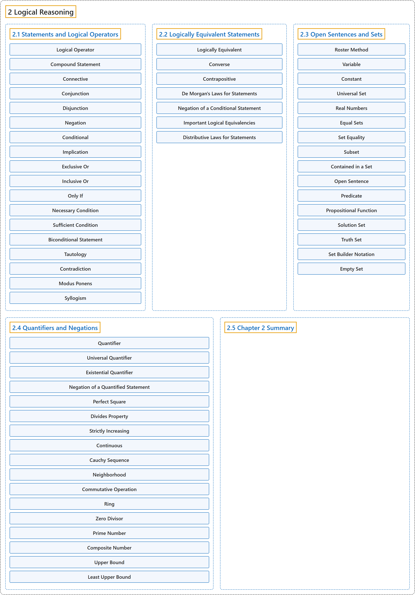

# 2 Logical Reasoning

## Classification

## Glossary

| Term | Definition | 中文翻译 | Source |
|---|---|---|---|
| **2 Logical Reasoning** 逻辑推理 | (No definition) | （无定义） | [Sundstrom, 2022, chapter 2](https://gvsuoer.github.io/sundstrom-textbook/C_2logic.html) |
| **[2.1 Statements and Logical Operators](2-1-statements-and-logical-operators.md)** 陈述与逻辑运算符 | (No definition) | （无定义） | [Sundstrom, 2022, section 2.1](https://gvsuoer.github.io/sundstrom-textbook/S_2logop.html) |
| **[2.2 Logically Equivalent Statements](2-2-logically-equivalent-statements.md)** 逻辑等价的陈述 | (No definition) | （无定义） | [Sundstrom, 2022, section 2.2](https://gvsuoer.github.io/sundstrom-textbook/S_logequiv.html) |
| **[2.3 Open Sentences and Sets](2-3-open-sentences-and-sets.md)** 开语句与集合 | (No definition) | （无定义） | [Sundstrom, 2022, section 2.3](https://gvsuoer.github.io/sundstrom-textbook/S_2predicates.html) |
| **[2.4 Quantifiers and Negations](2-4-quantifiers-and-negations.md)** 量词与否定 | (No definition) | （无定义） | [Sundstrom, 2022, section 2.4](https://gvsuoer.github.io/sundstrom-textbook/S_2quantifier.html) |
| **[2.5 Chapter 2 Summary](2-5-chapter-2-summary.md)** 第 2 章小结 | (No definition) | （无定义） | [Sundstrom, 2022, section 2.5](https://gvsuoer.github.io/sundstrom-textbook/S_2summary.html) |

## References

Sundstrom, T. (2022). *Mathematical reasoning: Writing and proof* (Version 2.1; PreTeXt edition by Grand Valley State University). Retrieved October 30, 2026, from <https://gvsuoer.github.io/sundstrom-textbook/frontmatter.html>
