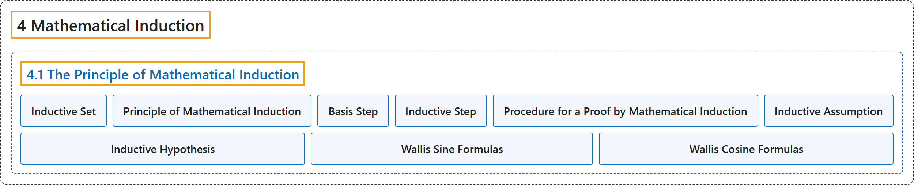

# 4.1 The Principle of Mathematical Induction

## Classification

## Glossary

| Term | Definition | 中文翻译 | Source |
|---|---|---|---|
| **4 Mathematical Induction** 数学归纳法 | (No definition) | （无定义） | [Sundstrom, 2022, chapter 4](https://gvsuoer.github.io/sundstrom-textbook/C_induction.html) |
| **4.1 The Principle of Mathematical Induction** 数学归纳法原理 | (No definition) | （无定义） | [Sundstrom, 2022, section 4.1](https://gvsuoer.github.io/sundstrom-textbook/S_mathinduction.html) |
| **Inductive Set** 归纳集 | "A set $T$ that is a subset of $\mathbb{Z}$ is an inductive set provided that **for each integer** $k\text{,}$ **if** $k \in T\text{,}$ **then** $k + 1 \in T\text{.}$" | 如果**对每个整数** $k$，**若** $k \in T$，**则** $k + 1 \in T$，那么作为 $\mathbb{Z}$ 子集的集合 $T$ 就是归纳集。 | [Sundstrom, 2022, section 4.1](https://gvsuoer.github.io/sundstrom-textbook/S_mathinduction.html#D_inductiveset) |
| **Principle of Mathematical Induction** 数学归纳法原理 | "**If** $T$ is a subset of $\mathbb{N}$ such that $1 \in T\text{,}$ **and** For every $k \in \mathbb{N}\text{,}$ if $k \in T\text{,}$ then $\left( {k + 1} \right) \in T\text{,}$ **then** $T = \mathbb{N}\text{.}$" | **如果** $T$ 是 $\mathbb{N}$ 的子集，满足 $1 \in T$，**并且**对每个 $k \in \mathbb{N}$，若 $k \in T$ 则 $\left( {k + 1} \right) \in T$，**那么** $T = \mathbb{N}$。 | [Sundstrom, 2022, section 4.1](https://gvsuoer.github.io/sundstrom-textbook/S_mathinduction.html#principle-math-induction) |
| **Basis Step** 基础步骤 | "To verify the hypothesis of the The Principle of Mathematical Induction, we must **Prove that** $1 \in T\text{.}$ That is, **prove that** $P( 1 )$ **is true**." | 要验证数学归纳法原理的假设，我们必须**证明** $1 \in T$，也就是**证明** $P( 1 )$ **为真**。 | [Sundstrom, 2022, section 4.1](https://gvsuoer.github.io/sundstrom-textbook/S_mathinduction.html#subsection-72) |
| **Inductive Step** 归纳步骤 | "Prove that $1 \in T\text{.}$ That is, prove that $P( 1 )$ is true. **Prove that if** $k \in T\text{,}$ **then** $\left( {k + 1} \right) \in T\text{.}$ That is, **prove that if** $P( k )$ **is true, then** $P( {k + 1} )$ **is true**" | 证明 $1 \in T$，即证明 $P( 1 )$ 为真。**证明若** $k \in T$，**则** $\left( {k + 1} \right) \in T$，也就是**证明若** $P( k )$ **为真，则** $P( {k + 1} )$ **为真** | [Sundstrom, 2022, section 4.1](https://gvsuoer.github.io/sundstrom-textbook/S_mathinduction.html#subsection-72) |
| **Procedure for a Proof by Mathematical Induction** 数学归纳法证明的步骤 | "To prove: $\left( {\forall n \in \mathbb{N}} \right)\left( {P\left( n \right)} \right)$ **Basis step**: Prove $P( 1 )\text{.}$ **Inductive step**: Prove that for each $k \in \mathbb{N}\text{,}$ if $P( k )$ is true, then $P( {k + 1} )$ is true. We can then **conclude that** $P( n )$ **is true for all** $n \in \mathbb{N}\text{.}$" | 要证明：$\left( {\forall n \in \mathbb{N}} \right)\left( {P\left( n \right)} \right)$。**基础步骤**：证明 $P( 1 )$。**归纳步骤**：证明对每个 $k \in \mathbb{N}$，若 $P( k )$ 为真，则 $P( {k + 1} )$ 为真。于是可以**断定** $P( n )$ **对所有** $n \in \mathbb{N}$ 为真。 | [Sundstrom, 2022, section 4.1](https://gvsuoer.github.io/sundstrom-textbook/S_mathinduction.html#proced-induct) |
| **Inductive Assumption** 归纳假定 | "So we will start the inductive step by **assuming that** $P( k )$ **is true**. This assumption is called the inductive assumption or the inductive hypothesis." | 所以我们从**假设** $P( k )$ **为真**开始归纳步骤。这个假设称为归纳假定或归纳假设。 | [Sundstrom, 2022, section 4.1](https://gvsuoer.github.io/sundstrom-textbook/S_mathinduction.html#p-2283) |
| **Inductive Hypothesis** 归纳假设 | "So we will start the inductive step by **assuming that** $P( k )$ **is true**. This assumption is called the inductive assumption or the inductive hypothesis." | 所以我们从**假设** $P( k )$ **为真**开始归纳步骤。这个假设称为归纳假定或归纳假设。 | [Sundstrom, 2022, section 4.1](https://gvsuoer.github.io/sundstrom-textbook/S_mathinduction.html#p-2283) |
| **Wallis Sine Formulas** 沃利斯正弦公式 | "$\begin{aligned} \int_{0}^{\pi/2} \sin^{\,2n}x \, dx & = \frac{1 \cdot 3 \cdot 5 \cdots (2n - 1)}{2 \cdot 4 \cdot 6 \cdots (2n)} \frac{\pi}{2} \text{ and }\\ \int_{0}^{\pi/2} \sin^{\,2n+1}x \, dx & = \frac{2 \cdot 4 \cdot 6 \cdots (2n)}{1 \cdot 3 \cdot 5 \cdots (2n + 1)}\text{.} \end{aligned}$ These are **known as the Wallis sine formulas**." | $\begin{aligned} \int_{0}^{\pi/2} \sin^{\,2n}x \, dx & = \frac{1 \cdot 3 \cdot 5 \cdots (2n - 1)}{2 \cdot 4 \cdot 6 \cdots (2n)} \frac{\pi}{2} \text{ and }\\ \int_{0}^{\pi/2} \sin^{\,2n+1}x \, dx & = \frac{2 \cdot 4 \cdot 6 \cdots (2n)}{1 \cdot 3 \cdot 5 \cdots (2n + 1)} \end{aligned}$ 这些**称为沃利斯正弦公式**。 | [Sundstrom, 2022, section 4.1](https://gvsuoer.github.io/sundstrom-textbook/S_mathinduction.html#exer_wallis) |
| **Wallis Cosine Formulas** 沃利斯余弦公式 | "$\begin{aligned} \int_{0}^{\pi/2} \cos^{\,2n}x \, dx & = \frac{1 \cdot 3 \cdot 5 \cdots (2n - 1)}{2 \cdot 4 \cdot 6 \cdots (2n)} \frac{\pi}{2} \text{ and }\\ \int_{0}^{\pi/2} \cos^{\,2n+1}x \, dx & = \frac{2 \cdot 4 \cdot 6 \cdots (2n)}{1 \cdot 3 \cdot 5 \cdots (2n+1)}\text{.} \end{aligned}$ These are **known as the Wallis cosine formulas**." | $\begin{aligned} \int_{0}^{\pi/2} \cos^{\,2n}x \, dx & = \frac{1 \cdot 3 \cdot 5 \cdots (2n - 1)}{2 \cdot 4 \cdot 6 \cdots (2n)} \frac{\pi}{2} \text{ and }\\ \int_{0}^{\pi/2} \cos^{\,2n+1}x \, dx & = \frac{2 \cdot 4 \cdot 6 \cdots (2n)}{1 \cdot 3 \cdot 5 \cdots (2n+1)} \end{aligned}$ 这些**称为沃利斯余弦公式**。 | [Sundstrom, 2022, section 4.1](https://gvsuoer.github.io/sundstrom-textbook/S_mathinduction.html#exer_wallis) |

## References

Sundstrom, T. (2022). *Mathematical reasoning: Writing and proof* (Version 2.1; PreTeXt edition by Grand Valley State University). Retrieved October 30, 2026, from <https://gvsuoer.github.io/sundstrom-textbook/frontmatter.html>
