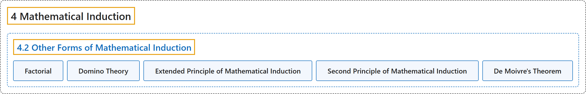

# 4.2 Other Forms of Mathematical Induction

## Classification

## Glossary

| Term | Definition | 中文翻译 | Source |
|---|---|---|---|
| **4 Mathematical Induction** 数学归纳法 | (No definition) | （无定义） | [Sundstrom, 2022, chapter 4](https://gvsuoer.github.io/sundstrom-textbook/C_induction.html) |
| **4.2 Other Forms of Mathematical Induction** 数学归纳法的其他形式 | (No definition) | （无定义） | [Sundstrom, 2022, section 4.2](https://gvsuoer.github.io/sundstrom-textbook/S_otherinduction.html) |
| **Factorial** 阶乘 | "If $n$ is a natural number, we define $\boldsymbol{n}$ factorial, denoted by $n!$, to be **the product of the first** $n$ **natural numbers**. In addition, we **define** $0!$ **to be equal to 1**." | 如果 $n$ 是自然数，定义 $\boldsymbol{n}$ 的阶乘（记作 $n!$）为**前** $n$ **个自然数的乘积**。另外，**定义** $0!$ **等于 1**。 | [Sundstrom, 2022, section 4.2](https://gvsuoer.github.io/sundstrom-textbook/S_otherinduction.html#nfactorial) |
| **Domino Theory** 多米诺理论 | "Now imagine that **each statement in equation (29) is a domino in a chain of dominoes**. When we prove the inductive step, we are proving that **if one domino is knocked over, then it will knock over the next one in the chain**." | 现在想象**式 (29) 中的每个陈述都是一串多米诺骨牌中的一块**。证明归纳步骤，就是在证明**如果一块骨牌被推倒，它就会推倒链中的下一块**。 | [Sundstrom, 2022, section 4.2](https://gvsuoer.github.io/sundstrom-textbook/S_otherinduction.html#subsection-76) |
| **Extended Principle of Mathematical Induction** 扩展数学归纳法原理 | "Let $M$ be an integer. **If** $T$ is a subset of $\mathbb{Z}$ such that $M \in T\text{,}$ **and** For every $k \in \mathbb{Z}$ with $k \geq M\text{,}$ if $k \in T\text{,}$ then $\left( {k + 1} \right) \in T\text{,}$ **then** $T$ **contains all integers greater than or equal to** $M\text{.}$" | 设 $M$ 是整数。**如果** $T$ 是 $\mathbb{Z}$ 的子集，满足 $M \in T$，**并且**对每个满足 $k \geq M$ 的 $k \in \mathbb{Z}$，若 $k \in T$ 则 $\left( {k + 1} \right) \in T$，**那么** $T$ **包含所有大于或等于** $M$ 的整数。 | [Sundstrom, 2022, section 4.2](https://gvsuoer.github.io/sundstrom-textbook/S_otherinduction.html#principle-math-induct) |
| **Second Principle of Mathematical Induction** 第二数学归纳法原理 | "Let $M$ be an integer. **If** $T$ is a subset of $\mathbb{Z}$ such that $M \in T\text{,}$ **and** For every $k \in \mathbb{Z}$ with $k \geq M\text{,}$ if $\left\{ {M, M + 1, \ldots ,k} \right\} \subseteq T\text{,}$ then $\left( {k + 1} \right) \in T\text{,}$ **then** $T$ **contains all integers greater than or equal to** $M\text{.}$" | 设 $M$ 是整数。**如果** $T$ 是 $\mathbb{Z}$ 的子集，满足 $M \in T$，**并且**对每个满足 $k \geq M$ 的 $k \in \mathbb{Z}$，若 $\left\{ {M, M + 1, \ldots ,k} \right\} \subseteq T$ 则 $\left( {k + 1} \right) \in T$，**那么** $T$ **包含所有大于或等于** $M$ 的整数。 | [Sundstrom, 2022, section 4.2](https://gvsuoer.github.io/sundstrom-textbook/S_otherinduction.html#principle-math-induct2) |
| **De Moivre's Theorem** 棣莫弗定理 | "One version of the theorem can be stated as follows: **If** $x$ **is a real number, then for each nonnegative integer** $n\text{,}$ $\left[ {\cos x + i(\sin x)} \right]^n = \cos (nx) + i( {\sin (nx)} )\!\text{.}$" | 该定理的一种形式可以表述为：**如果** $x$ **是实数，那么对每个非负整数** $n$，$\left[ {\cos x + i(\sin x)} \right]^n = \cos (nx) + i( {\sin (nx)} )$。 | [Sundstrom, 2022, section 4.2](https://gvsuoer.github.io/sundstrom-textbook/S_otherinduction.html#activity-24) |

## References

Sundstrom, T. (2022). *Mathematical reasoning: Writing and proof* (Version 2.1; PreTeXt edition by Grand Valley State University). Retrieved October 30, 2026, from <https://gvsuoer.github.io/sundstrom-textbook/frontmatter.html>
