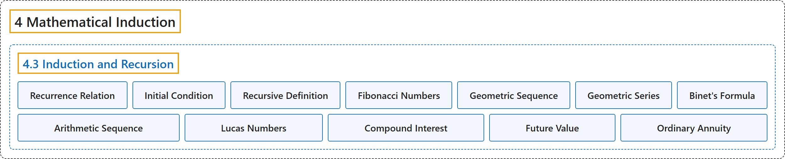

# 4.3 Induction and Recursion

## Classification

## Glossary

| Term | Definition | 中文翻译 | Source |
|---|---|---|---|
| **4 Mathematical Induction** 数学归纳法 | (No definition) | （无定义） | [Sundstrom, 2022, chapter 4](https://gvsuoer.github.io/sundstrom-textbook/C_induction.html) |
| **4.3 Induction and Recursion** 归纳与递归 | (No definition) | （无定义） | [Sundstrom, 2022, section 4.3](https://gvsuoer.github.io/sundstrom-textbook/S_recursion.html) |
| **Recurrence Relation** 递推关系 | "The specific definition of the first term is called the initial condition, and **the general definition of** $a_{n + 1}$ in terms of $n$ and the first $n$ terms $a_1 ,a_2 , \ldots ,a_n$ is called the recurrence relation." | 第一项的具体定义称为初始条件，而用 $n$ 和前 $n$ 项 $a_1 ,a_2 , \ldots ,a_n$ 表示 $a_{n + 1}$ **的一般定义**称为递推关系。 | [Sundstrom, 2022, section 4.3](https://gvsuoer.github.io/sundstrom-textbook/S_recursion.html#p-2561) |
| **Initial Condition** 初始条件 | "**The specific definition of the first term** is called the initial condition" | **第一项的具体定义**称为初始条件 | [Sundstrom, 2022, section 4.3](https://gvsuoer.github.io/sundstrom-textbook/S_recursion.html#p-2561) |
| **Recursive Definition** 递归定义 | "Another way to define a sequence is to **give a specific definition of the first term** (or the first few terms) and then **state, in general terms, how to determine** $a_{n + 1}$ in terms of $n$ and the first $n$ terms $a_1 ,a_2 , \ldots ,a_n\text{.}$ This process is known as definition by recursion and is also called a recursive definition." | 定义数列的另一种方法是**给出第一项的具体定义**（或前几项的），然后**一般地说明如何确定** $a_{n + 1}$（用 $n$ 和前 $n$ 项 $a_1 ,a_2 , \ldots ,a_n$ 表示）。这个过程称为递归定义法，也称为递归定义。 | [Sundstrom, 2022, section 4.3](https://gvsuoer.github.io/sundstrom-textbook/S_recursion.html#p-2561) |
| **Fibonacci Numbers** 斐波那契数 | "The Fibonacci numbers are **a sequence of natural numbers** $f_1 ,f_2 ,f_3 , \ldots ,f_n , \ldots$ **defined recursively** as follows: $f_1 = 1$ and $f_2 = 1\text{,}$ and For each natural number $n\text{,}$ $f_{n + 2} = f_{n + 1} + f_n\text{.}$" | 斐波那契数是**一个自然数数列** $f_1 ,f_2 ,f_3 , \ldots ,f_n , \ldots$，**按如下方式递归定义**：$f_1 = 1$，$f_2 = 1$，并且对每个自然数 $n$，$f_{n + 2} = f_{n + 1} + f_n$。 | [Sundstrom, 2022, section 4.3](https://gvsuoer.github.io/sundstrom-textbook/S_recursion.html#PA_fibonaccinumbers) |
| **Geometric Sequence** 等比数列 | "This is a recursive definition for a geometric sequence with initial term $a$ and (common) ratio $r\text{.}$ The basic idea is that **the next term in the sequence is obtained by multiplying the previous term by the ratio** $r\text{.}$" | 这是首项为 $a$、公比为 $r$ 的等比数列的递归定义。基本思想是：**数列的下一项由前一项乘以公比得到** $r$。 | [Sundstrom, 2022, section 4.3](https://gvsuoer.github.io/sundstrom-textbook/S_recursion.html#p-2603) |
| **Geometric Series** 等比级数 | "For each $n \in \mathbb{N}\text{,}$ the term $S_n$ is **a (finite) geometric series with initial term** $a$ **and (common) ratio** $r\text{.}$" | 对每个 $n \in \mathbb{N}$，项 $S_n$ 是**首项为** $a$ 、**公比为** $r$ 的（有限）等比级数。 | [Sundstrom, 2022, section 4.3](https://gvsuoer.github.io/sundstrom-textbook/S_recursion.html#p-2605) |
| **Binet's Formula** 比内公式 | "Use induction to prove that for each natural number $n\text{,}$ if $\alpha = \dfrac{1 + \sqrt{5}}{2}$ and $\beta = \dfrac{1 - \sqrt{5}}{2}\text{,}$ then $f_n = \dfrac{\alpha^n - \beta^n}{\alpha - \beta}\text{.}$ This **formula for the** $n^{th}$ **Fibonacci number** is known as Binet's formula" | 用归纳法证明：对每个自然数 $n$，若 $\alpha = \dfrac{1 + \sqrt{5}}{2}$，$\beta = \dfrac{1 - \sqrt{5}}{2}$，则 $f_n = \dfrac{\alpha^n - \beta^n}{\alpha - \beta}$。这个**关于第** $n^{th}$ **个斐波那契数的公式**称为比内公式 | [Sundstrom, 2022, section 4.3](https://gvsuoer.github.io/sundstrom-textbook/S_recursion.html#exer_binet) |
| **Arithmetic Sequence** 等差数列 | "An arithmetic sequence is **defined recursively** as follows: Let $c$ and $d$ be real numbers. Define the sequence $a_1 ,a_2 , \ldots ,a_n , \ldots$ by $a_1 = c$ and for each $n \in \mathbb{N}\text{,}$ $a_{n + 1} = a_n + d\text{.}$" | 等差数列**按如下方式递归定义**：设 $c$ 和 $d$ 是实数，定义数列 $a_1 ,a_2 , \ldots ,a_n , \ldots$ 为 $a_1 = c$，并且对每个 $n \in \mathbb{N}$，$a_{n + 1} = a_n + d$。 | [Sundstrom, 2022, section 4.3](https://gvsuoer.github.io/sundstrom-textbook/S_recursion.html#exer_sec53-arith) |
| **Lucas Numbers** 卢卡斯数 | "The Lucas numbers are **a sequence of natural numbers** $L_1, L_2, L_3, \ldots, L_n, \ldots \text{,}$ which are **defined recursively** as follows: $L_1 = 1$ and $L_2 = 3\text{,}$ and For each natural number $n\text{,}$ $L_{n+2} = L_{n+1} + L_n\text{.}$" | 卢卡斯数是**一个自然数数列** $L_1, L_2, L_3, \ldots, L_n, \ldots$，它**按如下方式递归定义**：$L_1 = 1$，$L_2 = 3$，并且对每个自然数 $n$，$L_{n+2} = L_{n+1} + L_n$。 | [Sundstrom, 2022, section 4.3](https://gvsuoer.github.io/sundstrom-textbook/S_recursion.html#exer_lucasnumbers) |
| **Compound Interest** 复利 | "Assume that $R$ dollars is deposited in an account that has **an interest rate of** $i$ for each compounding period. A compounding period is **some specified time period such as a month or a year**." | 假设把 $R$ 美元存入一个账户，该账户**每个计息期的利率为** $i$。计息期是**某个指定的时间段，例如一个月或一年**。 | [Sundstrom, 2022, section 4.3](https://gvsuoer.github.io/sundstrom-textbook/S_recursion.html#exer_compoundinterest) |
| **Future Value** 终值 | "Let $S_t$ represent **the amount in the account at the end of the** $t$ **th compounding period**. $S_t$ is frequently called the future value of the ordinary annuity." | 设 $S_t$ 表示**第** $t$ **个计息期结束时账户中的金额**。$S_t$ 常称为普通年金的终值。 | [Sundstrom, 2022, section 4.3](https://gvsuoer.github.io/sundstrom-textbook/S_recursion.html#exer_annuity) |
| **Ordinary Annuity** 普通年金 | "For an ordinary annuity, $R$ dollars is **deposited in an account at the end of each compounding period**." | 对普通年金，每个计息期结束时，把 $R$ 美元**存入账户**。 | [Sundstrom, 2022, section 4.3](https://gvsuoer.github.io/sundstrom-textbook/S_recursion.html#exer_annuity) |

## References

Sundstrom, T. (2022). *Mathematical reasoning: Writing and proof* (Version 2.1; PreTeXt edition by Grand Valley State University). Retrieved October 30, 2026, from <https://gvsuoer.github.io/sundstrom-textbook/frontmatter.html>
