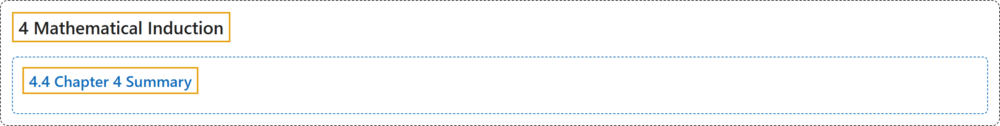

# 4.4 Chapter 4 Summary

## Classification

## Glossary

| Term | Definition | 中文翻译 | Source |
|---|---|---|---|
| **4 Mathematical Induction** 数学归纳法 | (No definition) | （无定义） | [Sundstrom, 2022, chapter 4](https://gvsuoer.github.io/sundstrom-textbook/C_induction.html) |
| **4.4 Chapter 4 Summary** 第 4 章小结 | (No definition) | （无定义） | [Sundstrom, 2022, section 4.4](https://gvsuoer.github.io/sundstrom-textbook/S_4summary.html) |

## References

Sundstrom, T. (2022). *Mathematical reasoning: Writing and proof* (Version 2.1; PreTeXt edition by Grand Valley State University). Retrieved October 30, 2026, from <https://gvsuoer.github.io/sundstrom-textbook/frontmatter.html>
