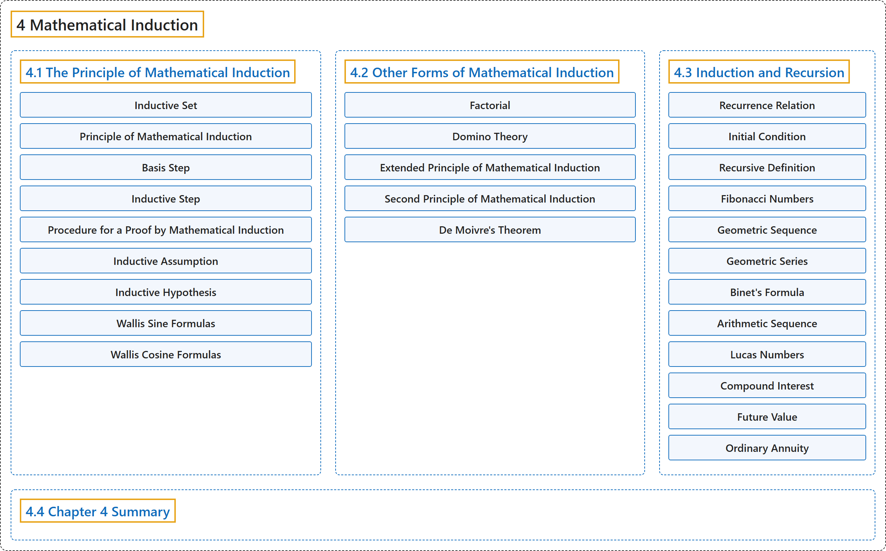

# 4 Mathematical Induction

## Classification

## Glossary

| Term | Definition | 中文翻译 | Source |
|---|---|---|---|
| **4 Mathematical Induction** 数学归纳法 | (No definition) | （无定义） | [Sundstrom, 2022, chapter 4](https://gvsuoer.github.io/sundstrom-textbook/C_induction.html) |
| **[4.1 The Principle of Mathematical Induction](4-1-the-principle-of-mathematical-induction.md)** 数学归纳法原理 | (No definition) | （无定义） | [Sundstrom, 2022, section 4.1](https://gvsuoer.github.io/sundstrom-textbook/S_mathinduction.html) |
| **[4.2 Other Forms of Mathematical Induction](4-2-other-forms-of-mathematical-induction.md)** 数学归纳法的其他形式 | (No definition) | （无定义） | [Sundstrom, 2022, section 4.2](https://gvsuoer.github.io/sundstrom-textbook/S_otherinduction.html) |
| **[4.3 Induction and Recursion](4-3-induction-and-recursion.md)** 归纳与递归 | (No definition) | （无定义） | [Sundstrom, 2022, section 4.3](https://gvsuoer.github.io/sundstrom-textbook/S_recursion.html) |
| **[4.4 Chapter 4 Summary](4-4-chapter-4-summary.md)** 第 4 章小结 | (No definition) | （无定义） | [Sundstrom, 2022, section 4.4](https://gvsuoer.github.io/sundstrom-textbook/S_4summary.html) |

## References

Sundstrom, T. (2022). *Mathematical reasoning: Writing and proof* (Version 2.1; PreTeXt edition by Grand Valley State University). Retrieved October 30, 2026, from <https://gvsuoer.github.io/sundstrom-textbook/frontmatter.html>
