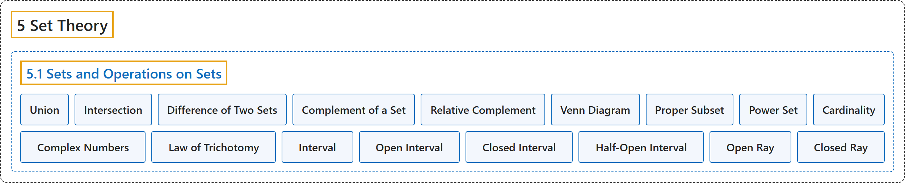

# 5.1 Sets and Operations on Sets

## Classification

## Glossary

| Term | Definition | 中文翻译 | Source |
|---|---|---|---|
| **5 Set Theory** 集合论 | (No definition) | （无定义） | [Sundstrom, 2022, chapter 5](https://gvsuoer.github.io/sundstrom-textbook/C_settheory.html) |
| **5.1 Sets and Operations on Sets** 集合与集合运算 | (No definition) | （无定义） | [Sundstrom, 2022, section 5.1](https://gvsuoer.github.io/sundstrom-textbook/S_setoperations.html) |
| **Union** 并集 | "The union of $A$ and $B\text{,}$ written $A \cup B$ and read “$A$ union $B\text{,}$” is **the set of all elements that are in** $A$ **or in** $B\text{.}$" | $A$ 与 $B$ 的并集，记作 $A \cup B$，读作“$A$ 并 $B$”，是**属于** $A$ **或属于** $B$ 的所有元素组成的集合。 | [Sundstrom, 2022, section 5.1](https://gvsuoer.github.io/sundstrom-textbook/S_setoperations.html#intersection) |
| **Intersection** 交集 | "The intersection of $A$ and $B\text{,}$ written $A \cap B$ and read “$A$ intersect $B\text{,}$” is **the set of all elements that are in both** $A$ **and** $B\text{.}$" | $A$ 与 $B$ 的交集，记作 $A \cap B$，读作“$A$ 交 $B$”，是**同时属于** $A$ **和** $B$ 的所有元素组成的集合。 | [Sundstrom, 2022, section 5.1](https://gvsuoer.github.io/sundstrom-textbook/S_setoperations.html#intersection) |
| **Difference of Two Sets** 两个集合的差 | "The set difference of $A$ and $B\text{,}$ or relative complement of $B$ with respect to $A\text{,}$ written $A - B$ and read “$A$ minus $B$” or “the complement of $B$ with respect to $A\text{,}$” is **the set of all elements in** $A$ **that are not in** $B\text{.}$" | $A$ 与 $B$ 的差集，或 $B$ 相对于 $A$ 的相对补集，记作 $A - B$，读作“$A$ 减 $B$”或“$B$ 相对于 $A$ 的补集”，是**属于** $A$ **但不属于** $B$ 的所有元素组成的集合。 | [Sundstrom, 2022, section 5.1](https://gvsuoer.github.io/sundstrom-textbook/S_setoperations.html#setdiff) |
| **Complement of a Set** 集合的补集 | "The complement of the set $A\text{,}$ written $A^c$ and read “the complement of $A\text{,}$” is **the set of all elements of** $U$ **that are not in** $A\text{.}$" | 集合 $A$ 的补集，记作 $A^c$，读作“$A$ 的补集”，是**全集** $U$ **中不属于** $A$ 的所有元素组成的集合。 | [Sundstrom, 2022, section 5.1](https://gvsuoer.github.io/sundstrom-textbook/S_setoperations.html#setdiff) |
| **Relative Complement** 相对补集 | "The set difference of $A$ and $B\text{,}$ or relative complement of $B$ with respect to $A\text{,}$ written $A - B$ and read “$A$ minus $B$” or “the complement of $B$ with respect to $A\text{,}$” is **the set of all elements in** $A$ **that are not in** $B\text{.}$" | $A$ 与 $B$ 的差集，或 $B$ 相对于 $A$ 的相对补集，记作 $A - B$，读作“$A$ 减 $B$”或“$B$ 相对于 $A$ 的补集”，是**属于** $A$ **但不属于** $B$ 的所有元素组成的集合。 | [Sundstrom, 2022, section 5.1](https://gvsuoer.github.io/sundstrom-textbook/S_setoperations.html#setdiff) |
| **Venn Diagram** 维恩图 | "Venn diagrams are used to **represent sets by circles (or some other closed geometric shape) drawn inside a rectangle**." | 维恩图用**画在矩形内的圆（或其他封闭几何图形）来表示集合**。 | [Sundstrom, 2022, section 5.1](https://gvsuoer.github.io/sundstrom-textbook/S_setoperations.html#PA_venn) |
| **Proper Subset** 真子集 | "The set $A$ is a proper subset of $B$ provided that $A \subseteq B$ **and** $A \ne B\text{.}$ When $A$ is a proper subset of $B\text{,}$ we write $A \subset B\text{.}$" | 如果 $A \subseteq B$ **且** $A \ne B$，集合 $A$ 就是 $B$ 的真子集。当 $A$ 是 $B$ 的真子集时，记作 $A \subset B$。 | [Sundstrom, 2022, section 5.1](https://gvsuoer.github.io/sundstrom-textbook/S_setoperations.html#propersubset) |
| **Power Set** 幂集 | "If $A$ is a subset of a universal set $U\text{,}$ then **the set whose members are all the subsets of** $A$ is called the power set of $A\text{.}$" | 如果 $A$ 是全集 $U$ 的子集，那么以 $A$ **的所有子集为成员的集合**称为 $A$ 的幂集。 | [Sundstrom, 2022, section 5.1](https://gvsuoer.github.io/sundstrom-textbook/S_setoperations.html#D_powerset) |
| **Cardinality** 势 | "**The number of elements in a finite set** $A$ is called the cardinality of $A$ and is denoted by $\mathbf{card}(A)\text{.}$" | 有限集 $A$ **中元素的个数**称为 $A$ 的势，记作 $\mathbf{card}(A)$。 | [Sundstrom, 2022, section 5.1](https://gvsuoer.github.io/sundstrom-textbook/S_setoperations.html#D_cardinality) |
| **Complex Numbers** 复数 | "The complex numbers, $\mathbb{C}\text{,}$ **consist of all numbers of the form** $a + bi\text{,}$ where $a, b \in \mathbb R$ and $i = \sqrt{-1}$ (or $i^2 = -1$)." | 复数集 $\mathbb{C}$ **由所有形如** $a + bi$ 的数组成，其中 $a, b \in \mathbb R$，$i = \sqrt{-1}$（即 $i^2 = -1$）。 | [Sundstrom, 2022, section 5.1](https://gvsuoer.github.io/sundstrom-textbook/S_setoperations.html#p-2808) |
| **Law of Trichotomy** 三分律 | "One of the properties of real numbers is the so-called Law of Trichotomy, which states that if $a, b \in \mathbb R\text{,}$ then **exactly one of the following is true**: $a \lt b\text{;}$ $a = b\text{;}$ $a > b\text{.}$" | 实数的一个性质是所谓的三分律：若 $a, b \in \mathbb R$，则**下列情况恰有一种成立**：$a \lt b$；$a = b$；$a > b$。 | [Sundstrom, 2022, section 5.1](https://gvsuoer.github.io/sundstrom-textbook/S_setoperations.html#exercise-422) |
| **Interval** 区间 | "In previous mathematics courses, we have frequently used **subsets of the real numbers** called intervals." | 在以前的数学课程中，我们经常使用称为区间的**实数子集**。 | [Sundstrom, 2022, section 5.1](https://gvsuoer.github.io/sundstrom-textbook/S_setoperations.html#A_intervals) |
| **Open Interval** 开区间 | "$\left( {a,b} \right) =$ $\left\{ {x \in \mathbb{R}\left. \right\vert a \lt x \lt b} \right\}$ **Open interval** from $a$ to $b$" | $\left( {a,b} \right) =$ $\left\{ {x \in \mathbb{R}\left. \right\vert a \lt x \lt b} \right\}$ 从 $a$ 到 $b$ 的**开区间** | [Sundstrom, 2022, section 5.1](https://gvsuoer.github.io/sundstrom-textbook/S_setoperations.html#A_intervals) |
| **Closed Interval** 闭区间 | "$\left[ {a,b} \right] =$ $\left\{ {x \in \mathbb{R}\left. \right\vert a \leq x \leq b} \right\}$ **Closed interval** from $a$ to $b$" | $\left[ {a,b} \right] =$ $\left\{ {x \in \mathbb{R}\left. \right\vert a \leq x \leq b} \right\}$ 从 $a$ 到 $b$ 的**闭区间** | [Sundstrom, 2022, section 5.1](https://gvsuoer.github.io/sundstrom-textbook/S_setoperations.html#A_intervals) |
| **Half-Open Interval** 半开区间 | "$\left[ {a,b} \right) =$ $\left\{ {x \in \mathbb{R}\left. \right\vert a \leq x \lt b} \right\}$ **Half-open interval** $\left( {a,b} \right] =$ $\left\{ {x \in \mathbb{R}\left. \right\vert a \lt x \leq b} \right\}$ **Half-open interval**" | $\left[ {a,b} \right) =$ $\left\{ {x \in \mathbb{R}\left. \right\vert a \leq x \lt b} \right\}$ **半开区间**；$\left( {a,b} \right] =$ $\left\{ {x \in \mathbb{R}\left. \right\vert a \lt x \leq b} \right\}$ **半开区间** | [Sundstrom, 2022, section 5.1](https://gvsuoer.github.io/sundstrom-textbook/S_setoperations.html#A_intervals) |
| **Open Ray** 开射线 | "$\left( {a, + \infty } \right) =$ $\left\{ {\left. {x \in \mathbb{R}} \right\vert x > a} \right\}$ **Open ray** $\left( { - \infty ,b} \right) =$ $\left\{ {\left. {x \in \mathbb{R}} \right\vert x \lt b} \right\}$ **Open ray**" | $\left( {a, + \infty } \right) =$ $\left\{ {\left. {x \in \mathbb{R}} \right\vert x > a} \right\}$ **开射线**；$\left( { - \infty ,b} \right) =$ $\left\{ {\left. {x \in \mathbb{R}} \right\vert x \lt b} \right\}$ **开射线** | [Sundstrom, 2022, section 5.1](https://gvsuoer.github.io/sundstrom-textbook/S_setoperations.html#A_intervals) |
| **Closed Ray** 闭射线 | "$\left[ {a, + \infty } \right) =$ $\left\{ {\left. {x \in \mathbb{R}} \right\vert x \geq a} \right\}$ **Closed ray** $\left( { - \infty ,b} \right] =$ $\left\{ {\left. {x \in \mathbb{R}} \right\vert x \leq b} \right\}$ **Closed ray**" | $\left[ {a, + \infty } \right) =$ $\left\{ {\left. {x \in \mathbb{R}} \right\vert x \geq a} \right\}$ **闭射线**；$\left( { - \infty ,b} \right] =$ $\left\{ {\left. {x \in \mathbb{R}} \right\vert x \leq b} \right\}$ **闭射线** | [Sundstrom, 2022, section 5.1](https://gvsuoer.github.io/sundstrom-textbook/S_setoperations.html#A_intervals) |

## References

Sundstrom, T. (2022). *Mathematical reasoning: Writing and proof* (Version 2.1; PreTeXt edition by Grand Valley State University). Retrieved October 30, 2026, from <https://gvsuoer.github.io/sundstrom-textbook/frontmatter.html>
