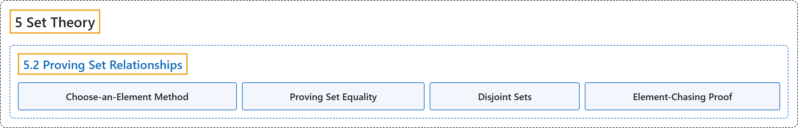

# 5.2 Proving Set Relationships

## Classification

## Glossary

| Term | Definition | 中文翻译 | Source |
|---|---|---|---|
| **5 Set Theory** 集合论 | (No definition) | （无定义） | [Sundstrom, 2022, chapter 5](https://gvsuoer.github.io/sundstrom-textbook/C_settheory.html) |
| **5.2 Proving Set Relationships** 证明集合关系 | (No definition) | （无定义） | [Sundstrom, 2022, section 5.2](https://gvsuoer.github.io/sundstrom-textbook/S_provingset.html) |
| **Choose-an-Element Method** 任取元素法 | "This table is in the form of a proof method called the choose-an-element method. This method is **frequently used when we encounter a universal quantifier in a statement in the backward process**." | 这张表采用一种称为任取元素法的证明方法。当**在逆向推理中遇到含全称量词的陈述时**，常用这种方法。 | [Sundstrom, 2022, section 5.2](https://gvsuoer.github.io/sundstrom-textbook/S_provingset.html#exercise-427) |
| **Proving Set Equality** 证明集合相等 | "One way to prove that two sets are equal is to use Theorem 5.4 and **prove each of the two sets is a subset of the other set**." | 证明两个集合相等的一种方法是利用定理 5.4，**证明两个集合各自是对方的子集**。 | [Sundstrom, 2022, section 5.2](https://gvsuoer.github.io/sundstrom-textbook/S_provingset.html#subsection-91) |
| **Disjoint Sets** 不相交集合 | "The sets $A$ and $B$ are said to be disjoint provided that $A \cap B = \emptyset\text{.}$" | 如果 $A \cap B = \emptyset$，就说集合 $A$ 和 $B$ 不相交。 | [Sundstrom, 2022, section 5.2](https://gvsuoer.github.io/sundstrom-textbook/S_provingset.html#D_disjointsets) |
| **Element-Chasing Proof** 元素追踪证明 | "Proofs involving sets that use this method are sometimes referred to as element-chasing proofs. This name is used since the basic method is to **choose an arbitrary element from one set** and “chase it” **until you prove it must be in another set**." | 使用这种方法的集合证明有时称为元素追踪证明。之所以这样命名，是因为其基本方法是**从一个集合中任取一个元素**，然后“追踪”它，**直到证明它必定属于另一个集合**。 | [Sundstrom, 2022, section 5.2](https://gvsuoer.github.io/sundstrom-textbook/S_provingset.html#subsection-93) |

## References

Sundstrom, T. (2022). *Mathematical reasoning: Writing and proof* (Version 2.1; PreTeXt edition by Grand Valley State University). Retrieved October 30, 2026, from <https://gvsuoer.github.io/sundstrom-textbook/frontmatter.html>
