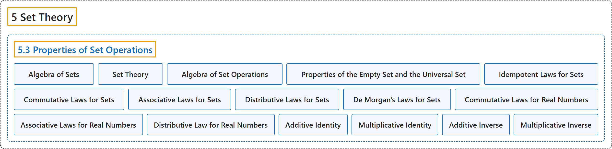

# 5.3 Properties of Set Operations

## Classification

## Glossary

| Term | Definition | 中文翻译 | Source |
|---|---|---|---|
| **5 Set Theory** 集合论 | (No definition) | （无定义） | [Sundstrom, 2022, chapter 5](https://gvsuoer.github.io/sundstrom-textbook/C_settheory.html) |
| **5.3 Properties of Set Operations** 集合运算的性质 | (No definition) | （无定义） | [Sundstrom, 2022, section 5.3](https://gvsuoer.github.io/sundstrom-textbook/S_setproperties.html) |
| **Algebra of Sets** 集合代数 | "The primary purpose of this section is to have in one place **many of the properties of set operations** that we may use in later proofs. These results are part of what is known as the algebra of sets or as set theory." | 本节的主要目的是把以后证明中可能用到的**许多集合运算性质**集中在一处。这些结果是所谓集合代数或集合论的一部分。 | [Sundstrom, 2022, section 5.3](https://gvsuoer.github.io/sundstrom-textbook/S_setproperties.html#subsection-94) |
| **Set Theory** 集合论 | "These results are part of what is known as the algebra of sets or as set theory." | 这些结果是所谓集合代数或集合论的一部分。 | [Sundstrom, 2022, section 5.3](https://gvsuoer.github.io/sundstrom-textbook/S_setproperties.html#subsection-94) |
| **Algebra of Set Operations** 集合运算代数 | "Let $A\text{,}$ $B\text{,}$ and $C$ be subsets of some universal set $U\text{.}$ Then **all of the following equalities hold**." | 设 $A$、$B$ 和 $C$ 是某个全集 $U$ 的子集，那么**下列等式都成立**。 | [Sundstrom, 2022, section 5.3](https://gvsuoer.github.io/sundstrom-textbook/S_setproperties.html#T_algebraofsets) |
| **Properties of the Empty Set and the Universal Set** 空集与全集的性质 | "**Properties of the Empty Set and the Universal Set** $\begin{aligned} A \cap \emptyset & = \emptyset & A \cap U & = A\\ A \cup \emptyset & = A & A \cup U & = U \end{aligned}$" | **空集与全集的性质** $\begin{aligned} A \cap \emptyset & = \emptyset & A \cap U & = A\\ A \cup \emptyset & = A & A \cup U & = U \end{aligned}$ | [Sundstrom, 2022, section 5.3](https://gvsuoer.github.io/sundstrom-textbook/S_setproperties.html#li-425) |
| **Idempotent Laws for Sets** 集合的幂等律 | "**Idempotent Laws** $\begin{aligned} A \cap A & = A & A \cup A & = A \end{aligned}$" | **幂等律** $\begin{aligned} A \cap A & = A & A \cup A & = A \end{aligned}$ | [Sundstrom, 2022, section 5.3](https://gvsuoer.github.io/sundstrom-textbook/S_setproperties.html#li-426) |
| **Commutative Laws for Sets** 集合的交换律 | "**Commutative Laws** $\begin{aligned} A \cap B & = B \cap A & A \cup B & = B \cup A \end{aligned}$" | **交换律** $\begin{aligned} A \cap B & = B \cap A & A \cup B & = B \cup A \end{aligned}$ | [Sundstrom, 2022, section 5.3](https://gvsuoer.github.io/sundstrom-textbook/S_setproperties.html#li-427) |
| **Associative Laws for Sets** 集合的结合律 | "**Associative Laws** $\begin{aligned} \left( A \cap B \right) \cap C & = A \cap \left(B \cap C \right)\\ \left( A \cup B \right) \cup C & = A \cup \left(B \cup C \right) \end{aligned}$" | **结合律** $\begin{aligned} \left( A \cap B \right) \cap C & = A \cap \left(B \cap C \right)\\ \left( A \cup B \right) \cup C & = A \cup \left(B \cup C \right) \end{aligned}$ | [Sundstrom, 2022, section 5.3](https://gvsuoer.github.io/sundstrom-textbook/S_setproperties.html#li-428) |
| **Distributive Laws for Sets** 集合的分配律 | "**Distributive Laws** $\begin{aligned} A \cap \left( B \cup C \right) & = \left( A \cap B \right) \cup \left( A \cap C \right)\\ A \cup \left( B \cap C \right) & = \left( A \cup B \right) \cap \left( A \cup C \right) \end{aligned}$" | **分配律** $\begin{aligned} A \cap \left( B \cup C \right) & = \left( A \cap B \right) \cup \left( A \cap C \right)\\ A \cup \left( B \cap C \right) & = \left( A \cup B \right) \cap \left( A \cup C \right) \end{aligned}$ | [Sundstrom, 2022, section 5.3](https://gvsuoer.github.io/sundstrom-textbook/S_setproperties.html#li-429) |
| **De Morgan's Laws for Sets** 集合的德摩根律 | "**De Morgan's Laws** $\left ({A \cap B} \right)^c = A^c \cup B^c$ $\left ({A \cup B} \right)^c = A^c \cap B^c$" | **德摩根律** $\left ({A \cap B} \right)^c = A^c \cup B^c$，$\left ({A \cup B} \right)^c = A^c \cap B^c$ | [Sundstrom, 2022, section 5.3](https://gvsuoer.github.io/sundstrom-textbook/S_setproperties.html#li-432) |
| **Commutative Laws for Real Numbers** 实数的交换律 | "**Commutative Laws**: $a+b=b+a\text{,}$ for all $a,b \in \mathbb{R}\text{.}$ $a \cdot b=b \cdot a\text{,}$ for all $a,b \in \mathbb{R}\text{.}$" | **交换律**：对所有 $a,b \in \mathbb{R}$，$a+b=b+a$；对所有 $a,b \in \mathbb{R}$，$a \cdot b=b \cdot a$。 | [Sundstrom, 2022, section 5.3](https://gvsuoer.github.io/sundstrom-textbook/S_setproperties.html#li-441) |
| **Associative Laws for Real Numbers** 实数的结合律 | "**Associative Laws**: $\left( {a + b} \right) + c = a + \left( {b + c} \right)\text{,}$ for all $a,b,c \in \mathbb{R}\text{.}$ $\left( {a \cdot b} \right) \cdot c = a \cdot \left( {b \cdot c} \right)\text{,}$ for all $a,b,c \in \mathbb{R}\text{.}$" | **结合律**：对所有 $a,b,c \in \mathbb{R}$，$\left( {a + b} \right) + c = a + \left( {b + c} \right)$；对所有 $a,b,c \in \mathbb{R}$，$\left( {a \cdot b} \right) \cdot c = a \cdot \left( {b \cdot c} \right)$。 | [Sundstrom, 2022, section 5.3](https://gvsuoer.github.io/sundstrom-textbook/S_setproperties.html#li-442) |
| **Distributive Law for Real Numbers** 实数的分配律 | "**Distributive Law**: $a \cdot \left( {b + c} \right) = a \cdot b + a \cdot c\text{,}$ for all $a,b,c \in \mathbb{R}\text{.}$" | **分配律**：对所有 $a,b,c \in \mathbb{R}$，$a \cdot \left( {b + c} \right) = a \cdot b + a \cdot c$。 | [Sundstrom, 2022, section 5.3](https://gvsuoer.github.io/sundstrom-textbook/S_setproperties.html#li-443) |
| **Additive Identity** 加法单位元 | "**Additive Identity** For all $a \in \mathbb{R}\text{,}$ $a + 0 = a = 0 + a\text{.}$" | **加法单位元**：对所有 $a \in \mathbb{R}$，$a + 0 = a = 0 + a$。 | [Sundstrom, 2022, section 5.3](https://gvsuoer.github.io/sundstrom-textbook/S_setproperties.html#li-444) |
| **Multiplicative Identity** 乘法单位元 | "**Multiplicative Identity**: For all $a \in \mathbb{R}\text{,}$ $a \cdot 1 = a = 1 \cdot a\text{.}$" | **乘法单位元**：对所有 $a \in \mathbb{R}$，$a \cdot 1 = a = 1 \cdot a$。 | [Sundstrom, 2022, section 5.3](https://gvsuoer.github.io/sundstrom-textbook/S_setproperties.html#li-445) |
| **Additive Inverse** 加法逆元 | "**Additive Inverses**: For all $a \in \mathbb{R}\text{,}$ $a + ( - a) = 0 = ( - a) + a\text{.}$" | **加法逆元**：对所有 $a \in \mathbb{R}$，$a + ( - a) = 0 = ( - a) + a$。 | [Sundstrom, 2022, section 5.3](https://gvsuoer.github.io/sundstrom-textbook/S_setproperties.html#li-446) |
| **Multiplicative Inverse** 乘法逆元 | "**Multiplicative Inverses**: For all $a \in \mathbb{R}$ with $a \ne 0\text{,}$ $a \cdot a^{ - 1} = 1 = a^{ - 1} \cdot a\text{.}$" | **乘法逆元**：对所有满足 $a \ne 0$ 的 $a \in \mathbb{R}$，$a \cdot a^{ - 1} = 1 = a^{ - 1} \cdot a$。 | [Sundstrom, 2022, section 5.3](https://gvsuoer.github.io/sundstrom-textbook/S_setproperties.html#li-447) |

## References

Sundstrom, T. (2022). *Mathematical reasoning: Writing and proof* (Version 2.1; PreTeXt edition by Grand Valley State University). Retrieved October 30, 2026, from <https://gvsuoer.github.io/sundstrom-textbook/frontmatter.html>
